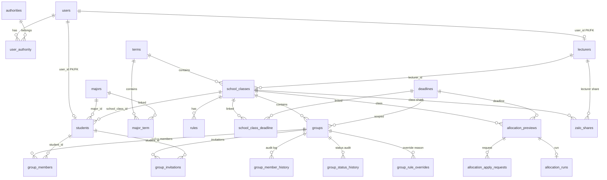

# BÁO CÁO KIỂM KÊ VÀ PHÂN TÍCH CODEBASE (MIGRATION INVENTORY)

> **Dự án**: F-Group Making Backend (Migrate từ Java/Spring Boot sang Rust)  
> **Thời gian thực hiện**: 2026-10-27  
> **Tài liệu tham chiếu**: `README.md`, `server/build.gradle.kts`, `server/src/main/resources/application.properties`, `docs/sql/*`, `Client/src/*`

---

## 1. TỔNG QUAN HỆ THỐNG VÀ DANH SÁCH MODULE HIỆN TẠI

Hệ thống F-Group Making là nền tảng quản lý phân nhóm sinh viên theo lớp học, quy định nhóm (rules), hạn chót (deadlines), giải thuật xếp nhóm thông minh (Smart Allocation), chia sẻ liên hệ (Zalo QR) và thông báo thời gian thực (WebSocket STOMP).

### 1.1. Cấu trúc Module Workspace
| Module | Công nghệ / Stack | Trạng thái Migration |
| :--- | :--- | :--- |
| `server/` | Java 21, Spring Boot 3.5.14, Gradle 9.7.1, Spring Data JPA, Hibernate 6, MySQL 8, Redis, STOMP/WebSocket, Thymeleaf, Apache POI | **Nguyên trạng (Dự phòng rollback)** |
| `server_rust/` | Rust 1.85, Axum 0.8, Tokio 1.x, SQLx 0.8, MySQL 8, WebSocket STOMP, Calamine, Lettre | **Đã hoàn thành 100% (Production-Ready)** |
| `Client/` | React 19, TypeScript 6, Vite 8, Ant Design 6, TanStack Query 5, Axios 1.20, STOMP.js 7, SockJS | **Giữ nguyên 100% (FE)** |
| `docs/sql/` | 13 migration SQL files + 6 seed scripts (MySQL 8) | **Giữ nguyên Schema & Data** |
| `server/mysql_data/` | Thư mục dữ liệu MySQL Docker | **Bảo toàn dữ liệu** |

### 1.2. Thống kê Codebase Java Backend
- **Tổng số file Java**: 222 files trong `server/src/main/java`
  - `config`: 9 files (Security, WebSocket, CORS, DatabaseInitializer, Async, Constants)
  - `domain`: 28 files (Entity, Enums, Auditing)
  - `repository`: 25 files (Spring Data JPA Repositories & Specifications)
  - `security`: 9 files (JWT, UserDetails, SessionManager, Interceptor)
  - `service`: 112 files (Services, DTOs, Event Listeners, Errors, Projections)
  - `util`: 5 files (API wrappers, Code formatting, Term utilities)
  - `web/rest`: 33 files (16 REST Controllers, VM models, Advice, Exception translators)
- **Kiểm thử Java**: 41 test classes với **492 test cases** (100% pass trên H2/MySQL mode).
- **Kiểm thử Frontend**: 47 test files với **473 test cases** (Vitest).

---

## 2. DANH SÁCH ENDPOINTS VÀ API CONTRACTS

Toàn bộ response API thành công (HTTP status < 400, ngoại trừ response dạng raw bytes/file) được bao bọc bởi `ResFormatResponse` theo cấu trúc:
```json
{
  "statusCode": 200,
  "error": null,
  "message": "Call API success!" hoặc giá trị @ApiMessage("..."),
  "data": { ... }
}
```
Lỗi (HTTP status >= 400) tuân theo chuẩn **RFC 7807 (Zalando Problem)**:
```json
{
  "type": "https://www.jhipster.tech/problem/problem-with-message",
  "title": "Bad Request",
  "status": 400,
  "detail": "Chi tiết lỗi",
  "path": "/api/...",
  "message": "error.key_hoac_message",
  "fieldErrors": [ { "objectName": "...", "field": "...", "message": "..." } ],
  "violations": [ { "field": "...", "message": "..." } ]
}
```

### 2.1. Phân loại 16 REST Controllers & Chi tiết Endpoints

#### 1. `AccountResource` (`/api`)
| Method | Endpoint | Quyền hạn | Request Body / Params | Response Data | Ghi chú |
| :--- | :--- | :--- | :--- | :--- | :--- |
| `POST` | `/api/login` | Public | `LoginVM { username, password }` | `ResLoginDTO` | Set cookie `refresh_token` (HttpOnly, Secure, SameSite=Strict) |
| `POST` | `/api/activate` | `ROLE_ADMIN` | Body: `{ email?, userId?, id? }`, Query: `termId?` | `void` (200 OK) | Gửi email kích hoạt |
| `POST` | `/api/activate/mul` | `ROLE_ADMIN` | Body: `MulUserId { userIds: Long[] }`, Query: `termId?` | `BatchActivationResultDTO` | Kích hoạt hàng loạt & async email |
| `GET` | `/api/account/activate/verify` | Public | Query: `key: string` | `ActivationKeyVerifyDTO` | Kiểm tra tính hợp lệ activation key |
| `POST` | `/api/account/activate` | Public | Body: `ActivateAccountVM { key, password }` | `void` (204 No Content) | Đặt mật khẩu và kích hoạt tài khoản |
| `POST` | `/api/account/activate/request`| Public | Body: `ResetPasswordInitVM { email }` | `void` (200 OK) | Tự yêu cầu gửi lại link kích hoạt |
| `GET` | `/api/account/reset-password/verify` | Public | Query: `key: string` | `ResetKeyVerifyDTO` | Kiểm tra reset key |
| `POST` | `/api/account/reset-password/init` | Public | Body: `ResetPasswordInitVM { email }` | `void` (200 OK) | Bắt đầu quy trình quên mật khẩu |
| `POST` | `/api/account/reset-password/finish` | Public | Body: `KeyAndPasswordVM { resetKey, newPassword }` | `void` (200 OK) | Hoàn tất đổi mật khẩu |

#### 2. `AllocationResource` (`/api/deadlines/{deadlineId}/classes/{classId}/allocation`)
*Quyền truy cập*: `ROLE_ADMIN`, `ROLE_LECTURE`, `ROLE_LECTURE_MASTER`
| Method | Endpoint | Params / Headers | Response Data | Ghi chú |
| :--- | :--- | :--- | :--- | :--- |
| `GET` | `/plans/recommendation` | Path: `deadlineId`, `classId` | `AllocationRecommendationDTO` | Gợi ý cấu hình chia nhóm |
| `GET` | `/plans` | Pageable (`page`, `size`, `sort`) | `ResultPaginationDTO` | Lịch sử các kế hoạch ngẫu nhiên |
| `GET` | `/plans/{planId}` | Path: `planId` | `AllocationPlanHistoryService.Detail` | Chi tiết kế hoạch đã lưu |
| `POST` | `/apply` | Header: `Idempotency-Key`, Body: `AllocationApplyDTO.Request { previewId }` | `AllocationApplyDTO` | Áp dụng chia nhóm chính thức |
| `GET` | `/history` | Pageable | `ResultPaginationDTO` | Lịch sử các lần apply |
| `GET` | `/history/{runId}` | Path: `runId` | `AllocationApplyDTO` | Chi tiết lần apply |
| `GET` | `/overview` | Path: `deadlineId`, `classId` | `AllocationPreviewDTO.Overview` | Tổng quan số liệu sinh viên/nhóm |
| `GET` | `/setup` | Query: `seed?` | `AllocationPreviewDTO.Setup` | Dữ liệu khởi tạo bảng xếp nhóm |
| `POST` | `/preview` | Body: `AllocationPreviewRequest` | `AllocationPreviewDTO` | Chạy thuật toán xếp nhóm giả lập |

#### 3. `ClassGroupingSessionResource` (`/api/school-classes/{classId}/grouping-session`)
*Quyền truy cập*: `ROLE_ADMIN`, `ROLE_LECTURE_MASTER`, `ROLE_LECTURE`
| Method | Endpoint | Query Params | Response Data | Ghi chú |
| :--- | :--- | :--- | :--- | :--- |
| `PUT` | `/` | Query: `termId?` | `DeadlineDTO` | Đảm bảo workspace xếp nhóm luôn tồn tại |

#### 4. `ClassRuleResource` (`/api/school-classes/{classId}/rules`)
*Quyền truy cập*: `ROLE_ADMIN`, `ROLE_LECTURE_MASTER`, `ROLE_LECTURE`
| Method | Endpoint | Request Body | Response Data | Ghi chú |
| :--- | :--- | :--- | :--- | :--- |
| `GET` | `/` | - | `ClassRulesDTO` | Lấy danh sách quy định nhóm của lớp |
| `PUT` | `/` | Body: `SaveClassRulesDTO` | `ClassRulesDTO` | Cập nhật quy định nhóm (tăng version) |

#### 5. `DeadlineResource` (`/api/deadlines`)
| Method | Endpoint | Quyền hạn | Request / Params | Response Data |
| :--- | :--- | :--- | :--- | :--- |
| `POST` | `/` | `ADMIN`, `LECTURE`, `LECTURE_MASTER` | Body: `CreateDeadlineDTO` | `DeadlineDTO` (201 Created) |
| `PUT` | `/{id}` | `ADMIN`, `LECTURE`, `LECTURE_MASTER` | Body: `UpdateDeadlineDTO` | `DeadlineDTO` |
| `GET` | `/` | Authenticated | Query: `termId?`, Pageable | `Page<DeadlineDTO>` |
| `GET` | `/{id}` | Authenticated | Path: `id` | `DeadlineDTO` |
| `GET` | `/{id}/validate` | `ROLE_STUDENT` | Query: `classId` | `DeadlineValidateDTO` |
| `GET` | `/my-activities` | `ROLE_STUDENT` | - | `List<StudentDeadlineActivityDTO>` |
| `POST` | `/{id}/close` | `ADMIN`, `LECTURE`, `LECTURE_MASTER` | Body: `CloseDeadlineDTO?` | `DeadlineDTO` |
| `DELETE`| `/{id}` | `ADMIN`, `LECTURE`, `LECTURE_MASTER` | Body: `CloseDeadlineDTO?` | `void` (204 No Content) |

#### 6. `GroupResource` (`/api/deadlines/{deadlineId}/classes/{classId}/groups`)
| Method | Endpoint | Quyền hạn | Request Body / Params | Response Data |
| :--- | :--- | :--- | :--- | :--- |
| `GET` | `/{groupId}/recommended-students` | Authenticated | Path: `groupId` | `List<GroupMemberDTO>` |
| `GET` | `/recommended-groups` | Authenticated | - | `List<GroupRecommendationDTO>` |
| `GET` | `/workspace` | Authenticated | - | `WorkspaceDTO` |
| `POST` | `/` | `ROLE_STUDENT` | Body: `CreateGroupRequest` | `GroupDTO` (201 Created) |
| `POST` | `/{groupId}/join` | `ROLE_STUDENT` | Path: `groupId` | `GroupDTO` |
| `POST` | `/{groupId}/leave` | `ROLE_STUDENT` | Path: `groupId` | `void` (204 No Content) |
| `POST` | `/{groupId}/transfer-leader` | `ROLE_STUDENT` | Body: `TransferLeaderRequest` | `GroupDTO` |
| `POST` | `/{groupId}/submit` | `ROLE_STUDENT` | Path: `groupId` | `GroupDTO` |
| `POST` | `/{groupId}/cancel-submit` | `ROLE_STUDENT` | Path: `groupId` | `GroupDTO` |
| `DELETE`| `/{groupId}` | `ROLE_STUDENT` | Path: `groupId` | `void` (204 No Content) |
| `POST` | `/lecturer-create` | Lecturer/Admin | Body: `LecturerCreateGroupRequest` | `GroupDTO` (201 Created) |
| `POST` | `/{groupId}/submit-review` | Lecturer/Admin | Path: `groupId` | `GroupDTO` |
| `POST` | `/{groupId}/move-member/{studentId}/to/{targetId}` | Lecturer/Admin | Path: `studentId`, `targetId` | `GroupDTO` |
| `POST` | `/{groupId}/accept` | Lecturer/Admin | Path: `groupId` | `GroupDTO` |
| `POST` | `/{groupId}/reject` | Lecturer/Admin | Body: `RejectGroupRequest` | `GroupDTO` |
| `POST` | `/{groupId}/revoke` | Lecturer/Admin | Path: `groupId` | `GroupDTO` |
| `POST` | `/{groupId}/members/{studentId}` | Lecturer/Admin | Path: `studentId` | `GroupDTO` |
| `DELETE`| `/{groupId}/members/{studentId}` | Lecturer/Admin | Path: `studentId` | `GroupDTO` |
| `POST` | `/{groupId}/members/{studentId}/set-leader` | Lecturer/Admin | Path: `studentId` | `GroupDTO` |
| `DELETE`| `/{groupId}/lecturer-disband` | Lecturer/Admin | Path: `groupId` | `void` (204 No Content) |
| `GET` | `/my-invitations` | `ROLE_STUDENT` | - | `List<GroupInvitationDTO>` |
| `GET` | `/{groupId}/invitations` | Authenticated | Path: `groupId` | `List<GroupInvitationDTO>` |
| `GET` | `/{groupId}/search-invitees`| Authenticated | Query: `query?` | `List<StudentSearchForInviteDTO>` |
| `POST` | `/{groupId}/invitations` | Authenticated | Body: `SendInvitationRequest` | `GroupInvitationDTO` (201) |
| `POST` | `/invitations/{invitationId}/accept` | `ROLE_STUDENT` | Path: `invitationId` | `GroupDTO` |
| `POST` | `/invitations/{invitationId}/reject` | `ROLE_STUDENT` | Path: `invitationId` | `void` (204 No Content) |
| `DELETE`| `/invitations/{invitationId}` | Authenticated | Path: `invitationId` | `void` (204 No Content) |

#### 7. `GroupReviewResource` (`/api/me/group-reviews`)
*Quyền truy cập*: `ROLE_LECTURE`, `ROLE_LECTURE_MASTER`, `ROLE_ADMIN`
| Method | Endpoint | Query Params | Response Data | Ghi chú |
| :--- | :--- | :--- | :--- | :--- |
| `GET` | `/api/me/group-reviews` | `termId` (bắt buộc), `classId?`, `status?`, `search?`, Pageable | `ResultPaginationDTO` | Danh sách nhóm chờ duyệt/đã duyệt |

#### 8. `LecturerClassResource` (`/api/me/school-classes`)
*Quyền truy cập*: `ROLE_ADMIN`, `ROLE_LECTURE_MASTER`, `ROLE_LECTURE`
| Method | Endpoint | Query Params | Response Data |
| :--- | :--- | :--- | :--- |
| `GET` | `/api/me/school-classes` | `search?`, `termId?`, Pageable | `ResultPaginationDTO` |

#### 9. `LecturerProfileResource` (`/api/me/lecturer-profile`)
*Quyền truy cập*: `ROLE_LECTURE`, `ROLE_LECTURE_MASTER`
| Method | Endpoint | Response Data | Ghi chú |
| :--- | :--- | :--- | :--- |
| `GET` | `/api/me/lecturer-profile` | `LecturerProfileDTO` | Thông tin hồ sơ giảng viên hiện tại |

#### 10. `LecturerResource` (`/api/lecturers`)
*Quyền truy cập*: `ROLE_ADMIN`
| Method | Endpoint | Params / Body | Response Data | Ghi chú |
| :--- | :--- | :--- | :--- | :--- |
| `POST` | `/api/lecturers` | Body: `CreateLecturerDTO` | `LecturerDTO` (201 Created) | Thêm giảng viên thủ công |
| `GET` | `/api/lecturers` | `search?`, `activated?`, `hasActivationKey?`, `termId?`, Pageable | `ResultPaginationDTO` | Danh sách giảng viên |
| `POST` | `/api/lecturers/import` | Multipart: `file`, Query: `termId?` | `ImportResultDTO` | Import danh sách GV từ Excel (.xlsx) |
| `POST` | `/api/lecturers/activate-all` | Query: `search?`, `termId?` | `BatchActivationResultDTO` | Kích hoạt tất cả GV thỏa điều kiện |
| `DELETE`| `/api/lecturers/{userId}`| Path: `userId` | `void` (204 No Content) | Xóa đơn lẻ |
| `POST` | `/api/lecturers/batch-delete` | Body: `Long[]`, Query: `termId?` | `void` (204 No Content) | Xóa hàng loạt |

#### 11. `MajorResource` (`/api/majors`)
*Quyền truy cập*: `ROLE_ADMIN`
| Method | Endpoint | Params / Body | Response Data | Ghi chú |
| :--- | :--- | :--- | :--- | :--- |
| `POST` | `/api/majors` | Body: `MajorDTO` | `MajorDTO` (201 Created) | Tạo chuyên ngành |
| `GET` | `/api/majors` | `search?`, `temporaryName?`, Pageable | `ResultPaginationDTO` | Danh sách chuyên ngành |
| `GET` | `/api/majors/{id}` | Path: `id` | `MajorDTO` | Chi tiết chuyên ngành |
| `PUT` | `/api/majors/{id}` | Body: `MajorDTO` | `MajorDTO` | Cập nhật tên/mã chuyên ngành |
| `DELETE`| `/api/majors/{id}` | Path: `id` | `void` (204 No Content) | Xóa chuyên ngành |

#### 12. `SchoolClassResource` (`/api/school-classes`)
| Method | Endpoint | Quyền hạn | Params / Body | Response Data |
| :--- | :--- | :--- | :--- | :--- |
| `GET` | `/api/school-classes` | `ADMIN`, `LECTURE_MASTER` | `search?`, `termId?`, Pageable | `ResultPaginationDTO` |
| `GET` | `/api/school-classes/{id}` | `ADMIN`, `LECTURE_MASTER`, `LECTURE` | Path: `id` | `SchoolClassDTO` |
| `GET` | `/api/school-classes/{id}/students` | `ADMIN`, `LECTURE_MASTER`, `LECTURE` | Path: `id` | `List<StudentDTO>` |
| `PUT` | `/api/school-classes/{id}/lecturer` | `ROLE_ADMIN` | Body: `AssignClassLecturerDTO` | `SchoolClassDTO` |

#### 13. `StudentProfileResource` (`/api/me/student-profile`)
*Quyền truy cập*: `ROLE_STUDENT`
| Method | Endpoint | Params / Body | Response Data | Ghi chú |
| :--- | :--- | :--- | :--- | :--- |
| `GET` | `/api/me/student-profile` | - | `StudentProfileDTO` | Hồ sơ sinh viên |
| `PUT` | `/api/me/student-profile/bio` | Body: `UpdateStudentBioRequest { bio }` | `Map<String, String>` (`{ "bio": "..." }`) | Cập nhật bio |
| `DELETE`| `/api/me/student-profile/bio` | - | `void` (204 No Content) | Xóa bio |

#### 14. `StudentResource` (`/api/students`)
*Quyền truy cập*: `ROLE_ADMIN`
| Method | Endpoint | Params / Body | Response Data | Ghi chú |
| :--- | :--- | :--- | :--- | :--- |
| `POST` | `/api/students` | Body: `CreateStudentDTO` | `StudentDTO` (201 Created) | Thêm SV thủ công |
| `GET` | `/api/students` | `search?`, `majorCode?`, `majorSearch?`, `majorId?`, `activated?`, `hasActivationKey?`, `termId?`, Pageable | `ResultPaginationDTO` | Danh sách sinh viên |
| `GET` | `/api/students/{userId}` | Path: `userId` | `StudentDTO` | Chi tiết sinh viên |
| `POST` | `/api/students/activate/all` | Query: `search?`, `majorCode?`, `majorSearch?`, `majorId?`, `termId?` | `BatchActivationResultDTO` | Kích hoạt hàng loạt theo bộ lọc |
| `POST` | `/api/students/import` | Multipart: `file`, Query: `termId?`, `confirmedMajorCodes?` | `ImportResultDTO` | Import SV từ Excel (.xlsx) |

#### 15. `TermResource` (`/api/terms`)
| Method | Endpoint | Quyền hạn | Params / Body | Response Data | Ghi chú |
| :--- | :--- | :--- | :--- | :--- | :--- |
| `GET` | `/api/terms` | Authenticated | Query: `currentAndFutureOnly` (mặc định: `true`) | `List<TermDTO>` | Danh sách kỳ học |
| `GET` | `/api/terms/current` | Authenticated | - | `TermDTO` | Kỳ học hiện tại |
| `POST` | `/api/terms` | `ROLE_ADMIN` | Body: `CreateTermRequestDTO { name }` | `TermDTO` (201 Created) | Tạo kỳ học mới |

#### 16. `ZaloShareResource` (`/api`)
| Method | Endpoint | Quyền hạn | Params / Body | Response Data | Ghi chú |
| :--- | :--- | :--- | :--- | :--- | :--- |
| `GET` | `/api/school-classes/{classId}/zalo-shares` | Lecturer/Admin | Query: `termId` | `ZaloShareDTO` | Lấy Zalo QR lớp |
| `PUT` | `/api/school-classes/{classId}/zalo-shares` | Lecturer/Admin | Multipart: `data` (JSON Write), `qr` (File) | `ZaloShareDTO` | Upload/cập nhật Zalo QR lớp |
| `DELETE`| `/api/school-classes/{classId}/zalo-shares/{id}` | Lecturer/Admin | Query: `version`, `termId` | `void` (204 No Content) | Xóa Zalo lớp |
| `GET` | `/api/lecturers/{lecturerId}/zalo-share` | Lecturer/Admin | Query: `termId` | `ZaloShareDTO` | Lấy Zalo GV |
| `PUT` | `/api/lecturers/{lecturerId}/zalo-share` | Lecturer/Admin | Multipart: `data` (JSON Write), `qr` (File) | `ZaloShareDTO` | Upload/cập nhật Zalo GV |
| `DELETE`| `/api/lecturers/{lecturerId}/zalo-share/{id}` | Lecturer/Admin | Query: `version`, `termId` | `void` (204 No Content) | Xóa Zalo GV |
| `GET` | `/api/me/zalo-shares` | `ROLE_STUDENT` | - | `List<ZaloShareDTO>` | Danh sách nhóm Zalo khả dụng của SV |
| `GET` | `/api/zalo-shares/{id}/qr` | Authenticated | Path: `id` | `byte[]` | **Raw binary image bytes** (Content-Type: `image/png`, `image/jpeg`, `image/webp`) |

### 2.2. WebSocket & STOMP Protocol (`/ws`)
- **Transport**: SockJS (`/ws`) và Native WebSocket (`/ws`).
- **Heartbeat**: 4000ms / 4000ms.
- **Xác thực**: STOMP `CONNECT` frame với header `Authorization: Bearer <token>`.
- **Kênh lắng nghe (Topics)**:
  - `/topic/admin/deadlines` (dành cho Admin nhận event cập nhật deadline/session).
  - `/user/queue/deadlines` (dành cho Giảng viên nhận thông báo deadline/session).
  - `/topic/classes/{classId}/deadlines` (dành cho Sinh viên và Giảng viên theo dõi hạn chót của lớp).
  - `/topic/classes/{classId}/deadlines/{deadlineId}/groups` (dành cho cập nhật realtime hoạt động nhóm, thành viên, phê duyệt).
- **Payload Event**:
  - `DeadlineRealtimeEvent`: `{ eventType, deadlineId, version, eventId, schoolClassId, ... }`
  - `GroupRealtimeEvent`: `{ eventType, groupId, deadlineId, schoolClassId, ... }`

---

## 3. DANH SÁCH ENTITY, BẢNG VÀ QUAN HỆ DATABASE

Hệ thống lưu trữ trên **MySQL 8.0**, định dạng `utf8mb4_unicode_ci`.



### 3.1. Chi tiết 22 bảng cơ sở dữ liệu
1. **`users`**:
   - Khóa chính: `id` BIGINT AUTO_INCREMENT.
   - Cột: `email` (unique, varchar 254), `password_hash` (varchar 255), `name` (varchar 50), `activated` (boolean), `activation_key` (varchar 20), `activation_key_expires_at` (datetime(6)), `reset_key` (varchar 20), `reset_date` (datetime(6)), `session_id` (varchar 255), `refresh_token` (varchar 255), `created_by`, `created_date`, `last_modified_by`, `last_modified_date`.
2. **`authorities`**:
   - Khóa chính: `name` (varchar 50) (`ROLE_ADMIN`, `ROLE_LECTURE`, `ROLE_LECTURE_MASTER`, `ROLE_STUDENT`, `ROLE_ANONYMOUS`).
3. **`user_authority`**:
   - Bảng nối: `user_id` (FK `users.id`), `authority_name` (FK `authorities.name`).
4. **`terms`**:
   - Khóa chính: `id` INT AUTO_INCREMENT.
   - Cột: `name` (varchar 20, unique/not null), auditing columns.
5. **`majors`**:
   - Khóa chính: `id` INT AUTO_INCREMENT.
   - Cột: `code` (varchar 20, unique), `name` (varchar 50, unique), auditing columns.
6. **`major_term`**:
   - Khóa chính: `id` BIGINT AUTO_INCREMENT.
   - Cột: `major_id` INT, `term_id` INT. Unique constraint: `ux_major_term (major_id, term_id)`.
7. **`school_classes`**:
   - Khóa chính: `id` INT AUTO_INCREMENT.
   - Cột: `name` (varchar 50), `term_id` (INT), `lecturer_id` (BIGINT, FK `users.id`), `rules_version` (bigint default 0), auditing columns.
8. **`students`**:
   - Khóa chính: `user_id` BIGINT (FK `users.id`).
   - Cột: `roll_number` (varchar unique), `full_name` (varchar), `major_id` (INT), `member_code` (varchar), `cohort` (varchar), `slot_type` (varchar), `school_class_id` (INT), `group_id` (BIGINT), `self_description` (varchar 500). Index: `idx_students_major_id`.
9. **`lecturers`**:
   - Khóa chính: `user_id` BIGINT (FK `users.id`).
   - Cột: `code` (varchar 50, unique).
10. **`deadlines`**:
    - Khóa chính: `id` INT AUTO_INCREMENT.
    - Cột: `name` (varchar 100), `description` (text), `start_time` (datetime(6)), `end_time` (datetime(6)), `status` (varchar 20), `version` (bigint), `schedule_revision` (bigint), `cancelled_at` (datetime(6)), `cancelled_by` (varchar 50), auditing columns.
11. **`school_class_deadline`**:
    - Khóa chính kết hợp: (`deadline_id`, `school_class_id`).
    - Cột: `end_time_override` (datetime(6)).
12. **`rules`**:
    - Khóa chính: `id` INT AUTO_INCREMENT.
    - Cột: `code` (varchar 50), `school_class_id` (INT), `` `value` `` (INT), `status` (boolean default true), auditing columns. Unique: `ux_rules_class_code (school_class_id, code)`.
13. **`` `groups` ``**:
    - Khóa chính: `id` BIGINT AUTO_INCREMENT.
    - Cột: `deadline_id` INT, `school_class_id` INT, `sequence_no` INT (null khi disbanded), `name` (varchar 100), `leader_id` BIGINT, `status` (varchar 20: OPEN, PENDING, ACCEPTED, REVOKED, DISBANDED), `reject_reason` (text), `submitted_rules_version` (bigint), `rules_evaluation_snapshot` (text), `is_lecturer_created` (boolean), `version` (bigint optimistic lock), auditing columns.
    - Unique: `uk_groups_class_deadline_sequence (school_class_id, deadline_id, sequence_no)`.
    - Index: `idx_groups_class_deadline (school_class_id, deadline_id, status)`.
14. **`group_members`**:
    - Khóa chính: `id` BIGINT AUTO_INCREMENT.
    - Cột: `group_id` BIGINT, `student_id` BIGINT, `deadline_id` INT, `school_class_id` INT, `role` (varchar 20: LEADER, MEMBER), `joined_at` (datetime(6)).
    - Unique: `uk_active_student_activity (student_id, deadline_id)`.
    - Index: `idx_gm_group_student (group_id, student_id)`.
15. **`group_invitations`**:
    - Khóa chính: `id` BIGINT AUTO_INCREMENT.
    - Cột: `group_id` BIGINT, `student_id` BIGINT, `inviter_id` BIGINT, `deadline_id` INT, `school_class_id` INT, `status` (varchar 20: PENDING, ACCEPTED, REJECTED, CANCELLED), `message` (varchar 500), `created_at` (datetime(6)), `responded_at` (datetime(6)).
    - Indexes: `idx_gi_student_deadline`, `idx_gi_group_status`.
16. **`group_member_history`**:
    - Khóa chính: `id` BIGINT AUTO_INCREMENT.
    - Cột: `group_id`, `student_id`, `deadline_id`, `action` (JOINED, LEFT, KICKED, TRANSFERRED_LEADER, ASSIGNED_BY_LECTURER, REMOVED_BY_LECTURER), `performed_by`, `note`, `created_at`.
17. **`group_status_history`**:
    - Khóa chính: `id` BIGINT AUTO_INCREMENT.
    - Cột: `group_id`, `from_status`, `to_status`, `changed_by`, `reason`, `created_at`.
18. **`group_rule_overrides`**:
    - Khóa chính: `id` BIGINT AUTO_INCREMENT.
    - Cột: `group_id`, `lecturer_username`, `violated_rules` (text), `override_reason` (text), `created_at`.
19. **`allocation_previews`**:
    - Khóa chính: `id` VARCHAR(36) UUID.
    - Cột: `owner_id`, `school_class_id`, `deadline_id`, `target_count`, `seed`, `snapshot_fingerprint` (varchar 64), `plan_fingerprint` (varchar 64), `payload` (longtext JSON), `format_version`, `created_at`, `expires_at`, `applied_at`, `version`.
20. **`allocation_apply_requests`**:
    - Khóa chính: `id` BIGINT AUTO_INCREMENT.
    - Cột: `owner_id`, `school_class_id`, `deadline_id`, `preview_id` (varchar 36), `key_hash` (varchar 64), `request_hash` (varchar 64), `status` (READY, PROCESSING, FAILED, SUCCEEDED), `result_json` (longtext), `failure_code`, `created_at`, `expires_at`, `version`.
    - Unique: `uk_aar_key (owner_id, school_class_id, deadline_id, key_hash)`.
21. **`allocation_runs`**:
    - Khóa chính: `id` BIGINT AUTO_INCREMENT.
    - Cột: `preview_id` (varchar 36, unique), `apply_request_id` (BIGINT, unique), `actor_id`, `school_class_id`, `deadline_id`, `target_count`, `seed`, `applied_at`, `snapshot_fingerprint`, `plan_fingerprint`, `result_json` (longtext).
22. **`zalo_shares`**:
    - Khóa chính: `id` BIGINT AUTO_INCREMENT.
    - Cột: `school_class_id` INT NULL, `lecturer_id` BIGINT NULL, `term_id` INT NOT NULL, `scope` (VARCHAR 10: CLASS, LECTURER), `scope_key` (VARCHAR 100, unique), `title` (VARCHAR 100), `invite_url` (VARCHAR 512), `description` (VARCHAR 500), `qr_public_id` (VARCHAR 255), `qr_format` (VARCHAR 10), `qr_bytes` (BIGINT), `version` (BIGINT), auditing columns.

---

## 4. BẢO MẬT VÀ PHÂN QUYỀN (SECURITY SPECIFICATION)

1. **Password Hashing**: BCrypt (`$2a$10$...`), tương thích hoàn toàn giữa Spring Security và thư viện `bcrypt` của Rust.
2. **Access Token**:
   - Thuật toán: `HMAC-SHA256` (`HS256`).
   - Secret key: Base64 string giải mã 64 bytes (`djnd.jwt.base64-secret`).
   - Thời hạn: 604,800 giây (7 ngày).
   - Claims bắt buộc:
     - `sub`: email của user (chuỗi thường, lowercase).
     - `user`: `{ "id": user.id, "email": user.email }`
     - `authorities`: mảng quyền, ví dụ `["ROLE_ADMIN"]` hoặc `["ROLE_STUDENT"]`.
     - `sessionId`: chuỗi UUID ngẫu nhiên được lưu trữ trong cột `users.session_id`.
3. **Session Invalidation**:
   - Khi token gửi lên, backend kiểm tra `sessionId` trong token với `users.session_id` trong database. Nếu `users.session_id` không khớp, trả về lỗi 401 với `SessionInvalidException` (`error.sessioninvalid`).
4. **Refresh Token**:
   - Lưu trữ tại cookie `refresh_token` với cờ `HttpOnly`, `Secure`, `Path=/`, `SameSite=Strict`, thời hạn 1,296,000 giây (15 ngày).
5. **CORS**:
   - Cho phép origin từ `http://localhost:3000`, `http://localhost:5173` và các origin cấu hình.
   - Hỗ trợ header `Authorization`, `Content-Type`, `Idempotency-Key`, `Accept-Language`, `X-Content-Type-Options`.
   - Credentials: `true`.
6. **Public Endpoints**:
   - `/api/login`, `/api/register`, `/api/account/activate/**`, `/api/account/reset-password/**`, `/ws/**`.

---

## 5. TÍCH HỢP BÊN NGOÀI (EXTERNAL INTEGRATIONS)

1. **Mail Service (SMTP)**:
   - Dùng gửi email kích hoạt tài khoản (`activationEmail.html`), đặt lại mật khẩu (`passwordResetEmail.html`), thông báo hạn chót (`deadlineNotificationEmail.html`), và thông báo phê duyệt nhóm (`groupReviewNotificationEmail.html`).
   - Môi trường dev dùng **Mailpit** (SMTP port 1025, Web UI port 8025) không TLS, không xác thực.
   - Môi trường prod hỗ trợ SMTP ngoài (TLS port 587 hoặc SSL port 465).
2. **Cloudinary (Zalo QR Storage)**:
   - Sử dụng cho quản lý ảnh mã QR nhóm Zalo.
   - Cơ chế authenticated upload: upload ảnh lên Cloudinary với quyền `type=authenticated`.
   - Cơ chế private download: sinh private download URL có ký HMAC (`expires_at`), backend tải binary bytes về stream trả lại cho frontend (`/api/zalo-shares/{id}/qr`), không trả direct link ra ngoài để bảo mật.
   - Dọn dẹp tài nguyên: gọi destroy authenticated asset khi cập nhật ảnh mới hoặc xóa Zalo share.
3. **Excel Processing (.xlsx)**:
   - Import danh sách sinh viên (`StudentService.importFromExcel`) với việc nhận diện cột B (Roll number), C (Full name), D (Major code), E (Member code), F (Email), G (Slot type), I (SchoolClass name), J (Lecturer code).
   - Tự động tạo lớp, gán giảng viên, tạo sinh viên, và tự sinh kỳ học tương ứng nếu cần.
   - Import danh sách giảng viên (`LecturerService.importFromExcel`).

---

## 6. DANH SÁCH TEST VÀ HÀNH VI KIỂM CHỨNG

### 6.1. Suite Java Backend (41 test classes, 492 tests)
- **Security & Interceptors**:
  - `AccountResourceSecurityTest`: kiểm tra login, sai mật khẩu, tài khoản chưa kích hoạt, session invalidation.
  - `StudentResourceSecurityTest`: bảo vệ endpoint quản trị sinh viên trước người dùng không có role ADMIN.
  - `RealtimeChannelInterceptorTest`: xác thực WebSocket STOMP token, chặn guest và kiểm tra role.
- **Rules & Groups**:
  - `GroupConcurrencyAndRuleTest`: kiểm tra tranh chấp gia nhập nhóm đồng thời, giới hạn số lượng thành viên tối đa (hard rule), optimistic lock version conflict.
  - `GroupSessionPolicyTest`: kiểm tra trạng thái deadline (UNSCHEDULED, UPCOMING, ACTIVE, EXPIRED), ngăn chỉnh sửa khi hết hạn.
  - `GroupReviewNotificationIntegrationTest`: kiểm tra tạo thông báo và gửi mail khi nộp/duyệt/từ chối nhóm.
  - `ClassRuleConcurrencyTest` & `ClassRuleStatusWarningsTest`: kiểm tra xung đột version của rule và tính hợp lệ các ràng buộc min/max.
  - `ClassLecturerAssignmentConcurrencyTest`: kiểm tra gán giảng viên đồng thời kèm optimistic lock `expectedLecturerId`.
- **Allocation Engine**:
  - `SmartAllocationServiceTest`: kiểm tra tính đúng đắn của thuật toán tìm kiếm nghiệm xếp nhóm thỏa mãn mọi ràng buộc min/max members, min/max majors, min SE members, cân bằng quy mô nhóm.
  - `AllocationApplyServiceTest`: kiểm tra tính lũy bao (idempotency key), kiểm tra fingerprint dữ liệu, hủy lời mời liên quan, vật chất hóa nhóm chính thức.
  - `AllocationRecommendationServiceTest`: kiểm tra hàm gợi ý số lượng nhóm khả thi.
- **Zalo Sharing**:
  - `ZaloShareValidationTest` & `ZaloShareResourceTest`: kiểm tra validation URL Zalo, dung lượng QR, định dạng file, quyền truy cập scoped CLASS và LECTURER.

---

## 7. CÁC RỦI RO, DEPENDENCY KHÓ CHUYỂN ĐỔI VÀ ĐIỂM CHƯA RÕ

| Thành phần Java | Thách thức khi sang Rust | Giải pháp tương đương trong Rust |
| :--- | :--- | :--- |
| **STOMP Broker / SockJS** | Axum không có sẵn built-in STOMP broker như Spring Messaging | Tự xây dựng STOMP 1.1/1.2 sub-protocol handler trên Axum WebSocket (`tokio-tungstenite` / `axum::extract::ws`). Sử dụng Tokio `broadcast` channel và scoped dispatch theo topics: `/topic/admin/deadlines`, `/topic/classes/{id}/deadlines`, `/user/queue/deadlines`. |
| **Zalando Problem RFC 7807** | Spring dùng thư viện `zalando-problem-spring-web` tự động bắt mọi exception | Thiết kế `AppError` enum trong Rust sử dụng `thiserror`, implement `IntoResponse` sinh đúng định dạng JSON RFC 7807 với các trường `type`, `title`, `status`, `detail`, `path`, `message`, `fieldErrors`, `violations`. |
| **Response Wrapper (`ResFormatResponse`)** | Spring dùng `ResponseBodyAdvice` bao bọc mọi response < 400 | Tạo Axum middleware hoặc response wrapper generic `ApiResponse<T>` / `RestResponse<T>` đảm bảo trả về `{ statusCode, message, data }`. |
| **Pageable (`1-indexed`)** | Spring boot config `one-indexed-parameters=true`, trả về `Page<T>` hoặc `ResultPaginationDTO` | Rust struct `PaginationParams { page: Option<i64>, size: Option<i64> }` với default page = 1, tính toán `LIMIT` và `OFFSET` tương thích `(page - 1) * size`. |
| **Excel Parser (POI)** | Apache POI hỗ trợ định dạng `.xlsx` chi tiết | Dùng crate `calamine` cho Rust để đọc dữ liệu bảng tính `.xlsx` nhanh gấp nhiều lần POI, giữ nguyên logic map cột B, C, D, E, F, G, I, J. |
| **Cloudinary SDK** | Java dùng `com.cloudinary:cloudinary-http5` | Tích hợp Cloudinary REST API qua `reqwest` bằng cách tính toán chữ ký SHA-1/SHA-256 theo chuẩn Cloudinary. |
| **Idempotency & Concurrency Locks** | Spring dùng ReentrantLock và pessimistic locking (`findForUpdate`) | Dùng SQL `SELECT ... FOR UPDATE` trong transaction của `sqlx`, kết hợp `tokio::sync::Mutex` đối với các khóa in-memory scoped. |

---

## 8. MAPPING GIỮA THÀNH PHẦN JAVA VÀ THÀNH PHẦN RUST

| Thành phần Java Spring Boot | Thành phần Rust tương ứng | Ghi chú kỹ thuật |
| :--- | :--- | :--- |
| `@RestController`, `@RequestMapping` | `axum::Router`, `axum::routing::{get, post, put, delete}` | Khớp 100% HTTP method, đường dẫn URL |
| `@PathVariable`, `@RequestParam`, `@RequestBody` | `axum::extract::Path`, `Query`, `Json` | Khớp kiểu dữ liệu |
| `@Valid`, Jakarta Validation | `validator::Validate` hoặc manual validation logic | Trả về HTTP 400 với RFC 7807 violation list |
| `@PreAuthorize("hasAuthority(...)")` | Axum middleware extractor (`AuthUser`, `RequireRole`) | Kiểm tra vai trò trong JWT claims |
| `@Transactional` | `sqlx::Transaction<'_, MySql>` | Commit khi hoàn tất, tự rollback nếu lỗi |
| Spring Data JPA Repositories | Rust Repository modules dùng `sqlx::query!` / `sqlx::query_as!` | Parameterized queries an toàn tuyệt đối |
| JPA Entities (`@Entity`, `@Table`) | Rust structs với `sqlx::FromRow`, `serde::Serialize`, `serde::Deserialize` | Field naming mapping `#[serde(rename_all = "camelCase")]` |
| `@Version` (Optimistic Locking) | Cột `version: i64`, kiểm tra `WHERE version = ?` và `SET version = version + 1` | Báo lỗi 409 Conflict khi `rows_affected == 0` |
| `SimpMessagingTemplate` (WebSocket STOMP) | `Arc<WsBroadcaster>` quản lý kết nối và gửi STOMP frames | Đảm bảo đúng topic format cho frontend |
| `JavaMailSender` + Thymeleaf | `lettre::SmtpTransport` + `minijinja` template engine | Sử dụng lại chính xác nội dung HTML của template mail |
| MapStruct / DTOs | Rust DTO structs với `From` / `Into` traits | Không runtime overhead, type-safe tại compile-time |
| `AuditingEntityListener` (`createdDate`, etc.) | Struct fields `created_at`, `last_modified_date` gán `Utc::now()` | Đồng nhất kiểu `DateTime<Utc>` |
