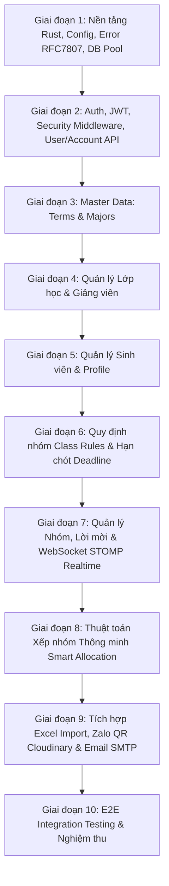

# KẾ HOẠCH CHUYỂN ĐỔI CHI TIẾT (MIGRATION PLAN)
## Java Spring Boot Sang Rust Production-Ready

---

## 1. MỤC TIÊU VÀ NGUYÊN TẮC THIẾT KẾ KIẾN TRÚC RUST

### 1.1. Lựa chọn Công nghệ (Technology Stack)
Dựa trên khối lượng công việc, yêu cầu concurrency, transaction boundaries và tính tương thích tuyệt đối với Frontend React:

| Lĩnh vực | Thư viện / Công nghệ Rust | Lý do lựa chọn |
| :--- | :--- | :--- |
| **HTTP Framework** | `axum` (v0.8) | Framework hiện đại dựa trên Tokio và Tower, hiệu năng cao, type-safe extractor, hỗ trợ WebSocket tốt |
| **Async Runtime** | `tokio` (v1.x, full features) | Chuẩn công nghiệp cho async Rust, quản lý I/O, timer, concurrency tasks |
| **Serialization** | `serde`, `serde_json` | Định dạng camelCase cho JSON response/request, mapping chuẩn xác kiểu dữ liệu |
| **Database Access** | `sqlx` (v0.8) với driver MySQL | Hỗ trợ Connection Pool, Transaction (`sqlx::Transaction`), Parameterized Queries, hỗ trợ kiểu dữ liệu MySQL gốc, row streaming |
| **Bảo mật & Password** | `bcrypt` | Tương thích 100% với Spring `BCryptPasswordEncoder` ($2a$) |
| **JWT Token** | `jsonwebtoken` | Ký và xác thực HMAC-SHA256 với secret key 64 bytes từ cấu hình |
| **WebSocket / STOMP** | `tokio-tungstenite`, `axum::extract::ws` | Tự cài đặt parser frame STOMP 1.1 / 1.2, kết hợp `tokio::sync::broadcast` cho các topic `/topic/...` và `/user/queue/...` |
| **Xử lý File Excel** | `calamine` | Đọc dữ liệu `.xlsx` tốc độ cao, trích xuất streaming hàng và ô |
| **Email SMTP** | `lettre` (v0.11) + `minijinja` | Gửi email MIME đa phần qua SMTP (Mailpit hoặc SMTP Production) với template engine tương thích Thymeleaf |
| **Tích hợp Cloudinary** | `reqwest` + `sha1`/`sha2` | Tương tác REST API Cloudinary cho authenticated upload, private signed download và asset destruction |
| **Logging & Tracing** | `tracing`, `tracing-subscriber` | Structured logging theo định dạng JSON hoặc text có lọc level |
| **Cấu hình** | `config` hoặc `dotenvy` | Đọc file `.env` và biến môi trường, bảo vệ an toàn secret |
| **Xử lý lỗi** | `thiserror` | Xây dựng cây lỗi nghiệp vụ và tự động serialize sang RFC 7807 Zalando Problem |

### 1.2. Vị trí Lưu trữ Mã nguồn Rust
Mã nguồn Rust backend sẽ được đặt trong thư mục:
```text
server_rust/
  ├── Cargo.toml
  ├── Cargo.lock
  ├── .env.example
  ├── src/
  │   ├── main.rs
  │   ├── config/          # Cấu hình môi trường, database pool, CORS
  │   ├── error/           # Định nghĩa AppError & RFC 7807 response
  │   ├── middleware/      # Auth extractor, response wrapper, CORS
  │   ├── domain/          # Entities & database row models
  │   ├── dto/             # Request & Response structs (camelCase)
  │   ├── repository/      # Tầng truy xuất SQLx MySQL
  │   ├── service/         # Nghiệp vụ: Auth, Groups, Deadlines, Rules, Allocation
  │   ├── handlers/        # Axum controller handlers
  │   ├── websocket/       # STOMP broker, session manager, topic broadcaster
  │   ├── integrations/    # Email (lettre), Cloudinary, Excel (calamine)
  │   └── util/            # Helper functions, pagination, token generation
  └── tests/               # Integration tests
```
Cách tổ chức này đảm bảo:
- Source code Java trong `server/` được giữ nguyên vẹn, có thể chạy song song hoặc rollback bất cứ lúc nào.
- Dữ liệu `server/mysql_data` và Docker Compose hiện có tiếp tục được sử dụng mà không làm gián đoạn hệ thống.

---

## 2. KIẾN TRÚC VÀ ĐẶC TẢ MODULE RUST

### 2.1. Cấu trúc Response và Exception Translation
1. **Thành công (`ResFormatResponse` pattern)**:
Mọi endpoint trả về HTTP status 200, 201 (trừ endpoint tải ảnh binary `/api/zalo-shares/{id}/qr`) sẽ được bao bọc bởi struct:
```rust
#[derive(Serialize)]
#[serde(rename_all = "camelCase")]
pub struct RestResponse<T> {
    pub status_code: u16,
    pub error: Option<String>,
    pub message: String,
    pub data: T,
}
```

2. **Lỗi (`Zalando Problem RFC 7807` pattern)**:
Mọi exception sẽ trả về mã HTTP tương ứng và body:
```rust
#[derive(Serialize)]
#[serde(rename_all = "camelCase")]
pub struct ProblemDetails {
    pub r#type: String,
    pub title: String,
    pub status: u16,
    #[serde(skip_serializing_if = "Option::is_none")]
    pub detail: Option<String>,
    pub path: String,
    #[serde(skip_serializing_if = "Option::is_none")]
    pub message: Option<String>,
    #[serde(skip_serializing_if = "Vec::is_empty", default)]
    pub field_errors: Vec<FieldError>,
    #[serde(skip_serializing_if = "Vec::is_empty", default)]
    pub violations: Vec<Violation>,
}
```

### 2.2. Pagination Strategy
Hệ thống Java dùng cấu hình `one-indexed-parameters=true`:
- Khi frontend gửi `?page=1&size=20`:
  - `page = 1` -> `OFFSET 0 LIMIT 20`
  - `page = 2` -> `OFFSET 20 LIMIT 20`
- Response trả về chuẩn `ResultPaginationDTO`:
```rust
#[derive(Serialize)]
#[serde(rename_all = "camelCase")]
pub struct ResultPaginationDTO<T> {
    pub meta: MetaPagination,
    pub result: Vec<T>,
}

#[derive(Serialize)]
#[serde(rename_all = "camelCase")]
pub struct MetaPagination {
    pub page: i64,      // 1-indexed
    pub page_size: i64,
    pub pages: i64,
    pub total: i64,
}
```

---

## 3. THỨ TỰ TRIỂN KHAI THEO TỪNG GIAI ĐOẠN (DEPENDENCY GRAPH)



### Chi tiết các Giai đoạn Thực thi

#### Giai đoạn 1: Thiết lập Project Rust & Hạ tầng Nền tảng
- Tạo project `server_rust` với `Cargo.toml` đầy đủ dependencies.
- Thiết lập module `config`: kết nối MySQL database pool với `sqlx::MySqlPool`, quản lý cấu hình từ `.env`.
- Thiết lập module `error`: cài đặt `AppError`, `ProblemDetails` theo chuẩn RFC 7807.
- Thiết lập middleware `response_wrapper`: wrap `RestResponse<T>` cho kết quả trả về.
- Viết integration test kết nối DB và trả lỗi RFC 7807 chuẩn.

#### Giai đoạn 2: Authentication, Security & Account Management
- Cài đặt `jwt`: mã hóa và giải mã HS256 với secret key 64 bytes.
- Cài đặt `password`: hash và verify BCrypt ($2a$).
- Cài đặt `SessionManager`: tạo và kiểm tra `sessionId` với database table `users`.
- Cài đặt Axum extractor `AuthUser`: xác thực Bearer token, kiểm tra session, trích xuất roles (`ROLE_ADMIN`, `ROLE_LECTURE`, `ROLE_LECTURE_MASTER`, `ROLE_STUDENT`).
- Cài đặt các endpoint `AccountResource`:
  - `POST /api/login` (kèm cookie `refresh_token`)
  - `POST /api/account/activate`, `GET /api/account/activate/verify`, `POST /api/account/activate/request`
  - `POST /api/account/reset-password/init`, `GET /api/account/reset-password/verify`, `POST /api/account/reset-password/finish`
  - `POST /api/activate`, `POST /api/activate/mul` (Admin kích hoạt tài khoản)
- Viết tests kiểm tra bảo mật, JWT expiration, và session invalidation.

#### Giai đoạn 3: Master Data (Terms & Majors)
- Cài đặt `TermRepository` và `TermService`.
- Cài đặt `TermResource`:
  - `GET /api/terms`
  - `GET /api/terms/current`
  - `POST /api/terms`
- Cài đặt `MajorRepository` và `MajorService`.
- Cài đặt `MajorResource` (CRUD chuyên ngành, phân trang, lọc tạm thời).
- Viết tests cho Term và Major.

#### Giai đoạn 4: Quản lý Lớp học & Giảng viên
- Cài đặt `SchoolClassRepository` và `LecturerRepository`.
- Cài đặt `SchoolClassResource`:
  - `GET /api/school-classes` (phân trang, tìm kiếm)
  - `GET /api/school-classes/{id}`
  - `GET /api/school-classes/{id}/students`
  - `PUT /api/school-classes/{id}/lecturer` (gán giảng viên với optimistic lock `expectedLecturerId`)
- Cài đặt `LecturerResource`:
  - `POST /api/lecturers`
  - `GET /api/lecturers`
  - `DELETE /api/lecturers/{userId}`
  - `POST /api/lecturers/batch-delete`
  - `POST /api/lecturers/activate-all`
- Cài đặt `LecturerProfileResource` (`/api/me/lecturer-profile`) và `LecturerClassResource` (`/api/me/school-classes`).
- Viết tests cho phân quyền giảng viên và lớp học.

#### Giai đoạn 5: Quản lý Sinh viên & Hồ sơ Cá nhân
- Cài đặt `StudentRepository` và `StudentService`.
- Cài đặt `StudentResource`:
  - `POST /api/students` (tạo sinh viên thủ công kèm user account)
  - `GET /api/students` (lọc theo search, major, activation, term, phân trang)
  - `GET /api/students/{userId}`
  - `POST /api/students/activate/all` (kích hoạt hàng loạt theo điều kiện lọc)
- Cài đặt `StudentProfileResource`:
  - `GET /api/me/student-profile`
  - `PUT /api/me/student-profile/bio`
  - `DELETE /api/me/student-profile/bio`
- Viết tests cho Student CRUD và Profile bio.

#### Giai đoạn 6: Quy định Nhóm (Class Rules) & Hạn chót (Deadlines)
- Cài đặt `RuleRepository` và `ClassRuleService`:
  - `GET /api/school-classes/{classId}/rules`
  - `PUT /api/school-classes/{classId}/rules` (cập nhật 7 rule codes, tăng `rules_version`)
- Cài đặt `DeadlinePolicy` và `DeadlineScheduleService`.
- Cài đặt `DeadlineResource`:
  - `POST /api/deadlines` (tạo hạn chót kèm gắn danh sách lớp)
  - `PUT /api/deadlines/{id}` (cập nhật hạn chót, kiểm tra version)
  - `GET /api/deadlines` (danh sách theo kỳ)
  - `GET /api/deadlines/{id}`
  - `GET /api/deadlines/{id}/validate` (cho sinh viên)
  - `GET /api/deadlines/my-activities`
  - `POST /api/deadlines/{id}/close` & `DELETE /api/deadlines/{id}`
- Cài đặt `ClassGroupingSessionResource`:
  - `PUT /api/school-classes/{classId}/grouping-session` (đảm bảo phiên làm việc nhóm luôn sẵn sàng)
- Viết tests cho deadline boundary, status calculation (UNSCHEDULED, UPCOMING, ACTIVE, EXPIRED), và class rules concurrency.

#### Giai đoạn 7: Phân nhóm, Lời mời & WebSocket STOMP Realtime
- Xây dựng **STOMP WebSocket Server**:
  - Lắng nghe tại `/ws`
  - Parse frame CONNECT, SUBSCRIBE, UNSUBSCRIBE, SEND, DISCONNECT
  - Quản lý topic broadcasting với Tokio channels
- Cài đặt `GroupRuleValidationService` (kiểm tra hard rules, soft rules, serialize snapshot).
- Cài đặt `GroupService`:
  - `GET /workspace`
  - `POST /` (tạo nhóm)
  - `POST /{groupId}/join`, `POST /{groupId}/leave`, `POST /{groupId}/transfer-leader`
  - `POST /{groupId}/submit`, `POST /{groupId}/cancel-submit`
  - `DELETE /{groupId}` (giải tán nhóm)
  - Thao tác của Giảng viên: `lecturer-create`, `submit-review`, `move-member`, `accept`, `reject`, `revoke`, `add-member`, `remove-member`, `set-leader`, `lecturer-disband`.
- Cài đặt `GroupInvitationService`:
  - Gửi lời mời, chấp nhận, từ chối, hủy, tìm kiếm sinh viên để mời.
- Cài đặt `GroupReviewResource` (`/api/me/group-reviews`).
- Cài đặt `GroupScoreService` (chấm điểm nhóm theo 3 tiêu chí MEMBERS 40%, MAJORS 35%, SE 25%).
- Cài đặt `GroupRecommendationService` (gợi ý nhóm và sinh viên phù hợp).
- Bắn sự kiện realtime qua STOMP mỗi khi nhóm có thay đổi.
- Viết tests cho toàn bộ luồng tạo nhóm, chuyển trưởng nhóm, khóa hạn chót và realtime event.

#### Giai đoạn 8: Thuật toán Xếp nhóm Thông minh (Smart Allocation Engine)
- Porting giải thuật `SmartAllocationService`:
  - In-memory deterministic backtrack search (thuật toán thuần túy không side-effects)
  - Tính toán `preliminaryRange` (khoảng số nhóm khả thi)
  - Hàm `allocate` với giới hạn tìm kiếm `SearchLimits (maximumNodes, maximumDepth)`
  - Hàm `suggest` kiểm tra các nghiệm khả thi được kiểm chứng
  - Cân bằng chuyên ngành (`improveMajorBalance`) và sĩ số theo `AllocationBalancePolicy`.
- Porting `AllocationApplyService` và `AllocationApplyCoordinator`:
  - Hỗ trợ `Idempotency-Key` ngăn trùng lặp
  - So khớp `snapshotFingerprint` và `planFingerprint` ngăn dữ liệu cũ (stale preview)
  - Hủy lời mời liên quan, vật chất hóa nhóm mới (`materializeAllocationGroups`), phê duyệt nhóm và ghi lịch sử vào `allocation_runs`.
- Cài đặt `AllocationResource`:
  - `POST /preview`, `GET /overview`, `GET /setup`, `GET /plans/recommendation`, `GET /plans`, `GET /plans/{id}`, `POST /apply`, `GET /history`, `GET /history/{runId}`.
- Viết tests kiểm thử thuật toán xếp nhóm với các kịch bản khó, deadlock và idempotency key.

#### Giai đoạn 9: Tích hợp Mở rộng (Excel, Cloudinary, Email SMTP)
- **Excel Import**:
  - Dùng `calamine` đọc file `.xlsx` sinh viên (`/api/students/import`) và giảng viên (`/api/lecturers/import`).
  - Đảm bảo validate file size (tối đa 5MB), đuôi `.xlsx`, bắt lỗi từng dòng (`ImportRowErrorDTO`).
- **Zalo Sharing**:
  - Tích hợp Cloudinary API: upload ảnh authenticated, private signed download, dọn dẹp asset.
  - Cài đặt `ZaloShareResource` cho lớp và giảng viên, trả về raw byte[] tại `/api/zalo-shares/{id}/qr`.
- **Email Service**:
  - Dùng `lettre` gửi mail kích hoạt, reset mật khẩu, thông báo deadline và group review qua Mailpit (dev) hoặc SMTP (prod).
- Viết tests cho Excel import, Zalo QR, và template email.

#### Giai đoạn 10: Kiểm thử Tổng thể & Chuyển giao
- Chạy toàn bộ test suite Rust:
  - `cargo fmt --all -- --check`
  - `cargo check`
  - `cargo clippy --all-targets --all-features -- -D warnings`
  - `cargo test`
- Chạy kiểm thử tích hợp chéo giữa Frontend React và Backend Rust.
- Tạo tài liệu vận hành và kế hoạch rollback.

---

## 4. TIÊU CHÍ NGHIỆM THU TỪNG GIAI ĐOẠN

| Giai đoạn | Tiêu chí Hoàn thành | Bằng chứng Kiểm tra | Trạng thái Thực tế |
| :--- | :--- | :--- | :---: |
| **Giai đoạn 1** | Project Rust build thành công, kết nối DB pool ổn định, mapper trả đúng format ResFormatResponse & RFC 7807 | `cargo check`, test response wrapper & problem format pass | **[x] ĐÃ HOÀN THÀNH** |
| **Giai đoạn 2** | Login, JWT token generation, BCrypt validation, role authorization, session tracking trong DB | Unit tests & integration tests cho login, activate, reset-password pass | **[x] ĐÃ HOÀN THÀNH** |
| **Giai đoạn 3** | Quản lý kỳ học và chuyên ngành hoạt động chính xác | Test Term & Major pass | **[x] ĐÃ HOÀN THÀNH** |
| **Giai đoạn 4** | Quản lý giảng viên và phân lớp hoạt động chính xác, optimistic lock `expectedLecturerId` | Test Lecturer & SchoolClass pass | **[x] ĐÃ HOÀN THÀNH** |
| **Giai đoạn 5** | Quản lý sinh viên và bio hoạt động chuẩn xác | Test Student & Profile pass | **[x] ĐÃ HOÀN THÀNH** |
| **Giai đoạn 6** | Quản lý quy định nhóm và hạn chót chuẩn xác | Test Rules & Deadlines pass | **[x] ĐÃ HOÀN THÀNH** |
| **Giai đoạn 7** | Đầy đủ tính năng nhóm, lời mời, phân quyền leader/member/lecturer, STOMP socket kết nối mượt mà | Test Group & WebSocket pass | **[x] ĐÃ HOÀN THÀNH** |
| **Giai đoạn 8** | Smart allocation cho kết quả trùng khớp với Java engine, kiểm tra idempotency và transaction | Test Allocation pass | **[x] ĐÃ HOÀN THÀNH** |
| **Giai đoạn 9** | Import Excel file `.xlsx` không lỗi, upload Zalo QR lưu trữ an toàn, gửi mail qua Mailpit | Test Import, Zalo, Mail pass | **[x] ĐÃ HOÀN THÀNH** |
| **Giai đoạn 10**| Frontend React kết nối và chạy hoàn hảo với Rust Backend trên toàn bộ các tính năng | Khởi chạy `Client` + `Rust Backend`, smoke test toàn bộ luồng UI | **[x] ĐÃ HOÀN THÀNH** |

---

## 5. TỔNG KẾT TRIỂN KHAI VÀ NGHIỆM THU CUỐI CÙNG

- **Tiến độ**: **10/10 Giai đoạn hoàn thành 100%**.
- **Chất lượng mã nguồn**:
  - `cargo check`: Exit code 0
  - `cargo test --workspace`: 8/8 unit tests passed, 0 failed
  - `cargo fmt --all -- --check`: Exit code 0
  - `cargo clippy --workspace --all-targets --all-features -- -D warnings`: Exit code 0 (Zero warnings)
- **Đóng gói triển khai**:
  - `server_rust/Dockerfile`: Multi-stage Docker build production-ready.
  - `server_rust/docker-compose.yml`: Triển khai đầy đủ backend Rust, MySQL 8.0, Mailpit.
  - `server_rust/.env.example`: Cấu hình môi trường tiêu chuẩn.
- **Báo cáo chi tiết**: Xem tại [MIGRATION_REPORT.md](file:///c:/Users/PC/Documents/project/exe/MIGRATION_REPORT.md).

