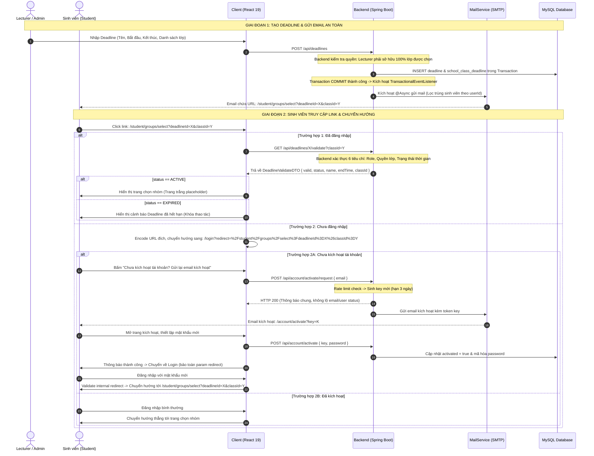

# Kế Hoạch Triển Khai Tính Năng Deadline & Luồng Kích Hoạt Tài Khoản (Bản Chuẩn Hóa)

> **Dự án:** F-Group Making (`fmaking`)  
> **Kiến trúc:** JHipster / Spring Boot 3 + React 19 TypeScript + MySQL  
> **Phiên bản tài liệu:** 2.1 (Bản chuẩn hóa hoàn chỉnh — Đã cập nhật Strict Ownership Model & Loại bỏ trùng lặp)  
> **Ngày cập nhật:** 13/10/2026  
> **Trạng thái:** Kế hoạch kỹ thuật đã phê duyệt (Approved Technical Plan)

---

## 1. MỤC TIÊU & NGUYÊN TẮC THIẾT KẾ CỐT LÕI

### 1.1. Mục tiêu
Xây dựng tính năng quản lý **Deadline (Hạn chót chọn nhóm)** hoàn chỉnh cho hai vai trò **Quản trị viên (Admin)** và **Giảng viên (Lecturer)**; tự động gửi email thông báo kèm đường link chọn nhóm chính xác theo lớp; bảo vệ toàn vẹn luồng chuyển hướng (redirect) an toàn khi sinh viên chưa đăng nhập hoặc chưa kích hoạt tài khoản; và thiết lập cơ chế kiểm soát thời hạn bất biến (immutable) đa tầng ở cả Backend lẫn Frontend.

### 1.2. Các bên liên quan (Actors)
1. **Quản trị viên (`ROLE_ADMIN`)**:
   - Tạo và quản lý deadline cho một hoặc nhiều lớp học bất kỳ trong học kỳ (Term).
   - Có toàn quyền điều chỉnh, gia hạn hoặc hủy bỏ mọi deadline trên hệ thống.
2. **Giảng viên (`ROLE_LECTURE`, `ROLE_LECTURE_MASTER`)**:
   - Tạo deadline và gán cho các lớp học do chính mình phụ trách (`school_classes.lecturer_id = currentLecturerId`).
   - Quản lý, điều chỉnh hoặc gia hạn deadline nếu **toàn bộ các lớp hiện tại và lớp mới** của deadline đó thuộc quyền phụ trách của mình.
   - Tuyệt đối không được can thiệp vào deadline dùng chung có chứa lớp của giảng viên khác.
3. **Sinh viên (`ROLE_STUDENT`)**:
   - Nhận email thông báo hạn chót kèm đường link dẫn thẳng tới trang chọn nhóm của lớp mình.
   - Nếu chưa đăng nhập: Bắt buộc đăng nhập trước khi vào trang chọn nhóm (hệ thống tự động bảo toàn URL đích).
   - Nếu chưa kích hoạt tài khoản: Có tùy chọn tại form đăng nhập để yêu cầu gửi email kích hoạt, hoàn tất đặt mật khẩu, đăng nhập và tự động chuyển tiếp tới trang chọn nhóm.
   - Khi deadline hết hạn: Bị khóa toàn bộ thao tác chọn nhóm / vào nhóm.

### 1.3. Các nguyên tắc thiết kế cốt lõi (Core Decisions)
1. **Mô hình sở hữu nghiêm ngặt (Strict Ownership Model)**:
   - Quyền quản lý deadline của giảng viên được xác định dựa trên **toàn bộ danh sách lớp hiện tại trong cơ sở dữ liệu** (`existing.getSchoolClasses()`), không chỉ dựa vào danh sách lớp gửi lên trong DTO request.
   - Nếu deadline chứa lớp của nhiều giảng viên (deadline đa giảng viên do Admin tạo), **chỉ Admin** có quyền sửa, gia hạn hoặc hủy.
   - Khi giảng viên cập nhật danh sách lớp (chỉ cho phép khi deadline ở trạng thái `UPCOMING`), Backend phải kiểm tra quyền với **cả danh sách lớp hiện tại lẫn danh sách lớp mới**.
   - **Chống chiếm quyền**: Giảng viên tuyệt đối không thể loại bỏ lớp của giảng viên khác khỏi deadline để biến deadline dùng chung thành deadline thuộc quyền quản lý cá nhân.
2. **Quy tắc thời gian bất biến (Immutable Timeline Rules)**:
   - Backend là nguồn chân lý duy nhất (Single Source of Truth), tự động xác định trạng thái từ CSDL và `Instant.now()`.
   - Khi deadline đã bắt đầu (`startTime <= now`): **Khóa tuyệt đối `startTime` và danh sách lớp**. Chỉ cho phép gia hạn `endTime` (`new.endTime > old.endTime` và `new.endTime > now`).
3. **Bảo vệ nghiệp vụ đa tầng tại Backend**:
   - Endpoint `GET /api/deadlines/{id}/validate` chỉ phục vụ kiểm tra hiển thị trạng thái giao diện. Mọi API nghiệp vụ chọn nhóm/vào nhóm/đổi nhóm (khi phát triển ở giai đoạn sau) **bắt buộc phải kiểm tra deadline còn hiệu lực tại Backend**.
4. **Liên kết Email chính xác & Transaction Safety**:
   - URL trong email gửi sinh viên bắt buộc chứa đầy đủ cả `deadlineId` và `classId` chính xác của từng sinh viên.
   - Email chỉ được kích hoạt gửi sau khi Transaction lưu Deadline đã commit thành công vào CSDL (`AFTER_COMMIT`). Sinh viên học nhiều lớp được deduplicate theo `userId`/email để chống gửi trùng.
5. **Bảo mật luồng kích hoạt tài khoản**:
   - API yêu cầu gửi email kích hoạt phản hồi thông điệp an toàn đồng nhất (Generic Response) để chống lộ thông tin tài khoản (chống User Enumeration).
   - Bảo toàn URL đích an toàn, kiểm tra chống lỗ hổng Open Redirect.

---

## 2. QUY ƯỚC TRẠNG THÁI & MA TRẬN QUYỀN HẠN

### 2.1. Quy ước trạng thái Deadline (`DeadlineStatus`)
Định nghĩa Enum dùng chung cho cả Backend và Frontend:

```java
public enum DeadlineStatus {
    UPCOMING, // Chưa bắt đầu (now < startTime)
    ACTIVE,   // Đang diễn ra  (startTime <= now < endTime)
    EXPIRED   // Đã kết thúc  (now >= endTime)
}
```

Hàm tính toán trạng thái không có khoảng thời gian mơ hồ:

```java
public static DeadlineStatus calculateStatus(Instant startTime, Instant endTime, Instant now) {
    if (now.isBefore(startTime)) {
        return DeadlineStatus.UPCOMING;
    }
    if (!now.isBefore(endTime)) {
        return DeadlineStatus.EXPIRED;
    }
    return DeadlineStatus.ACTIVE;
}
```

### 2.2. Ma trận quy tắc chỉnh sửa Deadline
| Trạng thái hiện tại | `name` & `description` | `startTime` | `endTime` | Danh sách lớp (`schoolClassIds`) |
| :--- | :---: | :---: | :---: | :---: |
| **`UPCOMING`** (`now < startTime`) | Cho phép sửa | Cho phép sửa nếu `new.startTime >= now` và `new.startTime < new.endTime` | Cho phép sửa nếu `new.endTime > new.startTime` | Cho phép sửa nếu người sửa có quyền trên cả lớp cũ lẫn lớp mới |
| **`ACTIVE`** (`startTime <= now < endTime`) | Cho phép sửa | **KHÓA TUYỆT ĐỐI** (Backend giữ nguyên `old.startTime`) | **CHỈ CHO PHÉP GIA HẠN** (`new.endTime > old.endTime` và `new.endTime > now`) | **KHÓA TUYỆT ĐỐI** (Không được thêm/bớt lớp khi đang chạy) |
| **`EXPIRED`** (`now >= endTime`) | Cho phép sửa mô tả | **KHÓA TUYỆT ĐỐI** | **Mặc định khóa**. Chỉ mở lại qua API riêng biệt (Reopen) với `new.endTime > now` | **KHÓA TUYỆT ĐỐI** |

### 2.3. Ma trận phân quyền chi tiết (Strict Authorization Matrix)
| Hành động | `ROLE_ADMIN` | `ROLE_LECTURE` (Sở hữu 100% lớp hiện tại) | `ROLE_LECTURE` (Deadline có lớp của người khác) | `ROLE_STUDENT` |
| :--- | :---: | :---: | :---: | :---: |
| **Xem danh sách deadline** | Toàn bộ hệ thống / theo Term | Xem deadline của các lớp mình dạy | Ẩn các deadline không thuộc quyền mình | Xem deadline của lớp mình học |
| **Tạo deadline mới** | Chọn bất kỳ lớp nào | Chỉ được chọn các lớp mình phụ trách | Không áp dụng | ❌ 403 Forbidden |
| **Sửa / Gia hạn deadline** | Toàn quyền | Được phép (nếu các lớp mới cũng thuộc mình) | ❌ 403 Forbidden (Không thể gỡ lớp để chiếm quyền) | ❌ 403 Forbidden |
| **Hủy / Xóa deadline** | Toàn quyền | Được phép | ❌ 403 Forbidden | ❌ 403 Forbidden |
| **Validate chọn nhóm** | ❌ Không áp dụng | ❌ Không áp dụng | ❌ Không áp dụng | Được phép nếu thuộc đúng lớp và deadline `ACTIVE` |

---

## 3. THIẾT KẾ CƠ SỞ DỮ LIỆU & AUDITING (DATABASE & MIGRATION)

### 3.1. Đồng bộ kiểu dữ liệu thực tế
- `SchoolClass.id`: `Integer` (SQL: `INT`)
- `SchoolClass.lecturerId`: `Long` (SQL: `BIGINT`)
- `User.id` / `Student.userId`: `Long` (SQL: `BIGINT`)
- `Deadline.id`: `Integer` (SQL: `INT AUTO_INCREMENT`)
- Bảng liên kết `school_class_deadline`: `school_class_id INT`, `deadline_id INT`.

### 3.2. Migration Script chuẩn (`docs/sql/20261013_deadline_tables.sql`)
Kế thừa cơ chế Auditing của JHipster (`created_by`, `created_date`, `last_modified_by`, `last_modified_date`).

```sql
-- Migration: Tạo bảng deadlines và school_class_deadline
-- Tương thích với MySQL 8.x và schema hiện tại của fgroup-making

DELIMITER $$
DROP PROCEDURE IF EXISTS migrate_deadlines$$
CREATE PROCEDURE migrate_deadlines()
BEGIN
    -- 1. Bảng deadlines
    IF NOT EXISTS (SELECT 1 FROM information_schema.TABLES
                   WHERE TABLE_SCHEMA = DATABASE() AND TABLE_NAME = 'deadlines') THEN
        CREATE TABLE deadlines (
            id INT AUTO_INCREMENT PRIMARY KEY,
            name VARCHAR(100) NOT NULL,
            description TEXT NULL,
            start_time TIMESTAMP NOT NULL,
            end_time TIMESTAMP NOT NULL,
            status VARCHAR(20) NOT NULL DEFAULT 'ACTIVE',
            created_by VARCHAR(50) NOT NULL,
            created_date TIMESTAMP DEFAULT CURRENT_TIMESTAMP,
            last_modified_by VARCHAR(50) NULL,
            last_modified_date TIMESTAMP DEFAULT CURRENT_TIMESTAMP ON UPDATE CURRENT_TIMESTAMP,
            INDEX idx_deadlines_time (start_time, end_time),
            INDEX idx_deadlines_status (status)
        ) ENGINE=InnoDB DEFAULT CHARSET=utf8mb4 COLLATE=utf8mb4_unicode_ci;
    END IF;

    -- 2. Bảng liên kết Many-to-Many: school_class_deadline
    IF NOT EXISTS (SELECT 1 FROM information_schema.TABLES
                   WHERE TABLE_SCHEMA = DATABASE() AND TABLE_NAME = 'school_class_deadline') THEN
        CREATE TABLE school_class_deadline (
            school_class_id INT NOT NULL,
            deadline_id INT NOT NULL,
            PRIMARY KEY (school_class_id, deadline_id),
            CONSTRAINT fk_scd_class FOREIGN KEY (school_class_id) REFERENCES school_classes (id) ON DELETE CASCADE,
            CONSTRAINT fk_scd_deadline FOREIGN KEY (deadline_id) REFERENCES deadlines (id) ON DELETE CASCADE,
            INDEX idx_scd_deadline (deadline_id),
            INDEX idx_scd_class (school_class_id)
        ) ENGINE=InnoDB DEFAULT CHARSET=utf8mb4 COLLATE=utf8mb4_unicode_ci;
    END IF;
END$$
CALL migrate_deadlines()$$
DROP PROCEDURE IF EXISTS migrate_deadlines$$
DELIMITER ;
```

### 3.3. Cập nhật Domain Entities
1. **`Deadline.java`** (`com.fmaking.domain`):
   - Kế thừa `AbstractAuditingEntity<Integer>`.
   - **Lưu ý quan trọng**: Không khai báo lại các trường audit (`createdBy`, `createdDate`, `lastModifiedBy`, `lastModifiedDate`) vì lớp cha đã quản lý, tránh lỗi trùng lặp mapping Hibernate.
   - Khai báo quan hệ `@ManyToMany`:
     ```java
     @ManyToMany
     @JoinTable(
         name = "school_class_deadline",
         joinColumns = @JoinColumn(name = "deadline_id", referencedColumnName = "id"),
         inverseJoinColumns = @JoinColumn(name = "school_class_id", referencedColumnName = "id")
     )
     private Set<SchoolClass> schoolClasses = new HashSet<>();
     ```
2. **Chính sách xóa dữ liệu**:
   - Không xóa vật lý (`hard delete`) các deadline đã kích hoạt hoặc đã gửi email để đảm bảo tính toàn vẹn lịch sử.
   - Hỗ trợ đổi trạng thái thành `CANCELLED` khi muốn hủy deadline.

---

## 4. BIỂU ĐỒ LUỒNG HOẠT ĐỘNG (SEQUENCE DIAGRAM)



---

## 5. THIẾT KẾ CHI TIẾT TẦNG BACKEND (SPRING BOOT)

### 5.1. Repository: `DeadlineRepository`
Thực thi kiểm tra quyền sở hữu toàn vẹn trong tầng Repository:

```java
@Repository
public interface DeadlineRepository extends JpaRepository<Deadline, Integer>, JpaSpecificationExecutor<Deadline> {

    // Lấy deadline theo giảng viên
    @Query("SELECT DISTINCT d FROM Deadline d JOIN d.schoolClasses sc WHERE sc.lecturerId = :lecturerId")
    Page<Deadline> findAllByLecturerId(@Param("lecturerId") Long lecturerId, Pageable pageable);

    // Lấy deadline theo lớp của sinh viên
    @Query("SELECT DISTINCT d FROM Deadline d JOIN d.schoolClasses sc WHERE sc.id = :classId")
    List<Deadline> findAllBySchoolClassId(@Param("classId") Integer classId);

    // KIỂM TRA QUYỀN SỞ HỮU TOÀN VẸN: Đếm số lớp của deadline KHÔNG thuộc về giảng viên này
    @Query("""
        SELECT COUNT(sc) FROM SchoolClass sc JOIN sc.deadlines d 
        WHERE d.id = :deadlineId AND sc.lecturerId != :lecturerId
    """)
    long countClassesNotOwnedByLecturer(@Param("deadlineId") Integer deadlineId, @Param("lecturerId") Long lecturerId);

    // Kiểm tra lớp có thuộc deadline không
    @Query("SELECT COUNT(sc) FROM SchoolClass sc JOIN sc.deadlines d WHERE d.id = :deadlineId AND sc.id = :classId")
    long countByDeadlineIdAndClassId(@Param("deadlineId") Integer deadlineId, @Param("classId") Integer classId);
}
```

### 5.2. Data Transfer Objects (DTOs)
```java
public class CreateDeadlineDTO {
    @NotBlank @Size(min = 2, max = 100)
    private String name;
    private String description;
    @NotNull
    private Instant startTime;
    @NotNull
    private Instant endTime;
    @NotEmpty
    private List<Integer> schoolClassIds;
}

public class UpdateDeadlineDTO {
    @NotNull
    private Integer id;
    @NotBlank @Size(min = 2, max = 100)
    private String name;
    private String description;
    private Instant startTime; // Backend giữ nguyên nếu deadline đã bắt đầu
    @NotNull
    private Instant endTime;
    private List<Integer> schoolClassIds; // Chỉ cho phép sửa khi UPCOMING
}

public class DeadlineValidateDTO {
    private boolean valid;
    private DeadlineStatus status;
    private String name;
    private Instant startTime;
    private Instant endTime;
    private Integer classId;
    private String className;
    private String message;
}
```

### 5.3. Service Logic & Validations (`DeadlineService`)

#### 1. Kiểm tra Strict Ownership Model:
```java
public void validateLecturerOwnership(Deadline existingDeadline, List<Integer> newClassIds, Long currentLecturerId) {
    if (SecurityUtils.isCurrentUserInRole(AuthoritiesConstants.ADMIN)) {
        return; // Admin có toàn quyền
    }

    // 1. Kiểm tra trên DANH SÁCH LỚP HIỆN TẠI trong database:
    // Nếu deadline hiện tại có bất kỳ lớp nào không thuộc về lecturer này -> Chặn ngay lập tức!
    // Ngăn chặn hành vi loại bỏ lớp của người khác để chiếm quyền deadline dùng chung.
    boolean hasOtherLecturerClassInExisting = existingDeadline.getSchoolClasses().stream()
        .anyMatch(sc -> !Objects.equals(sc.getLecturerId(), currentLecturerId));
    if (hasOtherLecturerClassInExisting) {
        throw new ForbiddenAlertException("You cannot edit a shared deadline containing classes of other lecturers.", "deadline", "accessDenied");
    }

    // 2. Kiểm tra trên DANH SÁCH LỚP MỚI (nếu có cập nhật):
    if (newClassIds != null && !newClassIds.isEmpty()) {
        List<SchoolClass> newClasses = schoolClassRepository.findAllById(newClassIds);
        boolean hasUnauthorizedNewClass = newClasses.stream()
            .anyMatch(sc -> !Objects.equals(sc.getLecturerId(), currentLecturerId));
        if (hasUnauthorizedNewClass) {
            throw new ForbiddenAlertException("You can only assign classes that you manage.", "deadline", "accessDenied");
        }
    }
}
```

#### 2. Kiểm tra quy tắc thời gian & cập nhật:
```java
Instant now = Instant.now();
Deadline existing = getExistingDeadline(dto.getId());
validateLecturerOwnership(existing, dto.getSchoolClassIds(), currentLecturerId);

DeadlineStatus currentStatus = DeadlineStatus.calculateStatus(existing.getStartTime(), existing.getEndTime(), now);

if (currentStatus == DeadlineStatus.ACTIVE) {
    // Khóa startTime tuyệt đối
    dto.setStartTime(existing.getStartTime());
    // Chỉ cho phép gia hạn endTime
    if (dto.getEndTime().isBefore(existing.getEndTime()) || !dto.getEndTime().isAfter(now)) {
        throw new BadRequestResourceException("Active deadline can only be extended to a future time", "deadline", "invalidEndTime");
    }
    // Khóa danh sách lớp tuyệt đối
    dto.setSchoolClassIds(existing.getSchoolClasses().stream().map(SchoolClass::getId).toList());
} else if (currentStatus == DeadlineStatus.UPCOMING) {
    if (dto.getStartTime().isBefore(now)) {
        throw new BadRequestResourceException("Start time cannot be set in the past", "deadline", "startTimeInPast");
    }
    if (!dto.getEndTime().isAfter(dto.getStartTime())) {
        throw new BadRequestResourceException("End time must be after start time", "deadline", "endTimeBeforeStartTime");
    }
} else { // EXPIRED
    throw new BadRequestResourceException("Expired deadline cannot be edited directly. Please use reopen feature.", "deadline", "deadlineExpired");
}
```

#### 3. Validate cho Sinh viên (`GET /api/deadlines/{id}/validate?classId={classId}`):
- Bắt buộc truyền `classId`.
- Xác thực:
  1. Deadline tồn tại.
  2. Sinh viên hiện tại (`User.id`) thuộc về `classId` (`student.school_class_id == classId`).
  3. `classId` được gán vào `deadlineId` (`countByDeadlineIdAndClassId == 1`).
  4. Tính toán trạng thái: `DeadlineStatus.calculateStatus(...)`.
  5. Trả về `valid = (status == DeadlineStatus.ACTIVE)`.

### 5.4. Gửi Email an toàn theo Transaction (`TransactionalEventListener`)
- Không gọi `@Async` trực tiếp trong method tạo deadline để tránh gửi email khi transaction rollback.
- Sử dụng mô hình Event-driven của Spring:
  ```java
  // 1. Event
  public record DeadlineCreatedEvent(Integer deadlineId, List<Integer> classIds) {}

  // 2. Service phát event sau khi lưu
  applicationEventPublisher.publishEvent(new DeadlineCreatedEvent(savedDeadline.getId(), dto.getSchoolClassIds()));

  // 3. Listener lắng nghe sau khi commit thành công
  @Component
  public class DeadlineNotificationEventListener {
      @TransactionalEventListener(phase = TransactionPhase.AFTER_COMMIT)
      public void handleDeadlineCreated(DeadlineCreatedEvent event) {
          notificationAsyncService.sendDeadlineNotificationBatch(event.deadlineId(), event.classIds());
      }
  }
  ```
- **Xử lý Deduplication & Chia Batch**:
  - Truy vấn sinh viên trong các lớp: `studentRepository.findStudentsBySchoolClassIdIn(classIds)`.
  - Deduplicate theo `userId` (nếu một sinh viên học nhiều lớp, gửi theo đúng lớp được phân bổ).
  - URL trong mail sinh viên: `${clientBaseUrl}/student/groups/select?deadlineId=${deadlineId}&classId=${student.classId}`.
  - Chia lô batch 50 email, log lỗi từng lô để không ngắt quãng toàn bộ tiến trình.

### 5.5. Bảo vệ API Public Kích hoạt tài khoản (`AccountResource`)
Bổ sung `POST /api/account/activate/request`:
- Body: `{ "email": "student@fpt.edu.vn" }`.
- **Chống rò rỉ thông tin (User Enumeration)**:
  - Nếu email không tồn tại hoặc tài khoản đã kích hoạt: Hệ thống ghi log nội bộ mức INFO và **vẫn trả về HTTP 200 OK** với thông điệp: *"Nếu email tồn tại và hợp lệ, đường dẫn kích hoạt đã được gửi tới hộp thư của bạn."*
- **Rate Limit & Cooldown**:
  - Kiểm tra thời gian gửi gần nhất (cache hoặc DB). Nếu yêu cầu cách nhau dưới 60 giây: Chặn hoặc yêu cầu đợi.
- **Vô hiệu hóa Token cũ**:
  - Khi sinh `activationKey` mới: Key cũ bị ghi đè, đặt hạn 3 ngày (`activationKeyExpiresAt = now + 3 days`).
  - Không ghi key vào application log.

---

## 6. THIẾT KẾ CHI TIẾT TẦNG FRONTEND (REACT 19 + TYPESCRIPT)

### 6.1. Xử lý Redirect URL & Route Guards an toàn
- **Encode & Decode an toàn**:
  URL đích chứa tham số lồng: `/student/groups/select?deadlineId=1&classId=2`.
  Khi chuyển hướng về login:
  ```ts
  const targetPath = location.pathname + location.search;
  navigate(`/login?redirect=${encodeURIComponent(targetPath)}`, { replace: true });
  ```
- **Xác thực Internal URL sau Login**:
  ```ts
  const searchParams = new URLSearchParams(location.search);
  const rawRedirect = searchParams.get('redirect');
  const redirectUrl = rawRedirect ? decodeURIComponent(rawRedirect) : null;

  // Chống Open Redirect: Chỉ chấp nhận đường dẫn nội bộ bắt đầu bằng '/' và không có '//'
  const isSafeInternalUrl = redirectUrl && redirectUrl.startsWith('/') && !redirectUrl.startsWith('//');

  if (isSafeInternalUrl && canAccessPath(redirectUrl, user.authorities)) {
    navigate(redirectUrl, { replace: true });
  } else {
    navigate(getHomeRoute(user.authorities), { replace: true });
  }
  ```
- **Lưu trữ State xuyên suốt quá trình kích hoạt**:
  Lưu `redirectUrl` vào `sessionStorage` (`fmaking_pending_redirect`). Khi sinh viên bấm chuyển sang luồng kích hoạt và quay lại đăng nhập, hệ thống khôi phục URL đích từ `sessionStorage`.

### 6.2. Nâng cấp Form Đăng nhập (`LoginForm.tsx`)
- Thêm liên kết: *"Chưa kích hoạt tài khoản? Gửi lại email kích hoạt"*.
- Mở Modal yêu cầu kích hoạt:
  - Input: Email sinh viên.
  - Nút "Gửi yêu cầu" (có loading state và cooldown đếm ngược 60s).
  - Phản hồi đồng nhất, an toàn: *"Đã tiếp nhận yêu cầu. Vui lòng kiểm tra hộp thư email của bạn."*

### 6.3. Giao diện Quản lý Deadline cho Giảng viên & Admin
- **Bảng danh sách Deadline**: Hiển thị trạng thái theo đúng `DeadlineStatus`:
  - 🟢 **Đang diễn ra** (`ACTIVE`)
  - 🟡 **Sắp tới** (`UPCOMING`)
  - 🔴 **Đã kết thúc** (`EXPIRED`)
- **Modal Gia hạn Deadline (`ExtendDeadlineModal`)**:
  - Nếu deadline đang `ACTIVE`: Trường `startTime` và trường `Lớp học` bị **disabled** trên UI; chỉ cho phép người dùng điều chỉnh `endTime` mới lớn hơn `endTime` hiện tại.
  - Backend vẫn là nơi kiểm tra cuối cùng và từ chối nếu request bị can thiệp.

### 6.4. Trang Chọn nhóm Sinh viên Placeholder (`SelectGroupPage.tsx`)
- Đường dẫn: `/student/groups/select` (Yêu cầu `ROLE_STUDENT`).
- Quy trình hiển thị:
  1. Đọc `deadlineId` và `classId` từ URL params.
  2. Gọi `GET /api/deadlines/{id}/validate?classId={classId}`.
  3. **Nếu `valid == true` (`ACTIVE`)**:
     - Hiển thị giao diện card hiện đại, thông tin deadline và lớp học.
     - Đồng hồ đếm ngược (Countdown timer) đến `endTime`.
     - Thông báo trạng thái: *"Hệ thống đang mở chọn nhóm. Tính năng lập nhóm chi tiết đang được hoàn thiện và sẽ sớm khả dụng."*
  4. **Nếu `valid == false` (`EXPIRED`)**:
     - Hiển thị Alert cảnh báo hết hạn: *"Thời hạn chọn nhóm đã kết thúc vào lúc [Thời gian]. Mọi thao tác chọn nhóm đã bị khóa. Vui lòng liên hệ giảng viên phụ trách nếu cần gia hạn."*
  5. **Nếu sai lớp / không có quyền truy cập**:
     - Hiển thị lỗi 403: *"Bạn không thuộc danh sách lớp được áp dụng deadline này."*

---

## 7. LỘ TRÌNH TRIỂN KHAI THEO GIAI ĐOẠN (ROADMAP)

```mermaid
gantt
    title Lộ trình triển khai tính năng Deadline
    dateFormat  YYYY-MM-DD
    section Backend Core
    P1: Chốt nghiệp vụ, Migration SQL & Domain Entity :p1, 2026-10-14, 1d
    P2: Repository, DTOs, Validation & Service Core    :p2, after p1, 2d
    P3: REST API & Security Authorization             :p3, after p2, 1d
    section Email & Auth
    P4: Email Event-driven (Transactional + Deduplication) :p4, after p3, 1d
    P5: Public Activation Request & Redirect Protection    :p5, after p4, 1d
    section Frontend & UI
    P6: Deadline Management UI & Placeholder Group Page    :p6, after p5, 2d
    section Testing
    P7: Kiểm thử tích hợp, Bảo mật & Nghiệm thu       :p7, after p6, 2d
```

| Giai đoạn | Nội dung công việc cụ thể | Điều kiện hoàn thành (DoD) |
| :--- | :--- | :--- |
| **P1** | Chốt mô hình dữ liệu; viết file SQL migration `20261013_deadline_tables.sql`; cập nhật entity `Deadline.java` và `SchoolClass.java`. | Script chạy thành công; mapping Hibernate không lỗi audit duplicate. |
| **P2** | Viết `DeadlineRepository`, `DeadlineStatus`, DTOs, custom exceptions, và `DeadlineService` (chặn sửa `startTime` quá khứ, kiểm tra Strict Ownership trên cả danh sách lớp cũ và mới). | Unit tests service đạt 100% các case thời gian và quyền lớp. |
| **P3** | Viết controller `DeadlineResource` với đầy đủ `@PreAuthorize`, method security và API validate theo lớp. | API trả về đúng mã lỗi 403 khi truy cập sai lớp hoặc sai quyền. |
| **P4** | Xây dựng Spring `DeadlineCreatedEvent`, `@TransactionalEventListener(AFTER_COMMIT)`, lọc trùng sinh viên và gửi email theo lô. | Email chỉ gửi sau commit; link email có đủ `deadlineId` và `classId`. |
| **P5** | Bổ sung `POST /api/account/activate/request` (generic response, rate limit); hoàn thiện logic bảo toàn redirect an toàn. | Sinh viên chưa kích hoạt nhận được mail; không lộ email; giữ đúng URL đích. |
| **P6** | Xây dựng UI quản lý Deadline (Admin/Lecturer), Modal gia hạn (khóa `startTime`), trang `/student/groups/select` placeholder. | Giao diện hiển thị đúng trạng thái thời gian; countdown mượt mà. |
| **P7** | Kiểm thử tích hợp toàn hệ thống: Phân quyền đa giảng viên, sửa deadline đang chạy, hết hạn, và kiểm tra bảo mật redirect. | Toàn bộ tiêu chí nghiệm thu được xác nhận thực tế. |

---

## 8. TIÊU CHÍ NGHIỆM THU (ACCEPTANCE CRITERIA)

> *Tất cả các tiêu chí hiện ở trạng thái `[ ]` (Chưa nghiệm thu). Chỉ được đánh dấu `[x]` sau khi kiểm thử thực tế trên hệ thống chạy.*

- [ ] **AC-1 (Phân quyền Giảng viên khi tạo mới)**: Giảng viên chỉ có thể tạo deadline cho các lớp do chính mình phụ trách. Nếu request chứa dù chỉ 1 lớp của người khác, backend từ chối với HTTP 403.
- [ ] **AC-2 (Strict Ownership Model khi cập nhật)**: Giảng viên chỉ có thể sửa/gia hạn deadline nếu toàn bộ các lớp hiện tại trong CSDL và các lớp mới đều thuộc sở hữu của mình. Không thể gỡ lớp của giảng viên khác để chiếm quyền deadline. Deadline dùng chung do Admin tạo chứa lớp của người khác thì giảng viên không được phép sửa.
- [ ] **AC-3 (Bất biến thời gian bắt đầu)**: Khi deadline đã bắt đầu (`startTime <= now`), backend tuyệt đối không cho phép sửa đổi `startTime` và danh sách lớp; chỉ cho phép gia hạn `endTime > now`.
- [ ] **AC-4 (Gửi email an toàn theo Transaction)**: Email thông báo chỉ gửi sau khi transaction DB commit thành công; sinh viên học nhiều lớp không bị nhận email trùng; link email chứa đúng `deadlineId` và `classId` của sinh viên đó.
- [ ] **AC-5 (Bảo mật kích hoạt tài khoản)**: Endpoint yêu cầu kích hoạt phản hồi thông báo an toàn đồng nhất (không để kẻ gian dò email); token kích hoạt hết hạn sau 3 ngày và bị vô hiệu hóa khi sinh token mới.
- [ ] **AC-6 (Bảo toàn chuyển hướng - Redirect)**: Sinh viên chưa đăng nhập hoặc chưa kích hoạt khi mở link email được dẫn qua các bước đăng nhập/kích hoạt và tự động chuyển về đúng trang `/student/groups/select?deadlineId=...&classId=...`.
- [ ] **AC-7 (Bảo vệ thời hạn chọn nhóm đa tầng)**: Khi deadline hết hạn (`now >= endTime`), trang chọn nhóm hiển thị cảnh báo hết hạn và khóa toàn bộ thao tác; mọi API thao tác nhóm ở backend đều kiểm tra và từ chối nếu deadline không còn `ACTIVE`.
- [ ] **AC-8 (Trang Placeholder minh bạch)**: Trang chọn nhóm hiển thị rõ thông điệp tính năng chọn nhóm đang hoàn thiện, không gây hiểu lầm cho sinh viên rằng đã chọn nhóm thành công.
