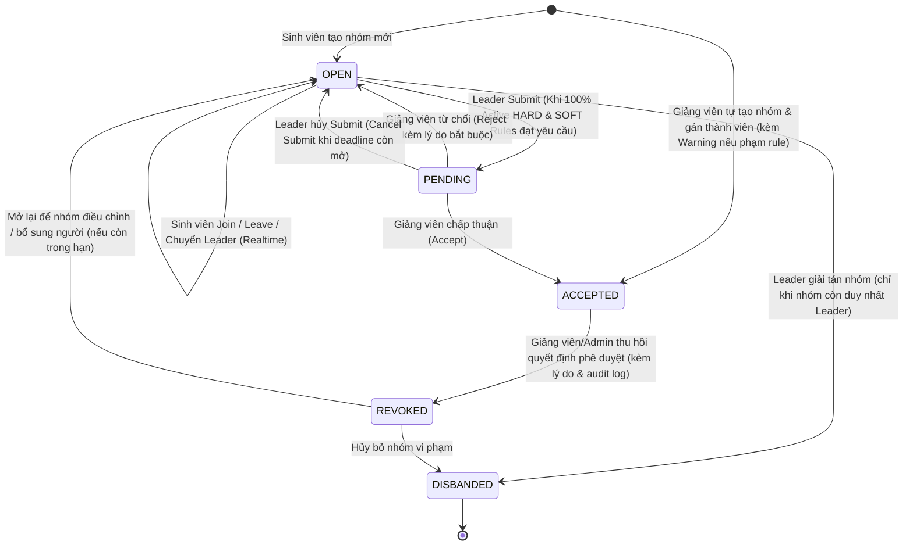
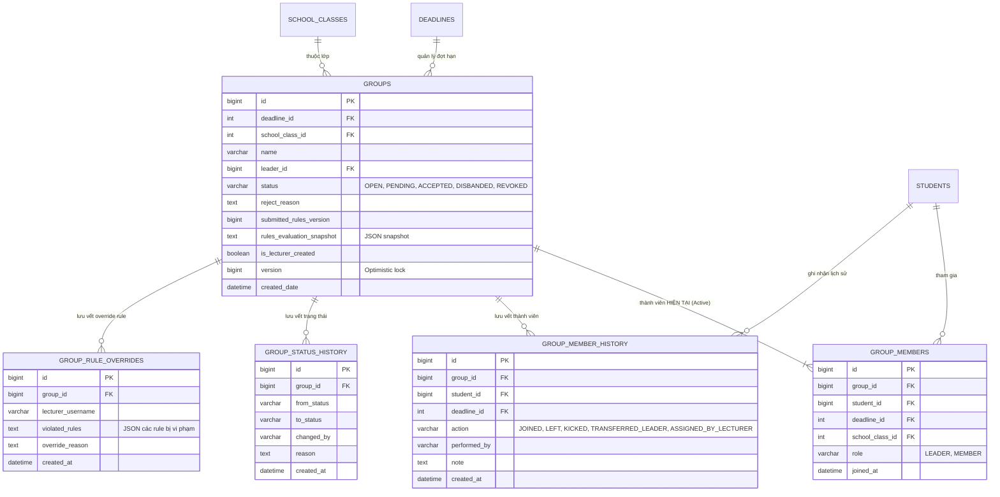
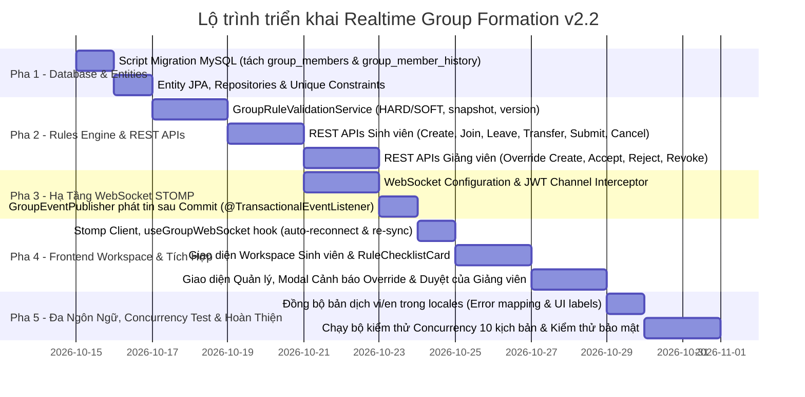

# KẾ HOẠCH TRIỂN KHAI TÍNH NĂNG TẠO & THAM GIA NHÓM REALTIME
## Realtime Group Formation & Approval

- **Mã tài liệu:** `PLAN-20261015-GROUP-REALTIME`
- **Phiên bản:** 2.2
- **Dự án:** F-Group Making (`fmaking`)
- **Phạm vi:** Nghiệp vụ, State Machine, Database Schema, Active Membership & Audit History, Concurrency Control, Rules Engine & Versioning, Realtime Architecture, Error Contract, Security, Testing & Acceptance Criteria
- **Trạng thái:** Đề xuất phê duyệt và triển khai sau khi hoàn tất các quyết định thiết kế còn mở
- **Kiến trúc:** JHipster / Spring Boot 3, React 19 TypeScript, MySQL

---

## 1. TỔNG QUAN VÀ CÁC NGUYÊN TẮC CỐT LÕI

### 1.1. Mục tiêu
Cung cấp môi trường chọn nhóm trực tuyến (**Class Group Formation Workspace**) có khả năng đồng bộ thời gian thực, cho phép sinh viên tạo nhóm, tham gia nhóm phù hợp với năng lực và chuyên ngành trong phạm vi hoạt động chia nhóm được phân công.

Giảng viên phụ trách có thể giám sát, hỗ trợ xếp nhóm, điều chuyển thành viên, cấu hình ngoại lệ được phép và phê duyệt nhóm theo quy chế học thuật của hoạt động.

### 1.2. Tám nguyên tắc cốt lõi hợp nhất (Core Principles)

#### 1. Phạm vi ràng buộc thành viên (Membership Scope)
Mỗi hoạt động chia nhóm được xác định bằng một định danh nghiệp vụ duy nhất, gắn với phạm vi lớp học và Deadline tương ứng. Một sinh viên chỉ được thuộc tối đa một nhóm đang có hiệu lực trong cùng hoạt động, nhưng có thể tham gia các nhóm khác nhau ở các hoạt động độc lập.
- Xác định `group_activity_id` hoặc quy định rõ `deadline_id` chính là định danh hoạt động chia nhóm.
- Bảo đảm tính duy nhất của thành viên đang hoạt động trong cùng một hoạt động.
- Tách dữ liệu thành viên hiện tại khỏi lịch sử thành viên nếu nghiệp vụ cho phép rời nhóm rồi tham gia nhóm khác.
- Không áp dụng một unique constraint trên bảng lịch sử nếu constraint đó ngăn cản các bản ghi lịch sử hợp lệ.

#### 2. Tham gia nhóm trực tiếp (Direct Join for MVP)
Sinh viên chưa có nhóm trong hoạt động hiện tại được phép tham gia trực tiếp nhóm `OPEN` khi còn chỗ và đáp ứng toàn bộ Hard Rules.
- Backend là nơi quyết định Join có hợp lệ hay không.
- Không yêu cầu Leader duyệt từng thành viên trong MVP.
- Kiểm tra lại trạng thái nhóm, số lượng thành viên, Deadline và điều kiện nghiệp vụ trong transaction.
- Ngăn chặn việc vượt số lượng thành viên tối đa hoặc một sinh viên tham gia đồng thời nhiều nhóm trong cùng hoạt động.

#### 3. Database là nguồn sự thật duy nhất (Single Source of Truth)
Toàn bộ thao tác ghi nghiệp vụ phải đi qua REST API và được xử lý bằng transaction cùng cơ chế kiểm soát đồng thời phù hợp.
Các thao tác bao gồm `Create`, `Join`, `Leave`, `Transfer Leader`, `Submit`, `Cancel Submit`, `Accept`, `Reject`, `Revoke` và các thao tác quản trị khác được State Machine cho phép.
- WebSocket/STOMP chỉ truyền sự kiện đồng bộ giao diện, không thay thế REST API.
- Chỉ phát sự kiện tương ứng sau khi transaction thành công.
- Client phải tải lại trạng thái chuẩn từ REST API khi kết nối lại hoặc phát hiện dữ liệu không đồng bộ.
- Cân nhắc Transactional Outbox nếu cần bảo đảm sự kiện không bị mất sau khi dữ liệu nghiệp vụ đã commit.

#### 4. Quyền giảng viên và Override có kiểm soát (Instructor Authority & Overrides)
Giảng viên được phân công có thể tạo nhóm, phân công hoặc điều chuyển sinh viên, phê duyệt nhóm và bỏ qua SOFT Rules theo chính sách được cho phép.
- Hard Rules không được bỏ qua, trừ khi nghiệp vụ định nghĩa rõ ngoại lệ đặc biệt và quyền tương ứng.
- Mỗi lần override phải lưu người thực hiện, thời điểm, hoạt động, nhóm và sinh viên liên quan, rule bị bỏ qua, lý do và kết quả.
- Các thao tác quản trị quan trọng phải có Audit Log hoặc lịch sử nghiệp vụ tương ứng.
- Backend phải xác minh quyền phụ trách lớp và hoạt động; không tin cậy thông tin phân quyền từ client.

#### 5. Bảo toàn dữ liệu lịch sử (Historical Data Preservation)
Không xóa vật lý dữ liệu nhóm đã hình thành hoặc dữ liệu lịch sử nghiệp vụ cần được bảo toàn.
- Mọi chuyển đổi trạng thái nhóm phải tuân theo State Machine.
- Lưu lịch sử chuyển trạng thái trong `group_status_history`.
- Lưu lịch sử tham gia, rời nhóm, chuyển nhóm và thay đổi vai trò thành viên.
- Giải tán nhóm hoặc thu hồi phê duyệt phải được thể hiện bằng chuyển đổi trạng thái nghiệp vụ phù hợp, không xóa dữ liệu để thay thế cho lịch sử.

#### 6. Kiểm soát đồng thời và tính toàn vẹn dữ liệu (Concurrency & Data Integrity)
Mọi thao tác có thể ảnh hưởng đến thành viên, Leader, trạng thái nhóm hoặc sức chứa phải an toàn trước các yêu cầu đồng thời.
- Sử dụng transaction, khóa dữ liệu và ràng buộc Database phù hợp.
- Xử lý riêng trường hợp một sinh viên đồng thời gửi yêu cầu Join nhiều nhóm.
- Kiểm tra lại điều kiện nghiệp vụ ngay trong transaction, không chỉ kiểm tra trước khi ghi.
- Có chính sách xử lý yêu cầu lặp lại do timeout, retry hoặc mất kết nối.
- Trả về lỗi nghiệp vụ nhất quán khi xảy ra xung đột dữ liệu.

#### 7. Versioning của Rules và tính nhất quán khi phê duyệt (Rules Versioning)
Mỗi thay đổi cấu hình Rules phải được quản lý phiên bản hoặc có cơ chế tương đương để xác định chính xác bộ quy tắc được áp dụng.
- Khi Submit, lưu phiên bản Rules được sử dụng để đánh giá nhóm.
- Xác định rõ cách xử lý nếu Rules thay đổi khi nhóm đang `PENDING`.
- Khi Accept, backend thực hiện các kiểm tra bắt buộc theo chính sách đã công bố, không dựa vào trạng thái giao diện của client.
- Lưu kết quả kiểm tra và thông tin ngoại lệ cần thiết để phục vụ audit.

#### 8. Bảo mật, phân quyền và đồng bộ realtime (Security & Realtime Consistency)
Mọi API và kênh WebSocket phải xác minh danh tính, vai trò và phạm vi truy cập theo lớp học, hoạt động và nhóm.
- Sinh viên chỉ được thao tác trong phạm vi hoạt động mà mình có quyền tham gia.
- Leader chỉ được thực hiện các thao tác quản lý nhóm được State Machine cho phép.
- Giảng viên chỉ được can thiệp trong phạm vi được phân công, trừ khi có quyền quản trị cao hơn.
- Sự kiện realtime chỉ được gửi đến người có quyền xem dữ liệu tương ứng.
- Client phải hỗ trợ reconnect, tải lại trạng thái bằng REST API và xử lý sự kiện trùng hoặc đến sai thứ tự.
- Nếu cần bảo đảm giao sự kiện sau khi commit, sử dụng cơ chế phát sự kiện bền vững phù hợp.

### 1.3. Hai điểm cần chốt trước khi phê duyệt

- **Thứ nhất (Thiết kế khóa duy nhất của thành viên):** Nếu một sinh viên được phép rời nhóm A rồi tham gia nhóm B trong cùng hoạt động, `UNIQUE(student_id, deadline_id)` trên bảng lịch sử sẽ ngăn dữ liệu hợp lệ. Cần xác định rõ bảng nào lưu thành viên đang hoạt động, bảng nào lưu lịch sử, rồi mới chốt constraint MySQL:
  - **Bảng `group_members` (thành viên đang hoạt động):** Áp dụng `UNIQUE KEY uk_active_student_activity (student_id, deadline_id)` để đảm bảo một sinh viên chỉ thuộc duy nhất 1 nhóm tại một thời điểm trong cùng một hoạt động. Khi sinh viên rời nhóm, bản ghi active bị xóa.
  - **Bảng `group_member_history` (lịch sử biến động):** Không áp dụng unique constraint để lưu trọn vẹn chuỗi sự kiện lịch sử hợp lệ (`JOINED`, `LEFT`, `KICKED`, `ASSIGNED_BY_LECTURER`).
- **Thứ hai (Trạng thái phê duyệt):** Cần phân biệt nhóm đã được `ACCEPTED` với hoạt động đã hoàn thành (`COMPLETED`). Nếu giảng viên có thể thu hồi phê duyệt, cần quy định trạng thái đích của `REVOKE` (chuyển sang `REVOKED`, sau đó mở lại `OPEN` để nhóm điều chỉnh/bổ sung người nếu còn trong hạn, hoặc `DISBANDED` để hủy bỏ nhóm), quyền thực hiện và ảnh hưởng đến thành viên.


---

## 2. MÔ HÌNH VÒNG ĐỜI & CHUYỂN TRẠNG THÁI NHÓM (STATE MACHINE)

### 2.1. Sơ Đồ Chuyển Trạng Thái



### 2.2. Định Nghĩa Chính Xác Trạng Thái `ACCEPTED`
> [!IMPORTANT]
> **Định nghĩa chuẩn nghiệp vụ:**  
> Trạng thái **`ACCEPTED`** chỉ thể hiện **nhóm đã được Giảng viên phê duyệt cơ cấu thành viên hợp lệ để bước vào giai đoạn thực hiện đồ án/bài tập**.  
> Trạng thái này **KHÔNG ĐỒNG NGHĨA** với việc nhóm đã hoàn thành môn học, nộp bài tập cuối kỳ (`COMPLETED`) hay kết thúc hoạt động giảng dạy.

### 2.3. Ma Trận Khóa Thao Tác Theo Trạng Thái Nhóm
Nhằm ngăn chặn xung đột dữ liệu khi nhóm đang trong quy trình xét duyệt:

| Thao tác nghiệp vụ | `OPEN` | `PENDING` (Đã nộp) | `ACCEPTED` (Đã duyệt) | `REVOKED` (Bị thu hồi) | `DISBANDED` (Đã giải tán) |
| :--- | :---: | :---: | :---: | :---: | :---: |
| **Sinh viên Join nhóm** | ✅ Cho phép (nếu còn slot) | ❌ **Khóa hoàn toàn** | ❌ **Khóa hoàn toàn** | ❌ Khóa | ❌ Khóa |
| **Thành viên tự Leave** | ✅ Cho phép (member thường) | ❌ **Khóa hoàn toàn** | ❌ **Khóa hoàn toàn** | ❌ Khóa | ❌ Khóa |
| **Leader chuyển quyền Leader**| ✅ Cho phép | ❌ **Khóa hoàn toàn** | ❌ **Khóa hoàn toàn** | ❌ Khóa | ❌ Khóa |
| **Leader giải tán nhóm** | ✅ Cho phép (khi còn 1 mình)| ❌ **Khóa hoàn toàn** | ❌ **Khóa hoàn toàn** | ❌ Khóa | ❌ Khóa |
| **Leader nộp nhóm (Submit)**| ✅ Cho phép (khi đủ rule) | ❌ Không (đang chờ) | ❌ Không | ❌ Không | ❌ Không |
| **Leader hủy nộp (Cancel Submit)**| ❌ Không | ✅ **Cho phép** (khi còn hạn)| ❌ Không | ❌ Không | ❌ Không |
| **Giảng viên Accept** | ❌ Không | ✅ **Cho phép** | ❌ Không (đã duyệt) | ❌ Không | ❌ Không |
| **Giảng viên Reject** | ❌ Không | ✅ **Cho phép** (kèm lý do) | ❌ Không | ❌ Không | ❌ Không |
| **Giảng viên/Admin Revoke** | ❌ Không | ❌ Không | ✅ **Cho phép** (kèm lý do) | ❌ Không | ❌ Không |

---

## 3. THIẾT KẾ CƠ SỞ DỮ LIỆU TÁCH RỜI (ACTIVE MEMBERSHIP VS HISTORY LOG)

Để giải quyết triệt để vấn đề: *"Sinh viên có thể rời nhóm A rồi tham gia nhóm B trong cùng một đợt Deadline mà vẫn lưu được trọn vẹn lịch sử mà không bị lỗi duplicate key"*, kiến trúc cơ sở dữ liệu được tách làm 2 bảng riêng biệt:



### Chi Tiết Phân Nhiệm Của Từng Bảng:
1. **Bảng `group_members` (Active Membership - Thành viên Đang Hoạt Động):**
   - Chỉ chứa các sinh viên **đang thực sự có mặt trong nhóm**.
   - Khi sinh viên rời nhóm (Leave) hoặc bị kick hoặc nhóm giải tán: Bản ghi tương ứng trong bảng này sẽ bị xóa (`DELETE`), giải phóng sinh viên trở về trạng thái chưa có nhóm.
   - **Ràng buộc duy nhất:** `UNIQUE KEY uk_active_student_activity (student_id, deadline_id)`.
     - Vì bảng này chỉ chứa thành viên active, ràng buộc này đảm bảo một sinh viên không bao giờ có thể thuộc 2 nhóm cùng lúc tại một thời điểm trong cùng một đợt deadline.
     - Khi sinh viên đã rời nhóm A, bản ghi ở nhóm A không còn trong bảng này -> Sinh viên hoàn toàn có thể Join nhóm B mà không bao giờ gặp lỗi duplicate key.
2. **Bảng `group_member_history` (Audit Log - Lịch Sử Biến Động Thành Viên):**
   - **KHÔNG CÓ** unique constraint trên `(student_id, deadline_id)`.
   - Lưu trữ dạng log ghi nối tiếp (Append-only log) mỗi khi có sự kiện: Sinh viên tham gia, tự rời nhóm, bị loại, hoặc được giảng viên điều chuyển.
   - Giúp Giảng viên và Admin dễ dàng tra cứu: *"Sinh viên này trước đó đã ở nhóm nào? Rời nhóm lúc mấy giờ? Ai là người chuyển quyền?"*.

### Script Migration MySQL Đề Xuất (`20261015_group_formation_tables.sql`):
```sql
-- 1. Bảng groups
CREATE TABLE IF NOT EXISTS `groups` (
    `id` BIGINT AUTO_INCREMENT PRIMARY KEY,
    `deadline_id` INT NOT NULL,
    `school_class_id` INT NOT NULL,
    `name` VARCHAR(100) NOT NULL,
    `leader_id` BIGINT NOT NULL,
    `status` VARCHAR(20) NOT NULL DEFAULT 'OPEN',
    `reject_reason` TEXT NULL,
    `submitted_rules_version` BIGINT NULL,
    `rules_evaluation_snapshot` TEXT NULL,
    `is_lecturer_created` BOOLEAN NOT NULL DEFAULT FALSE,
    `version` BIGINT NOT NULL DEFAULT 0,
    `created_by` VARCHAR(50),
    `created_date` DATETIME(6),
    `last_modified_by` VARCHAR(50),
    `last_modified_date` DATETIME(6),
    CONSTRAINT `fk_groups_deadline` FOREIGN KEY (`deadline_id`) REFERENCES `deadlines` (`id`),
    CONSTRAINT `fk_groups_school_class` FOREIGN KEY (`school_class_id`) REFERENCES `school_classes` (`id`),
    INDEX `idx_groups_class_deadline` (`school_class_id`, `deadline_id`, `status`)
) ENGINE=InnoDB DEFAULT CHARSET=utf8mb4 COLLATE=utf8mb4_unicode_ci;

-- 2. Bảng group_members (Chỉ lưu thành viên HIỆN TẠI đang active)
CREATE TABLE IF NOT EXISTS `group_members` (
    `id` BIGINT AUTO_INCREMENT PRIMARY KEY,
    `group_id` BIGINT NOT NULL,
    `student_id` BIGINT NOT NULL,
    `deadline_id` INT NOT NULL,
    `school_class_id` INT NOT NULL,
    `role` VARCHAR(20) NOT NULL DEFAULT 'MEMBER',
    `joined_at` DATETIME(6) NOT NULL,
    CONSTRAINT `fk_gm_group` FOREIGN KEY (`group_id`) REFERENCES `groups` (`id`) ON DELETE CASCADE,
    CONSTRAINT `fk_gm_student` FOREIGN KEY (`student_id`) REFERENCES `students` (`user_id`),
    CONSTRAINT `uk_active_student_activity` UNIQUE (`student_id`, `deadline_id`),
    INDEX `idx_gm_group_student` (`group_id`, `student_id`)
) ENGINE=InnoDB DEFAULT CHARSET=utf8mb4 COLLATE=utf8mb4_unicode_ci;

-- 3. Bảng group_member_history (Lưu trọn vẹn lịch sử biến động thành viên)
CREATE TABLE IF NOT EXISTS `group_member_history` (
    `id` BIGINT AUTO_INCREMENT PRIMARY KEY,
    `group_id` BIGINT NOT NULL,
    `student_id` BIGINT NOT NULL,
    `deadline_id` INT NOT NULL,
    `action` VARCHAR(30) NOT NULL, -- JOINED, LEFT, KICKED, TRANSFERRED_LEADER, ASSIGNED_BY_LECTURER
    `performed_by` VARCHAR(50) NOT NULL,
    `note` TEXT NULL,
    `created_at` DATETIME(6) NOT NULL,
    INDEX `idx_gmh_group_id` (`group_id`),
    INDEX `idx_gmh_student_id` (`student_id`),
    INDEX `idx_gmh_deadline_id` (`deadline_id`)
) ENGINE=InnoDB DEFAULT CHARSET=utf8mb4 COLLATE=utf8mb4_unicode_ci;

-- 4. Bảng group_status_history (Lưu vết thay đổi trạng thái nhóm)
CREATE TABLE IF NOT EXISTS `group_status_history` (
    `id` BIGINT AUTO_INCREMENT PRIMARY KEY,
    `group_id` BIGINT NOT NULL,
    `from_status` VARCHAR(20) NOT NULL,
    `to_status` VARCHAR(20) NOT NULL,
    `changed_by` VARCHAR(50) NOT NULL,
    `reason` TEXT NULL,
    `created_at` DATETIME(6) NOT NULL,
    INDEX `idx_gsh_group_id` (`group_id`)
) ENGINE=InnoDB DEFAULT CHARSET=utf8mb4 COLLATE=utf8mb4_unicode_ci;

-- 5. Bảng group_rule_overrides (Lưu vết can thiệp bỏ qua Rule của Giảng viên)
CREATE TABLE IF NOT EXISTS `group_rule_overrides` (
    `id` BIGINT AUTO_INCREMENT PRIMARY KEY,
    `group_id` BIGINT NOT NULL,
    `lecturer_username` VARCHAR(50) NOT NULL,
    `violated_rules` TEXT NOT NULL,
    `override_reason` TEXT NOT NULL,
    `created_at` DATETIME(6) NOT NULL,
    INDEX `idx_gro_group_id` (`group_id`)
) ENGINE=InnoDB DEFAULT CHARSET=utf8mb4 COLLATE=utf8mb4_unicode_ci;
```

---

## 4. XỬ LÝ CONCURRENCY & BẢO VỆ GIAO DỊCH (CONCURRENCY CONTROL)

### 4.1. Khóa Bi Quan Chống Tranh Chấp Slot Cuối Cùng
- **Tình huống:** Nhóm có 4/5 thành viên (chỉ còn đúng 1 vị trí trống). Có 10 sinh viên cùng bấm "Join" tại cùng một tích tắc.
- **Quy trình xử lý tuần tự an toàn:**
  1. API `joinGroup` bắt đầu transaction `@Transactional(isolation = Isolation.READ_COMMITTED)`.
  2. Thực hiện khóa bi quan:
     ```java
     @Lock(LockModeType.PESSIMISTIC_WRITE)
     @QueryHints({@QueryHint(name = "jakarta.persistence.lock.timeout", value = "3000")})
     Optional<Group> findByIdForUpdate(Long id);
     ```
  3. **Đọc lại dữ liệu thực tế sau khi sở hữu khóa:**
     - Đếm lại số lượng thành viên thực tế trong bảng `group_members`.
     - Nếu `currentMembers >= maxMembers`: Ném ngoại lệ `GroupFullException` -> HTTP 409 Conflict với code `ERR_GROUP_FULL`. Transaction rollback an toàn.
  4. Nếu còn slot: Kiểm tra các điều kiện Hard rules khác, chèn bản ghi vào `group_members`, ghi log vào `group_member_history`, cập nhật `version` của `groups`.
  5. Transaction commit -> Nhả khóa cho request kế tiếp xử lý.

### 4.2. Chống Tranh Chấp 2 Nhóm Song Song Bằng Unique Constraint
- Sinh viên gửi đồng thời 2 request Join vào Nhóm A và Nhóm B:
  - Khi cả 2 thread thực hiện chèn vào `group_members`, chỉ mục `uk_active_student_activity` lập tức chặn đứng thread thứ hai.
  - Thread 2 nhận ngoại lệ `DataIntegrityViolationException` -> Backend trả về HTTP 409 Conflict với code `ERR_ALREADY_IN_GROUP` ("Bạn đã tham gia một nhóm khác trong đợt hạn này").

---

## 5. THIẾT KẾ REST API CONTRACT & MÃ LỖI (ERROR CONTRACT)

### 5.1. Danh Sách Endpoint
Mọi endpoint nằm dưới đường dẫn `/api/deadlines/{deadlineId}/classes/{classId}/groups`:

| Method | Endpoint | Actor | Chức năng nghiệp vụ |
| :--- | :--- | :---: | :--- |
| `GET` | `.../workspace` | All | Lấy toàn bộ dữ liệu workspace: Hạn chót, danh sách nhóm, nhóm của caller, SV chưa có nhóm, Rule checklist. |
| `POST` | `.../` | Student | Tạo nhóm mới (caller làm Leader, trạng thái `OPEN`). |
| `POST` | `.../{groupId}/join` | Student | Tham gia vào nhóm (kiểm tra slot trống & HARD rules qua Pessimistic Lock). |
| `POST` | `.../{groupId}/leave` | Student | Thành viên tự rời khỏi nhóm `OPEN` (xóa khỏi `group_members`, ghi `group_member_history`). |
| `POST` | `.../{groupId}/transfer-leader` | Leader | Chuyển vai trò Leader cho thành viên khác trong nhóm. |
| `POST` | `.../{groupId}/submit` | Leader | Nộp danh sách nhóm lên Giảng viên (chuyển sang `PENDING`). |
| `POST` | `.../{groupId}/cancel-submit` | Leader | Hủy nộp nhóm khi còn trong hạn (chuyển từ `PENDING` về `OPEN`). |
| `DELETE`| `.../{groupId}` | Leader | Giải tán nhóm (chỉ khi nhóm chỉ còn 1 mình Leader, chuyển sang `DISBANDED`). |
| `POST` | `.../lecturer-create` | Lecturer | Giảng viên tạo nhóm và gán danh sách sinh viên (duyệt thẳng `ACCEPTED`, chấp nhận override có cảnh báo). |
| `POST` | `.../{groupId}/accept` | Lecturer | Giảng viên chấp thuận nhóm `PENDING` (`ACCEPTED`). |
| `POST` | `.../{groupId}/reject` | Lecturer | Giảng viên từ chối nhóm kèm lý do bắt buộc (chuyển về `OPEN`). |
| `POST` | `.../{groupId}/revoke` | Lecturer | Giảng viên thu hồi quyết định phê duyệt của nhóm `ACCEPTED` (chuyển sang `REVOKED`). |

### 5.2. Chuẩn Hóa HTTP Status & Mã Lỗi Nghiệp Vụ
| HTTP Status | Error Code | Ý nghĩa nghiệp vụ |
| :---: | :--- | :--- |
| **`400 Bad Request`** | `ERR_INVALID_PAYLOAD` | Tên nhóm không hợp lệ hoặc thiếu thông tin bắt buộc |
| **`403 Forbidden`** | `ERR_FORBIDDEN_NOT_IN_CLASS`<br>`ERR_FORBIDDEN_NOT_LEADER`<br>`ERR_FORBIDDEN_NOT_LECTURER` | Không có quyền truy cập lớp học; Không phải Leader; Không phải Giảng viên phụ trách |
| **`404 Not Found`** | `ERR_GROUP_NOT_FOUND`<br>`ERR_DEADLINE_NOT_FOUND` | Nhóm hoặc đợt hạn không tồn tại |
| **`409 Conflict`** | `ERR_DEADLINE_EXPIRED`<br>`ERR_GROUP_FULL`<br>`ERR_ALREADY_IN_GROUP`<br>`ERR_GROUP_STATE_CONFLICT`<br>`ERR_RULE_VERSION_MISMATCH` | Hạn chót đã kết thúc; Nhóm vừa đầy; Đã thuộc nhóm khác; Thao tác bị cấm ở trạng thái hiện tại; Lệch phiên bản rule |
| **`422 Unprocessable`** | `ERR_HARD_RULE_VIOLATED`<br>`ERR_SOFT_RULE_NOT_SATISFIED` | Vi phạm số lượng thành viên tối thiểu hoặc thiếu sinh viên SE |

---

## 6. THIẾT KẾ WEBSOCKET REALTIME & RECONNECT RESILIENCE

### 6.1. Hook `useGroupWebSocket(classId, deadlineId)`
Hook đảm nhận:
1. **Kết nối & Ngắt kết nối** an toàn theo vòng đời component.
2. **Auto-reconnect với Exponential Backoff** (1s -> 2s -> 4s -> tối đa 10s).
3. **Đồng bộ lại dữ liệu sau Reconnect:** Tự động gọi API `refetchWorkspace()` để cập nhật toàn bộ trạng thái mới nhất ngay khi kết nối lại thành công.
4. **Cung cấp trạng thái kết nối** (`connected`, `reconnecting`, `disconnected`) cho UI hiển thị thanh banner thông báo.

### 6.2. Danh Sách Sự Kiện Realtime Chuẩn Hóa
Topic: `/topic/classes/{classId}/deadlines/{deadlineId}/groups`
- `GROUP_CREATED`: Nhóm mới được tạo.
- `GROUP_UPDATED`: Cập nhật thông tin nhóm (tên, mô tả).
- `MEMBER_JOINED`: Sinh viên vào nhóm.
- `MEMBER_LEFT`: Sinh viên rời nhóm.
- `LEADER_CHANGED`: Chuyển quyền trưởng nhóm.
- `GROUP_SUBMITTED`: Nhóm chuyển sang `PENDING`.
- `GROUP_CANCEL_SUBMIT`: Nhóm hủy submit, quay về `OPEN`.
- `GROUP_ACCEPTED`: Giảng viên chấp thuận nhóm `ACCEPTED`.
- `GROUP_REJECTED`: Giảng viên từ chối nhóm (kèm lý do).
- `GROUP_DISBANDED`: Nhóm bị giải tán.
- `GROUP_RULES_UPDATED`: Giảng viên cập nhật quy định của lớp.

Sự kiện được phát an toàn qua `@TransactionalEventListener(phase = TransactionPhase.AFTER_COMMIT)`.

---

## 7. GIAO DIỆN NGƯỜI DÙNG & ĐA NGÔN NGỮ (FRONTEND UI/UX & i18n)

### 7.1. Các Component Trọng Tâm Cần Xây Dựng
1. **`SelectGroupPage.tsx`:** Thay thế màn hình chờ bằng không gian làm việc chọn nhóm thực thụ. Quản lý các trạng thái `loading`, `empty`, `error`, `reconnecting`.
2. **`RuleChecklistCard.tsx`:** Hiển thị danh sách Rule active của lớp, phân biệt rõ HARD/SOFT rules, hiển thị tiến độ và điều kiện chưa đạt.
3. **`MyGroupPanel.tsx`:** Danh sách thành viên kèm avatar, chuyên ngành, icon 👑 cho Leader. Cụm nút Submit, Hủy nộp, Rời nhóm, Giải tán nhóm.
4. **`AvailableGroupsGrid.tsx` & `GroupCard.tsx`:** Danh sách nhóm đang mở kèm số slot trống (`3/5`), nút Tham gia (Join) có hiệu ứng loading.
5. **`TransferLeaderModal.tsx` & `LecturerGroupModal.tsx`:** Modal chuyển quyền Leader; Modal Giảng viên tạo nhóm kèm cảnh báo Warning nếu phạm rule và bắt buộc nhập lý do override.
6. **`RejectGroupModal.tsx`:** Modal Giảng viên từ chối nhóm bắt buộc nhập lý do.

### 7.2. Đồng Bộ Hóa Đa Ngôn Ngữ
Bổ sung đầy đủ namespace `groupFormation` và ánh xạ mã lỗi `errors.ERR_*` vào `Client/src/locales/vi.json` và `en.json`.

---

## 8. KỊCH BẢN KIỂM THỬ ĐỒNG THỜI (CONCURRENCY TESTING)

Hệ thống bắt buộc vượt qua 10 kịch bản kiểm thử:
1. **Tranh chấp slot cuối (Last-slot race condition):** 10 thread cùng Join vào 1 slot cuối cùng -> Đúng 1 thread thành công, 9 thread còn lại nhận HTTP 409 Conflict (`ERR_GROUP_FULL`).
2. **Double Join (Tranh chấp 2 nhóm song song):** 1 sinh viên gửi 2 request Join vào 2 nhóm khác nhau cùng lúc -> Đúng 1 nhóm thành công, request kia bị chặn bởi `uk_active_student_activity` (`ERR_ALREADY_IN_GROUP`).
3. **Rời nhóm A rồi vào nhóm B:** Sinh viên rời nhóm A thành công, sau đó vào nhóm B trong cùng 1 deadline -> Thực hiện thành công trơn tru, bảng `group_members` cập nhật đúng nhóm B, bảng `group_member_history` lưu đủ 2 bản ghi lịch sử `LEFT` và `JOINED`.
4. **Submit trong lúc có người Join/Leave:** Leader bấm Submit trong khi một thành viên đang Join -> Transaction lock đảm bảo nhóm nộp với danh sách thành viên chuẩn xác hoặc request Join bị từ chối an toàn.
5. **Cancel Submit đối kháng Accept:** Giảng viên bấm Accept đúng tích tắc Leader bấm Cancel Submit -> Cơ chế Versioning `@Version` đảm bảo chỉ một hành động được chấp nhận, hành động sau nhận thông báo trạng thái nhóm đã thay đổi.
6. **Sửa Rule khi nhóm đang PENDING:** Giảng viên sửa rule -> Nhóm PENDING giữ nguyên snapshot và hiện cảnh báo lệch phiên bản cho giảng viên.
7. **Broadcast Realtime chịu tải:** 50 client cùng mở workspace của một lớp, khi có 1 sự kiện Join -> Tất cả 50 client nhận đúng event trong vòng dưới 200ms.
8. **Mất kết nối và khôi phục:** Giả lập ngắt kết nối WebSocket trong 5 giây -> Client kết nối lại, tự động gọi REST API refetch và cập nhật giao diện hoàn toàn khớp với Database.
9. **Chặn thao tác khi Deadline hết hạn:** Giả lập request gọi API ghi khi deadline đã hết hạn -> Backend trả về HTTP 409 Conflict (`ERR_DEADLINE_EXPIRED`).
10. **Bảo mật phân quyền (Data Isolation):** Sinh viên Lớp A dùng token của mình cố tình gọi API Join vào nhóm của Lớp B -> Backend chặn với HTTP 403 Forbidden (`ERR_FORBIDDEN_NOT_IN_CLASS`).

---

## 9. LỘ TRÌNH TRIỂN KHAI THEO 5 PHA (PHASED ROADMAP)



---

## 10. BẢNG TIÊU CHÍ NGHIỆM THU (ACCEPTANCE CRITERIA)

| STT | Hạng mục | Tiêu chuẩn nghiệm thu đạt yêu cầu (Pass) |
| :-: | :--- | :--- |
| 1 | **Tạo nhóm & Leader** | Sinh viên hợp lệ tạo nhóm thành công, trở thành Leader và nhóm nhận trạng thái `OPEN`, hiển thị realtime cho cả lớp. |
| 2 | **Join an toàn** | Chỉ một sinh viên thành công khi nhiều người cùng tranh vị trí cuối cùng. Số lượng thành viên không bao giờ vượt quá `MAX_MEMBERS_PER_GROUP`. |
| 3 | **Độc nhất thành viên & Lưu lịch sử** | Một sinh viên chỉ thuộc tối đa một nhóm trong cùng một đợt deadline (`deadline_id`). Khi sinh viên rời nhóm A để vào nhóm B, hệ thống thực hiện trơn tru, bảng `group_members` cập nhật nhóm B và bảng `group_member_history` lưu đủ lịch sử biến động. |
| 4 | **Submit đúng Rule** | Backend từ chối Submit nếu còn HARD Rule hoặc SOFT Rule active chưa đạt. Nhóm `PENDING` bị khóa toàn bộ các thao tác Join/Leave/Transfer/Disband. |
| 5 | **Hủy Submit** | Chỉ Leader được phép hủy Submit khi nhóm đang `PENDING` và đợt hạn còn mở; nhóm quay về `OPEN` và mở lại các quyền thao tác. |
| 6 | **Accept / Reject** | Giảng viên có quyền duyệt (`ACCEPTED`). Định nghĩa rõ `ACCEPTED` chỉ là phê duyệt cơ cấu thành viên nhóm. Nếu từ chối (`Reject`), bắt buộc nhập lý do và nhóm trở lại `OPEN` để sinh viên điều chỉnh. |
| 7 | **Đặc quyền Override**| Chỉ Giảng viên mới được phép bỏ qua các SOFT Rule. Hệ thống hiển thị cảnh báo Warning và bắt buộc ghi nhận lịch sử vào bảng `group_rule_overrides`. |
| 8 | **Xử lý Deadline hết hạn**| Khi hết hạn, Backend trả HTTP 409 Conflict (`ERR_DEADLINE_EXPIRED`) cho mọi thao tác ghi của Sinh viên. Giảng viên vẫn có quyền duyệt hoặc gán sinh viên còn sót. |
| 9 | **Realtime & Reconnect**| Các client có quyền nhận cập nhật trạng thái tức thì sau khi transaction commit. Khi mất kết nối và kết nối lại, dữ liệu được tự động đồng bộ lại qua REST API. |
| 10 | **Bảo mật & i18n** | Người dùng không thể can thiệp dữ liệu ngoài lớp học của mình. Toàn bộ giao diện và mã lỗi backend được ánh xạ song ngữ Tiếng Việt & Tiếng Anh trơn tru. |
| 11 | **Kiểm thử Concurrency**| Vượt qua 10 kịch bản kiểm thử tải đồng thời không xảy ra dữ liệu mồ côi, không vượt số lượng tối đa và không xảy ra deadlock. |
