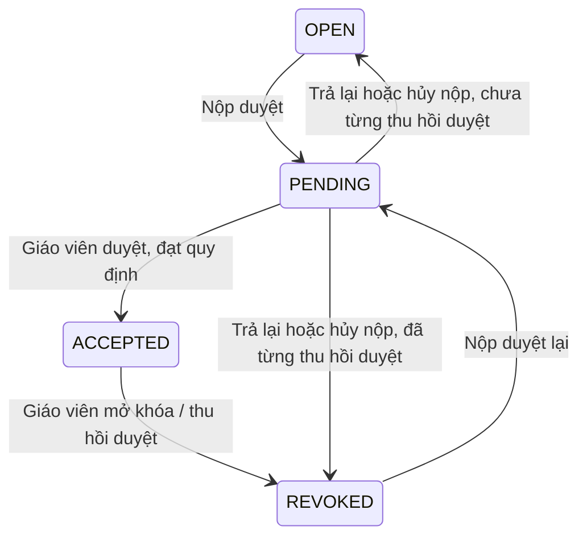

# Đề xuất thống nhất flow sắp nhóm, duyệt nhóm và deadline

Ngày phân tích: 16/10/2026. Trạng thái: **Đã được người dùng duyệt và triển khai**. Kết quả và hướng dẫn vận hành nằm trong [báo cáo triển khai 17](17-trien-khai-flow-nhom-deadline-theo-lop.md).

Cập nhật theo làm rõ của người dùng: **gia hạn/mở lại theo lớp hoặc tất cả lớp của deadline; không chọn riêng nhóm**. Trong lớp được mở, quyền sửa tiếp tục phụ thuộc trạng thái duyệt của từng nhóm.

## 1. Yêu cầu và cách hiểu đề xuất

1. Giáo viên được phân công lớp được sắp xếp nhóm cả khi deadline đang mở lẫn đã hết hạn. Quyền này áp dụng giống nhau cho nhóm chưa từng duyệt và nhóm đã được bỏ duyệt để sửa lại.
2. Nhóm đã duyệt vẫn khóa cơ cấu. Giáo viên cần chủ động **Mở khóa / Thu hồi duyệt** trước khi sửa; sau đó có thể sửa và duyệt lại mà không cần mở deadline cho sinh viên.
3. Sinh viên chỉ được thao tác khi deadline đang mở **và** trạng thái nhóm cho phép. Mở lại deadline không tự mở khóa nhóm đã duyệt.
4. Nút **Hủy deadline** được thay bằng **Kết thúc ngay**. Hành động này có hiệu lực như hết hạn thông thường và vẫn cho phép mở lại cùng phiên sau này.
5. Việc kết thúc, gia hạn hoặc mở lại deadline không tự đổi trạng thái nhóm, không xóa thành viên và không tạo phiên chọn nhóm mới.
6. Khi gia hạn/mở lại deadline, người dùng chọn **một hoặc nhiều lớp** hoặc **tất cả các lớp thuộc deadline đang thao tác**. Lớp không được chọn giữ nguyên thời hạn và quyền thao tác hiện có.
7. Thời gian mới áp dụng cho toàn bộ nhóm trong mỗi lớp được chọn. Không có danh sách chọn nhóm hay deadline riêng cho từng nhóm. Nhóm `ACCEPTED` vẫn khóa; nhóm nháp `OPEN/REVOKED` được sinh viên sửa khi thời gian của lớp đang mở.

Trong báo cáo, “mở khóa nhóm” được hiểu là hành động hiện có `ACCEPTED → REVOKED`. Khi thời gian của lớp đang mở, hành động này cũng cho phép sinh viên của nhóm tiếp tục thao tác theo quyền Leader/thành viên. Chọn lớp để gia hạn không đồng nghĩa với thu hồi duyệt bất kỳ nhóm nào.

## 2. Flow thực tế đang có và nguyên nhân bất nhất

| Nội dung | Hành vi trong source hiện tại | Hệ quả |
| --- | --- | --- |
| Giáo viên sửa nhóm `OPEN` | Không yêu cầu deadline `ACTIVE`, nhưng chặn phiên `CANCELLED` | Sửa được sau hạn tự nhiên |
| Giáo viên sửa nhóm `REVOKED` | `requireStaffEditable()` gọi lại policy dành cho sinh viên, bắt deadline `ACTIVE` | Cùng hết hạn nhưng nhóm đã bỏ duyệt lại không sửa được |
| Giao diện giáo viên | `canEditGroup()` cũng yêu cầu `ACTIVE` riêng cho `REVOKED` | Sửa backend riêng sẽ vẫn bị giao diện khóa nút/kéo thả |
| Nộp lại nhóm bởi giáo viên | Dùng `requireStaffEditable()` | Nhóm `REVOKED` sau hạn còn bị chặn cả bước nộp duyệt lại |
| Sinh viên | Mutation kiểm tra deadline `ACTIVE`, sau đó kiểm tra trạng thái nhóm và vai trò | Phần lớn đã đúng yêu cầu mới |
| Mở lại deadline | Thay `endTime`, giữ ID phiên, không chuyển nhóm `ACCEPTED` thành nháp | Đã đúng: mở deadline không tự bỏ duyệt nhóm |
| Deadline dùng chung nhiều lớp | `Deadline` chỉ có một `endTime`; `school_class_deadline` hiện là liên kết Many-to-Many không mang thời hạn riêng; `confirmedClassIds` chỉ xác nhận toàn bộ lớp bị ảnh hưởng | Chưa thể gia hạn riêng một lớp bằng cách chỉ thay payload hoặc chọn checkbox; sửa `endTime` chung sẽ tác động cả lớp không được chọn |
| Hủy deadline | Ghi `status = CANCELLED`; status này ưu tiên hơn đồng hồ | Khóa cả giáo viên và sinh viên, không cho gia hạn/mở lại |
| Đồng bộ giao diện khi hủy | Cache bị đặt `canManageGroups=false`, `canReview=false`, `canReopen=false` | Không thể chỉ thay chữ trên nút để sửa nghiệp vụ |
| Kiểm thử hiện tại | Có test yêu cầu `REVOKED` sau hạn bị chặn và `CANCELLED` không được mở lại | Phải sửa tiêu chí kiểm thử cũ cùng với nghiệp vụ |

Các vị trí đã đối chiếu:

- [GroupService.java](../server/src/main/java/com/fmaking/service/GroupService.java): `getWorkspace`, `requireStaffEditable`, `validateManagementDeadline`, `revokeGroup`, `lecturerSubmitGroup`, `rejectGroup`, `cancelSubmitGroup`.
- [DeadlinePolicy.java](../server/src/main/java/com/fmaking/service/DeadlinePolicy.java) và [DeadlineStatus.java](../server/src/main/java/com/fmaking/domain/DeadlineStatus.java): phân giải trạng thái và điều kiện ghi.
- [DeadlineService.java](../server/src/main/java/com/fmaking/service/DeadlineService.java): `updateDeadline`, `cancelOrDeleteDeadline`, DTO quyền thao tác.
- [LecturerGroupWorkspacePage.tsx](../Client/src/pages/lecturer/LecturerGroupWorkspacePage.tsx): `canEditGroup`, kéo thả, thêm/xóa thành viên và gửi duyệt.
- [realtime.ts](../Client/src/features/deadline/realtime.ts), [DeadlineTable.tsx](../Client/src/features/deadline/components/DeadlineTable.tsx), các trang deadline Admin/Giáo viên và thông báo VI/EN.
- [Tài liệu flow trước đó](15-group-session-deadline-approval.md): đang quy định `REVOKED` phải `ACTIVE` kể cả giáo viên. Yêu cầu mới thay thế quy định này.

Đây là phân tích source và các test hiện có; không khẳng định trạng thái dữ liệu hoặc bản backend đang chạy thực tế đã được kiểm chứng trong lượt này.

## 3. Quy tắc phân quyền mới

Hai điều kiện được kiểm tra độc lập:

- **Thời gian:** sinh viên phải tuân thủ deadline hiệu lực của **lớp mình**; giáo viên quản lý lớp không bị ràng buộc bởi thời gian mở/đóng.
- **Trạng thái nhóm:** `ACCEPTED` khóa cơ cấu; muốn sửa phải thu hồi duyệt. `PENDING` cần trả lại trước khi sửa cơ cấu.

“Không bị ràng buộc deadline” không bỏ qua quyền quản lý lớp, tính hợp lệ của thành viên, Leader, giới hạn số lượng hoặc các quy định nhóm đang bật.

Trong bảng dưới đây, `ACTIVE/EXPIRED/UPCOMING` là trạng thái theo thời gian hiệu lực của lớp được truy cập. Cùng một deadline có thể đang mở cho lớp A nhưng đã hết hạn ở lớp B sau khi gia hạn riêng lớp A.

| Deadline | Nhóm | Sinh viên | Giáo viên quản lý lớp |
| --- | --- | --- | --- |
| `ACTIVE` | `OPEN` | Được thao tác theo vai trò | Được chỉnh sửa, phân bổ, gửi duyệt |
| `ACTIVE` | `REVOKED` | Được thao tác theo vai trò vì đã được mở khóa | Được chỉnh sửa, phân bổ, gửi duyệt |
| `ACTIVE` | `PENDING` | Không sửa cơ cấu; Leader được hủy nộp | Được duyệt hoặc trả lại; trả lại trước khi sửa |
| `ACTIVE` | `ACCEPTED` | Không được sửa, dù vừa mở lại deadline | Mở khóa trước khi sửa |
| `EXPIRED` | `OPEN` hoặc `REVOKED` | Chỉ xem; không được nộp/hủy nộp hay sửa | Được chỉnh sửa, phân bổ và gửi duyệt lại |
| `EXPIRED` | `PENDING` | Chỉ xem | Được duyệt hoặc trả lại rồi sửa |
| `EXPIRED` | `ACCEPTED` | Chỉ xem | Được mở khóa rồi sửa và duyệt lại |
| `UPCOMING` | Nhóm hợp lệ trong phiên | Chỉ xem, chưa được thao tác | Được chuẩn bị/phân bổ nhóm theo quyền hiện có |
| Bất kỳ | `DISBANDED` | Không chỉnh sửa nhóm đã giải tán | Không chỉnh sửa nhóm đã giải tán |

Phạm vi “chỉnh sửa” của giáo viên gồm tạo nhóm nháp, thêm/xóa/chuyển thành viên, đổi Leader, giải tán nhóm nháp và gửi duyệt. Chuyển thành viên phải kiểm tra trạng thái của **cả nhóm nguồn và nhóm đích**.

Sinh viên vẫn phải tuân thủ quyền hiện có: Leader thực hiện nộp/hủy nộp, đổi Leader; thành viên không được tự lấy quyền Leader. Sinh viên chưa có nhóm chỉ được tạo/tham gia khi deadline `ACTIVE`; nhóm đích phải là nhóm nháp hợp lệ.

Admin giữ quyền quản lý hiện có. Giảng viên/giảng viên phụ trách chỉ được ghi nhóm ở lớp được phân công; việc đọc rộng hơn của giảng viên phụ trách không tự cấp quyền sửa/mở khóa.

## 4. Flow nhóm sau khi sửa

- Giáo viên đi qua các bước trên không cần deadline `ACTIVE`.
- Các bước do sinh viên thực hiện vẫn cần deadline `ACTIVE`.
- `ACCEPTED` không chuyển trạng thái chỉ vì hết hạn, gia hạn hoặc mở lại deadline.
- Giữ lịch sử thu hồi duyệt. Không đổi `REVOKED` thành `OPEN` để né kiểm tra.
- Nhóm sửa xong phải nộp và duyệt lại, không tự khôi phục `ACCEPTED`.
- Việc phân bổ nháp vẫn cho phép nhóm chưa đủ điều kiện tối thiểu; nộp/duyệt phải kiểm tra lại đầy đủ quy định hiện hành.

Ví dụ đúng yêu cầu: hết hạn → giáo viên duyệt → mở khóa → sửa thành viên → nộp lại → duyệt lại. Toàn bộ chuỗi này thực hiện được trong khi deadline vẫn `EXPIRED`; sinh viên chỉ xem.

## 5. Thay “Hủy deadline” bằng “Kết thúc ngay”

### 5.1. Phương án triển khai đề xuất

Ưu tiên sửa tối thiểu, tái sử dụng cơ chế hết hạn theo thời gian hiện có:

1. Khi phiên đang `ACTIVE`, người có quyền bấm **Kết thúc ngay** và xác nhận.
2. Backend khóa bản ghi deadline, kiểm tra lại quyền và trạng thái tại thời điểm xử lý.
3. Đặt `endTime` bằng thời gian server hiện tại. Không ghi `CANCELLED`; không xóa deadline.
4. Trạng thái hiệu lực trở thành `EXPIRED` ngay tại thời điểm đó, giống hết hạn tự nhiên.
5. Ghi thông tin người sửa/thời gian sửa bằng audit hiện có; phát sự kiện `DEADLINE_CLOSED` sau commit, kèm trạng thái `EXPIRED`, thời gian và version mới.
6. Sinh viên dừng mọi thao tác ghi. Giáo viên tiếp tục quản lý theo bảng quyền ở mục 3.
7. Vẫn hiển thị **Mở lại**. Mở lại dùng cùng ID phiên, đặt `endTime` mới trong tương lai và phát `DEADLINE_REOPENED`.

Theo phương án này, mốc kết thúc dự kiến cũ được thay bằng mốc kết thúc thực tế. Audit hiện có chỉ giữ lần sửa gần nhất; sự kiện realtime không phải nhật ký lưu trữ lâu dài. Nếu cần giữ toàn bộ lịch sử đóng/mở và hạn cũ, phải bổ sung lịch sử deadline trong một thay đổi riêng.

### 5.2. Các trạng thái ngoài `ACTIVE`

| Trạng thái | Hành vi đề xuất |
| --- | --- |
| `ACTIVE` | Cho **Kết thúc ngay** |
| `EXPIRED` | Không cần đóng thêm; gọi lặp trả kết quả hiện tại, không đổi `endTime`/version vô ích |
| `UPCOMING` | Đề xuất không hiện **Kết thúc ngay**, vẫn cho chỉnh lịch trước khi bắt đầu |
| `CANCELLED` cũ | Có hướng khôi phục ở mục 7; không tiếp tục sinh thêm bản ghi hủy vĩnh viễn |

**Điểm cần duyệt:** đề xuất nút mới chỉ áp dụng cho phiên đang mở. Đóng một phiên chưa bắt đầu cần quy tắc riêng vì đặt `endTime = now` sẽ làm thời gian kết thúc sớm hơn thời gian bắt đầu; source hiện tại còn ưu tiên kiểm tra `UPCOMING`. Nếu muốn đóng cả phiên chưa bắt đầu, cần bổ sung trạng thái đóng chủ động hoặc metadata đóng, đồng bộ resolver backend/frontend và quy tắc mở lại. Không mặc định đổi `startTime` để né vấn đề này.

### 5.3. Mở lại và deadline dùng chung nhiều lớp

- Deadline đã hết hạn tự nhiên và deadline kết thúc sớm dùng chung flow mở lại.
- Vì mốc kết thúc đã trở thành mốc đóng thực tế, hạn mở lại của lớp chỉ cần lớn hơn thời gian hiện tại và hợp lệ với `startTime`; không bắt buộc vượt hạn dự kiến đã bị thay thế. Lớp vẫn đang mở chỉ được gia hạn đến mốc muộn hơn hạn hiệu lực hiện tại.
- Giữ danh sách lớp của phiên; không tạo deadline mới để phục hồi quyền thao tác.
- **Gia hạn/mở lại:** chọn lớp cần áp dụng hoặc tất cả lớp của deadline. Chỉ lớp được chọn nhận hạn mới; các lớp khác giữ nguyên.
- **Kết thúc ngay:** trong phạm vi đề xuất hiện tại, vẫn kết thúc toàn bộ lớp của deadline sau khi xác nhận đủ lớp. Phải kết thúc cả các thời hạn đã gia hạn riêng, không chỉ sửa hạn chung rồi để lớp có hạn riêng tiếp tục mở.
- Admin được chọn mọi lớp thuộc deadline. Giáo viên chỉ được gia hạn/mở lại lớp được phân công; được chọn lớp mình dù deadline còn liên kết lớp của giáo viên khác. Muốn áp dụng cho tất cả lớp hoặc kết thúc toàn bộ deadline phải có quyền với toàn bộ lớp bị ảnh hưởng.
- Sau mở lại lớp: nhóm `OPEN/REVOKED` cho phép sinh viên thao tác; `ACCEPTED` tiếp tục khóa; `PENDING` không sửa cơ cấu trực tiếp, Leader có thể hủy nộp trước khi sửa.

### 5.4. Flow chọn lớp khi gia hạn/mở lại

1. Mở hộp thoại **Gia hạn / Mở lại thời gian chọn nhóm** của deadline.
2. Chọn **Các lớp được chọn** hoặc **Tất cả các lớp của deadline**. Không chọn mặc định tất cả một cách âm thầm; hiển thị rõ danh sách lớp và hạn hiện tại.
3. Với chế độ chọn lớp, đánh dấu một hoặc nhiều lớp. Lớp ngoài quyền quản lý không được chọn; backend vẫn phải xác thực lại quyền.
4. Nhập hạn kết thúc mới áp dụng chung cho các lớp được chọn. Nếu danh sách có cả lớp đang mở và đã hết hạn, kiểm tra điều kiện tương ứng của từng lớp; không rút ngắn hạn lớp đang mở.
5. Hiển thị xác nhận đúng các lớp sẽ thay đổi và thông báo: “Nhóm đã duyệt tiếp tục khóa; nhóm nháp được chỉnh sửa theo thời gian mới của lớp.”
6. Backend cập nhật toàn bộ lớp được chọn trong một transaction. Nếu bất kỳ lớp nào không hợp lệ hoặc không đủ quyền, từ chối toàn bộ request; không âm thầm bỏ qua lớp.
7. Đồng bộ trạng thái và thời gian mới tới đúng các lớp thay đổi. Các lớp không chọn giữ thời gian cũ, kể cả khi đang mở hoặc đã hết hạn.

Ví dụ: deadline có lớp A và B; lớp A có 10 nhóm, gồm 7 nhóm chưa duyệt và 3 nhóm đã duyệt. Chọn gia hạn **lớp A** đến 20:00 sẽ mở thời gian cho cả lớp A. Các nhóm nháp trong 7 nhóm chưa duyệt được sửa; 3 nhóm đã duyệt vẫn khóa. Nhóm đang `PENDING` giữ bước hủy nộp/trả lại trước sửa. Lớp B giữ nguyên hạn. Chọn **tất cả lớp** thì A và B cùng nhận hạn mới, vẫn kiểm tra trạng thái duyệt riêng từng nhóm.

Sinh viên chưa có nhóm trong lớp được mở lại vẫn được tạo/tham gia theo quy định hiện có. Việc chọn lớp không giới hạn vào các nhóm đã tồn tại và không cho tham gia nhóm đã duyệt.

### 5.5. Thay đổi mô hình thời gian cần thiết

Source hiện tại dùng một `Deadline.endTime` cho mọi lớp liên kết. Để lớp A nhận hạn mới mà lớp B giữ hạn cũ, đề xuất:

- Giữ nguyên deadline ID, nhóm, membership và danh sách lớp liên kết.
- Chuyển liên kết `school_class_deadline` thành entity có thể lưu thời hạn theo lớp, ví dụ cột nullable `end_time_override`. Hạn hiệu lực của lớp là giá trị này nếu có, nếu không dùng `Deadline.endTime`.
- Gia hạn riêng chỉ cập nhật hạn của lớp được chọn. Gia hạn tất cả phải cập nhật tất cả hạn hiệu lực cùng lúc, xử lý cả override cũ để không còn lớp dùng hạn lỗi thời.
- Tất cả kiểm tra Student, DTO validation/activity/Workspace/Review, đồng hồ đếm ngược và sự kiện realtime phải dùng **hạn hiệu lực theo lớp**, không tiếp tục đọc trực tiếp hạn chung.
- Danh sách quản lý hiển thị thời gian/trạng thái theo lớp; nếu khác nhau thì hiện “Khác nhau theo lớp” và chi tiết từng lớp. Không dùng một nhãn `ACTIVE` chung để khẳng định mọi lớp đều đang mở.
- Scheduler phải lập lịch theo deadline và lớp; thay đổi một lớp không được hủy mất lịch của các lớp khác. Mutation khóa và kiểm tra lại cùng nguồn thời hạn với scheduler/DTO.
- Bổ sung migration cột nullable, giữ giá trị null cho liên kết cũ để hành vi trước gia hạn riêng không đổi. Không tách thành deadline mới vì sẽ phá nguyên tắc một phiên và liên kết nhóm hiện tại.

Đây là phạm vi bổ sung so với bản báo cáo đầu: **gia hạn theo lớp cần thay đổi mô hình lưu thời hạn**, không chỉ sửa giao diện.

Thông báo xác nhận đề xuất:

> Kết thúc thời gian chọn nhóm ngay cho các lớp đã liệt kê? Sinh viên sẽ dừng chỉnh sửa. Giáo viên vẫn có thể quản lý nhóm và mở lại thời gian chọn nhóm sau.

## 6. Các tình huống cần nhìn thấy trên giao diện

| Tình huống | Kết quả mong đợi |
| --- | --- |
| Hết hạn, nhóm chưa từng được duyệt | Giáo viên sửa được; sinh viên chỉ xem |
| Hết hạn, giáo viên vừa bỏ duyệt nhóm | Giáo viên sửa được ngay; sinh viên vẫn chỉ xem |
| Nhóm đã duyệt, giáo viên mở lại deadline | Sinh viên vẫn bị khóa nhóm |
| Nhóm đã duyệt, giáo viên mở khóa nhưng chưa mở deadline | Giáo viên sửa được; sinh viên vẫn chỉ xem |
| Nhóm đã được mở khóa và deadline đang mở | Sinh viên sửa theo quyền Leader/thành viên |
| Bấm Kết thúc ngay | Trạng thái Đã hết hạn; không hiện Đã hủy; vẫn có Mở lại |
| Mở lại sau khi kết thúc ngay | Cùng phiên, giữ nhóm/thành viên; chỉ nhóm nháp được sinh viên thao tác |
| Gia hạn lớp A, không chọn lớp B cùng deadline | Toàn bộ nhóm của A dùng thời gian mới, vẫn khóa nhóm đã duyệt; B giữ hạn và quyền hiện có |
| Chọn tất cả lớp khi gia hạn | Mọi lớp thuộc deadline nhận hạn mới nếu người thao tác đủ quyền; không tự thu hồi duyệt nhóm |
| Chuyển người giữa nhóm nháp và nhóm đã duyệt | Chặn đến khi nhóm đã duyệt được mở khóa |

Thông báo trong Workspace và trang Duyệt nhóm phải phân biệt:

- “Đã hết thời gian chọn nhóm. Sinh viên chỉ xem; giáo viên vẫn được quản lý nhóm.”
- “Nhóm đã được duyệt. Mở lại deadline không mở khóa nhóm.”
- “Đã thu hồi duyệt. Giáo viên có thể chỉnh sửa; sinh viên chỉ được chỉnh khi deadline đang mở.”

Đổi icon/thông báo phù hợp cho hành động kết thúc, cập nhật cả tiếng Việt và tiếng Anh. Bỏ câu hiện tại nói mọi chỉnh sửa sau mở khóa đều cần deadline hoạt động.

## 7. Dữ liệu `CANCELLED` đã tồn tại

Không tự động biến toàn bộ phiên cũ thành `ACTIVE`, vì có thể vô tình mở quyền sinh viên.

Phương án đề xuất cần được duyệt cùng báo cáo:

1. Kiểm kê read-only số phiên `CANCELLED`, lớp liên kết và các mốc thời gian.
2. Trong flow tương thích, coi phiên `CANCELLED` cũ là **đã đóng**, sinh viên luôn chỉ xem cho đến khi mở lại hợp lệ. Giáo viên quản lý lớp vẫn được thao tác nhóm theo trạng thái nhóm.
3. Cho người có quyền chủ động **Mở lại** các lớp được chọn của phiên cũ bằng hạn mới trong tương lai. Nếu chuyển trạng thái lưu chung từ `CANCELLED` về `ACTIVE`, phải đồng thời chuẩn hóa hạn nền thành đã hết hạn và chỉ đặt hạn mới cho các lớp được chọn; lớp không chọn không được tự mở do còn `endTime` cũ trong tương lai. Toàn bộ chuyển đổi thực hiện trong cùng transaction.
4. Giữ `cancelledAt/cancelledBy` cũ để truy vết, không dùng chúng như điều kiện khóa vĩnh viễn sau khi phiên đã mở lại.
5. Backend phải trả trạng thái hiệu lực nhất quán cho danh sách, validation, activity, Workspace và Review. Frontend không được lấy `endTime` cũ còn trong tương lai để tự bật lại phiên chưa được mở lại.

Đây là kế hoạch tương thích sẽ triển khai sau duyệt; lượt này chưa kiểm kê hay thay dữ liệu database. Nếu chọn phương án chỉ hỗ trợ phiên mới, các phiên `CANCELLED` cũ sẽ vẫn mắc kẹt, nên phương án đó không được khuyến nghị.

## 8. Phạm vi code dự kiến sửa sau khi được duyệt

| Thành phần | Nội dung sửa |
| --- | --- |
| `GroupService` | Bỏ kiểm tra deadline sinh viên trong `requireStaffEditable`; thống nhất `OPEN/REVOKED` cho toàn bộ thao tác giáo viên; xử lý quyền phiên đóng cũ nhất quán |
| `DeadlinePolicy`, `DeadlineStatus` | Phân biệt quyền sinh viên/giáo viên; tính trạng thái theo hạn hiệu lực từng lớp; hỗ trợ phiên hủy cũ theo mục 7 |
| Entity/repository và migration | Bổ sung thời hạn theo lớp trên liên kết `school_class_deadline`, giữ tương thích dữ liệu cũ và nguyên tắc một phiên |
| `DeadlineService`, `DeadlineResource` | Gia hạn/mở lại theo lớp hoặc tất cả lớp, kiểm tra quyền đúng phạm vi; thêm hành động kết thúc ngay và khôi phục phiên hủy cũ |
| API gia hạn/mở lại | Phân biệt phạm vi áp dụng với danh sách lớp liên kết, ví dụ `scope=SELECTED/ALL`, `targetClassIds`, `confirmedClassIds`; `schoolClassIds` không dùng để chuyển/xóa lớp khỏi phiên |
| API deadline | Đề xuất `POST /api/deadlines/{id}/close` với `confirmedClassIds`; không tiếp tục dùng DELETE với ý nghĩa hủy vĩnh viễn |
| Endpoint DELETE cũ | Trong giai đoạn tương thích, chuyển về cùng nghiệp vụ đóng, cùng kiểm tra quyền và xác nhận lớp; request thiếu xác nhận của phiên dùng chung phải bị từ chối |
| DTO/types | Thêm `canClose`, danh sách thời gian/trạng thái và quyền gia hạn theo lớp; validation/activity/Workspace/Review trả hạn của đúng lớp |
| Scheduler/realtime | Lịch bắt đầu/hết hạn theo lớp; nhận `DEADLINE_CLOSED`; sự kiện và version phân biệt đúng lớp; không ghi đè thời gian của lớp không thay đổi |
| Lecturer Workspace/Review | Đồng bộ nút, kéo thả, thêm/xóa/chuyển người, Leader, giải tán, nộp duyệt và nội dung mở khóa |
| Deadline Admin/Lecturer | Đổi nút đóng; hộp thoại gia hạn/mở lại có chọn lớp hoặc tất cả lớp, hiển thị hạn hiện tại từng lớp và phạm vi xác nhận |
| Student Workspace/Dashboard | Khóa ghi ngay khi hết hạn/đóng, giữ khóa `ACCEPTED` sau mở lại, đồng bộ sau mở khóa nhóm |
| VI/EN và tài liệu cũ | Cập nhật thuật ngữ, thông báo và các quy tắc mâu thuẫn trong tài liệu 15 |

Riêng việc đổi nút đóng đối với `ACTIVE` không cần cột mới, nhưng yêu cầu bổ sung **gia hạn theo lớp** cần migration thời hạn theo lớp ở mục 5.5. Chưa triển khai source hoặc migration trong lượt cập nhật báo cáo này. Đóng cả `UPCOMING` và lưu đầy đủ lịch sử đóng/mở vẫn là phạm vi cần quyết định riêng.

## 9. Kiểm thử và tiêu chí nghiệm thu

1. Cùng deadline `EXPIRED`, giáo viên sửa được cả `OPEN` và `REVOKED`: thêm/xóa/chuyển thành viên, đổi Leader, giải tán nhóm nháp, nộp và duyệt lại.
2. `ACCEPTED` luôn chặn sửa cơ cấu trước khi mở khóa; `PENDING` phải trả lại trước khi sửa. Nhóm nguồn/đích khi chuyển người cùng tuân thủ quy tắc.
3. Sinh viên bị chặn ở tất cả mutation khi `UPCOMING/EXPIRED/đã đóng`; kiểm thử gọi API trực tiếp, không chỉ kiểm tra nút.
4. Mở lại deadline không đổi `ACCEPTED`. Sinh viên chỉ sửa được sau mở khóa và khi deadline `ACTIVE`, đúng quyền Leader/thành viên.
5. Kết thúc ngay trả `EXPIRED`, giữ nguyên phiên/nhóm/thành viên; giáo viên vẫn quản lý được. Gọi đóng lặp không kéo dài hạn hoặc thay audit vô ích.
6. Mở lại sau đóng cho phép hạn mới sớm hơn hạn dự kiến ban đầu, miễn vẫn ở tương lai; có thể lặp đóng/mở nhiều lần cùng ID phiên.
7. Gia hạn riêng lớp A không đổi hạn, trạng thái hoặc quyền thao tác của B cùng deadline; gia hạn tất cả cập nhật đúng cả lớp có override cũ. Request phải xác nhận đúng lớp mục tiêu, đủ quyền và có hiệu lực toàn bộ hoặc không thay đổi gì.
8. Phiên `CANCELLED` cũ không tự mở cho sinh viên; có thể phục hồi chủ động và không mất dữ liệu nhóm hoặc audit cũ.
9. Realtime đóng/mở không khóa nhầm giáo viên. Response đọc cũ hoặc sự kiện version cũ không được bật lại nút sinh viên hay ghi đè trạng thái mới.
10. Giao dịch sinh viên đang chạy và thao tác đóng deadline được tuần tự hóa bằng khóa hiện có: giao dịch hoàn tất trước thao tác đóng được giữ; request ghi xử lý sau khi đóng commit phải bị từ chối.
11. Chuyển thành viên thất bại phải rollback cả nhóm nguồn/đích, Leader và history; giữ kiểm tra quy định nhóm, lớp/phiên, membership duy nhất.
12. Sửa các test cũ đang khẳng định giáo viên không được sửa `REVOKED` sau hạn hoặc phiên hủy không bao giờ được mở lại. Chạy các suite Group/Deadline, frontend tests liên quan, typecheck và build.
13. Lớp có 10 nhóm: mở lại lớp áp dụng thời gian cho cả 10 nhóm; chỉ nhóm nháp được sửa, nhóm đã duyệt không tự mở khóa. Không có chức năng chọn riêng nhóm trong modal gia hạn.
14. Giáo viên được gia hạn lớp mình trong deadline có lớp của giáo viên khác, nhưng không được đổi hạn lớp ngoài quyền; chọn tất cả khi thiếu quyền phải bị từ chối, không tự thu hẹp phạm vi.
15. Kiểm tra scheduler, cache, countdown, validation/activity/Workspace/Review khi cùng deadline có lớp `ACTIVE` và lớp `EXPIRED`; sự kiện của A không bật/tắt nhầm B.
16. Kết thúc ngay toàn deadline phải đóng cả lớp đã gia hạn riêng; mở lại chọn một lớp từ phiên `CANCELLED` cũ không mở ngầm các lớp khác. Migration giữ nguyên dữ liệu nhóm/thành viên và thời hạn hiệu lực cũ.

Kiểm thử ghi dùng database test riêng; báo cáo/test không tự thay đổi dữ liệu ứng dụng.

## 10. Các quyết định đề nghị duyệt

| Quyết định | Phương án đề nghị |
| --- | --- |
| Giáo viên sửa nhóm đã bỏ duyệt sau hạn | Cho phép đầy đủ như nhóm `OPEN`, không yêu cầu mở deadline |
| Ý nghĩa mở khóa nhóm | Một hành động thu hồi duyệt; sinh viên chỉ được sửa tiếp khi deadline cũng đang mở |
| Phạm vi gia hạn/mở lại | Chọn lớp hoặc tất cả lớp thuộc deadline, không chọn nhóm; lớp không chọn giữ hạn cũ |
| Nhóm trong lớp được gia hạn | Toàn lớp dùng thời gian mới; `OPEN/REVOKED` được sửa, `ACCEPTED` vẫn khóa, `PENDING` giữ bước hủy nộp/trả lại |
| Lưu thời hạn theo lớp | Bổ sung thời hạn tại liên kết `school_class_deadline`, giữ cùng phiên và nhóm, migration tương thích dữ liệu cũ |
| `PENDING/ACCEPTED` | Giữ bước trả lại/mở khóa trước sửa; không sửa trực tiếp cơ cấu nhóm đang chờ/đã duyệt |
| Thay Hủy deadline | Kết thúc ngay đối với `ACTIVE`; `EXPIRED` được mở lại; `UPCOMING` tiếp tục chỉnh lịch |
| Hạn cũ sau kết thúc ngay | Thay bằng mốc đóng thực tế; chưa bổ sung lịch sử deadline riêng |
| Phiên `CANCELLED` cũ | Hỗ trợ quản lý và mở lại có kiểm soát theo mục 7, không tự mở quyền sinh viên |

Người dùng đã duyệt triển khai theo phần làm rõ gia hạn theo lớp. Các mục đề xuất phía trên được giữ làm cơ sở đối chiếu; trạng thái triển khai thực tế và kết quả kiểm thử được ghi trong báo cáo 17.
