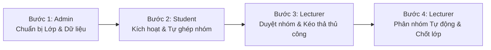

# F-Group Making — Tài liệu Giới thiệu & Thuyết trình MVP (EXE101)

> **Dự án:** F-Group Making (Hệ thống Quản lý Lớp học & Hỗ trợ Phân nhóm Sinh viên Tự động)  
> **Môn học:** Khởi nghiệp Đổi mới Sáng tạo (EXE101) — Đại học FPT  
> **Vai trò:** Business Analyst (BA) kiêm Phụ trách Nội dung Thuyết trình MVP  
> **Phiên bản:** MVP 1.0 (Cập nhật đối chiếu mã nguồn thực tế: Tháng 10/2026)  
> **Tài liệu liên quan:** `docs/19-smart-automatic-allocation.md`, `docs/18-board-sap-nhom-nang-cao.md`, `docs/17-trien-khai-flow-nhom-deadline-theo-lop.md`.

---

## MỤC LỤC
1. [A. Giới thiệu dự án](#a-giới-thiệu-dự-án)
2. [B. Tổng quan MVP & Trạng thái phát triển](#b-tổng-quan-mvp--trạng-thái-phát-triển)
3. [C. Các luồng hoạt động chính trong hệ thống](#c-các-luồng-hoạt-động-chính-trong-hệ-thống)
4. [D. Giải thích trực quan về Phân nhóm Tự động (Smart Automatic Allocation)](#d-giải-thích-trực-quan-về-phân-nhóm-tự-động-smart-automatic-allocation)
5. [E. Kịch bản Demo thực tế (Step-by-Step Live Demo Script)](#e-kịch-bản-demo-thực-tế-step-by-step-live-demo-script)

---

## A. GIỚI THIỆU DỰ ÁN

### 1. F-Group Making là gì?
**F-Group Making** là nền tảng quản lý lớp học và hỗ trợ chia nhóm thông minh, được thiết kế chuyên biệt cho môi trường đào tạo đại học theo định hướng dự án thực tế, điển hình như môn học **EXE101**, Đồ án Tốt nghiệp (Capstone Project) tại Đại học FPT. 

Hệ thống kết hợp hài hòa giữa **tính chủ động của sinh viên** (tự tìm bạn, tự thành lập nhóm theo nguyện vọng) và **quyền kiểm soát chặt chẽ của giảng viên** (thiết lập quy chế lớp, duyệt nhóm, phân bổ thủ công và phân bổ tự động bằng thuật toán thông minh).

### 2. Hệ thống dành cho ai? (Đối tượng sử dụng)
* **Quản trị viên (Admin):** Quản lý học kỳ, nhập danh sách giảng viên, sinh viên, danh mục chuyên ngành, khởi tạo lớp học và phân công giảng viên phụ trách.
* **Giảng viên (Lecturer / Lecturer Master):** Cấu hình quy định nhóm của lớp (sĩ số, đa ngành, yêu cầu Kỹ thuật phần mềm - SE), thiết lập thời hạn (deadline) tạo nhóm, duyệt nhóm sinh viên nộp lên, can thiệp xếp nhóm thủ công trên bảng kéo thả và vận hành tính năng xếp nhóm tự động.
* **Sinh viên (Student):** Kích hoạt tài khoản, cập nhật hồ sơ năng lực (bio/mô tả bản thân), tìm kiếm đồng đội hoặc nhóm phù hợp thông qua điểm tương thích (Compatibility Score), tạo nhóm, mời thành viên và nộp nhóm lên giảng viên xét duyệt.

### 3. Vấn đề thực tế mà sinh viên và giảng viên đang gặp phải
* **Đối với Sinh viên:**
  * **"Bơ vơ" không tìm được nhóm:** Sinh viên học trái lớp, sinh viên ít mối quan hệ thường bị cô lập, không biết nhóm nào còn thiếu người hoặc ai chưa có nhóm để liên hệ.
  * **Khó khăn trong việc tìm thành viên đa chuyên ngành:** Các môn học liên ngành (như EXE101 đòi hỏi kết hợp giữa Kỹ thuật phần mềm, Kinh doanh quốc tế, Thiết kế đồ họa...) khiến sinh viên khó tìm kiếm đồng đội khác chuyên ngành.
  * **Rủi ro nhóm không hợp lệ phút chót:** Sinh viên tự gom nhóm qua chat (Zalo, Messenger) nhưng đến ngày chốt sổ mới phát hiện thiếu chuyên ngành bắt buộc hoặc không đủ sĩ số tối thiểu.
* **Đối với Giảng viên:**
  * **Quá tải quản lý thủ công:** Giảng viên phải kiểm tra danh sách nhóm qua Google Sheets/Excel với hàng trăm sinh viên, dễ sai sót, mất nhiều giờ để kiểm đếm xem nhóm đã đủ người, đủ ngành chưa.
  * **Xử lý sinh viên dư thừa (Unassigned) mệt mỏi:** Sau hạn chót, luôn có 10–20% sinh viên chưa có nhóm. Giảng viên phải tự "nhét" thủ công vào các nhóm mà không biết nhóm nào đang thiếu người hay có vi phạm quy định về ngành không.
  * **Thiếu công cụ trực quan và tức thời:** Không có hệ thống theo dõi trạng thái nhóm thời gian thực, không có cơ chế cảnh báo vi phạm quy chế lớp tức thì.

### 4. Giải pháp của F-Group Making
F-Group Making số hóa toàn diện quy trình tạo và quản lý nhóm theo 3 giai đoạn:
1. **Thiết lập & Tự do có kiểm soát:** Giảng viên đặt luật cho từng lớp (ví dụ: 4–6 thành viên/nhóm, tối thiểu 2 chuyên ngành, bắt buộc ít nhất 1 bạn ngành SE). Sinh viên tự tìm bạn qua hệ thống gợi ý tương thích và nộp nhóm trong thời hạn quy định.
2. **Duyệt nhóm & Điều chỉnh linh hoạt:** Giảng viên duyệt các nhóm đạt chuẩn để "bảo vệ" nhóm đó. Với các sinh viên còn sót lại, giảng viên có thể dùng **Bảng sắp nhóm nâng cao (kéo thả trực quan)** để điều chỉnh nhanh.
3. **Phân nhóm tự động thông minh (Smart Automatic Allocation):** Chỉ với 1 click, hệ thống tự động tính toán, phân bổ toàn bộ sinh viên chưa có nhóm vào các nhóm phù hợp, cam kết **đạt 100% quy chế lớp**, **cân bằng sĩ số tối đa** (chênh lệch không quá 1 sinh viên giữa các nhóm) và **tuyệt đối tôn trọng các nhóm sinh viên đã tự tạo hợp lệ**.

### 5. Giá trị mang lại so với cách chia nhóm truyền thống

| Tiêu chí so sánh | Cách truyền thống (Excel / Google Sheets) | Với F-Group Making |
| :--- | :--- | :--- |
| **Thời gian chốt nhóm** | 1 – 2 tuần qua nhiều kênh chat rời rạc | Vài phút sau khi hết hạn tạo nhóm |
| **Kiểm soát quy chế lớp** | Giảng viên tự đếm mắt từng dòng, dễ sót | Hệ thống tự động kiểm tra 7 quy định tức thời |
| **Sinh viên chưa có nhóm** | Bị bỏ quên hoặc xếp đại, bất mãn | Được thuật toán tự sắp xếp cân đối, bảo vệ quyền lợi |
| **Tính đa dạng chuyên ngành** | Thường lệch ngành (nhóm toàn IT, nhóm toàn Kinh tế) | Tự động cân đối đa ngành và phân bổ đều nhân sự SE |
| **Minh bạch & Trực quan** | File Excel dễ bị ghi đè, không có lịch sử | Lịch sử phân nhóm rõ ràng, xem trước (Preview) trước khi áp dụng |

---

## B. TỔNG QUAN MVP & TRẠNG THÁI PHÁT TRIỂN

Dựa trên việc kiểm tra, đối chiếu trực tiếp mã nguồn Frontend (React + TypeScript), Backend (Spring Boot + Java 21) và cơ sở dữ liệu:

> **Nguyên tắc thẩm định BA:**
> * **[Hoàn thành - Sẵn sàng Demo]:** Mã nguồn BE & FE đầy đủ, giao diện hoàn thiện, đã có kiểm thử đơn vị / thành phần pass tốt, có thể trình diễn ngay trên luồng chuẩn.
> * **[Đã triển khai - Cần xác minh E2E]:** Mã nguồn hoàn chỉnh, logic nghiệp vụ chặt chẽ, đã pass test môi trường giả lập (H2/MySQL test), nhưng cần kiểm thử thực tế trên cơ sở dữ liệu ứng dụng thật hoặc cần cấu hình dịch vụ ngoài (như SMTP email).
> * **[Đang phát triển / Định hướng tương lai]:** Ý tưởng nâng cao, chưa đưa vào phạm vi bản phát hành hiện tại.

### Bảng tổng hợp chức năng MVP

| Phân hệ / Chức năng | Vai trò | Vấn đề giải quyết | Trạng thái thực tế trong mã nguồn |
| :--- | :--- | :--- | :--- |
| **Quản trị hệ thống & Dữ liệu nền tảng** | Admin | Khởi tạo môi trường học tập, học kỳ, ngành học, lớp học và phân công giảng viên. | **[Hoàn thành - Sẵn sàng Demo]** Quản lý kỳ học, lớp học, gán giảng viên phụ trách đầy đủ. |
| **Nhập dữ liệu Excel (Sinh viên & Giảng viên)** | Admin | Giúp nhập hàng trăm sinh viên/lớp trong vài giây thay vì nhập tay. | **[Hoàn thành - Sẵn sàng Demo]** Hỗ trợ đọc file Excel, xem trước dữ liệu, cảnh báo ngành mới. |
| **Kích hoạt tài khoản người dùng** | Student, Lecturer | Tự thiết lập mật khẩu bảo mật qua liên kết gửi về tài khoản cá nhân. | **[Đã triển khai - Sẵn sàng Demo]** Màn hình kích hoạt và đổi mật khẩu hoạt động tốt (email demo dùng tài khoản cấp sẵn hoặc link trực tiếp). |
| **Cấu hình Quy chế phân nhóm theo Lớp** | Lecturer, Admin | Cho phép mỗi lớp học có quy định nhóm riêng linh hoạt (sĩ số, ngành, SE). | **[Hoàn thành - Sẵn sàng Demo]** 7 quy định chuẩn hóa, bật/tắt và chỉnh sửa giá trị trực tiếp. |
| **Quản lý Thời hạn (Deadline) theo Lớp** | Lecturer, Admin | Đặt khung thời gian sinh viên được tự chọn nhóm; gia hạn/mở lại theo từng lớp. | **[Hoàn thành - Sẵn sàng Demo]** Hỗ trợ gia hạn theo từng lớp, kết thúc sớm, đồng bộ thời gian thực. |
| **Sinh viên tự lập nhóm & Quản lý nhóm** | Student | Sinh viên chủ động tìm bạn, lập nhóm, đổi trưởng nhóm, mời thành viên. | **[Hoàn thành - Sẵn sàng Demo]** Giao diện Chọn nhóm, Tạo nhóm, Nộp duyệt, Rời nhóm hoàn chỉnh. |
| **Điểm tương thích (Compatibility Score)** | Student | Gợi ý nhóm phù hợp cho sinh viên còn lẻ và gợi ý sinh viên cho nhóm còn thiếu. | **[Hoàn thành - Sẵn sàng Demo]** Tính điểm 10–100 dựa trên nhu cầu SE, đa ngành, sĩ số và bio. |
| **Giảng viên Duyệt / Từ chối nhóm** | Lecturer | Giảng viên kiểm định chất lượng nhóm; phê chuẩn để bảo vệ nhóm hợp lệ. | **[Hoàn thành - Sẵn sàng Demo]** Duyệt (Accept), Từ chối (Reject kèm lý do), Thu hồi duyệt (Revoke). |
| **Phân bổ Thủ công (Board Sắp nhóm Nâng cao)** | Lecturer | Giảng viên trực tiếp kéo thả sinh viên vào nhóm hoặc xử lý trường hợp đặc biệt. | **[Hoàn thành - Sẵn sàng Demo]** Kéo thả trực quan, chuyển nhóm nguyên tử, tự cuộn thông minh. |
| **Phân bổ Tự động (Smart Automatic Allocation)** | Lecturer | Xếp toàn bộ sinh viên còn lại vào nhóm chuẩn chỉ với 1 click, cân bằng sĩ số. | **[Đã triển khai - Cần xác minh E2E]** FE/BE đầy đủ (Range, Suggestion, Random, Preview, History, Atomic Apply); cần chạy rehearsal trên DB thật. |
| **Điểm cấu trúc nhóm (Group Score)** | Lecturer | Đo lường mức độ hoàn thiện quy chế của nhóm theo tỷ lệ % trực quan. | **[Hoàn thành - Sẵn sàng Demo]** Thang điểm 100% dựa trên 3 tiêu chí: Sĩ số (40), Đa ngành (35), SE (25). |
| **Hoàn tác phân nhóm tự động (Undo Allocation)** | Lecturer | Khôi phục trạng thái lớp trước khi bấm Áp dụng phân bổ tự động. | **[Chưa triển khai - Định hướng v2]** Phiên bản đầu cam kết an toàn bằng cơ chế Xem trước (Preview) kỹ lưỡng; chưa có nút Undo sau khi đã Apply. |

---

## C. CÁC LUỒNG HOẠT ĐỘNG CHÍNH TRONG HỆ THỐNG

### Luồng 1: Chuẩn bị lớp học và Quy chế nhóm
* **Người thực hiện:** Admin & Giảng viên.
* **Mục đích:** Khởi tạo dữ liệu lớp học, phân công giảng viên và thiết lập luật chơi rõ ràng cho sinh viên trước khi bắt đầu môn học.
* **Trình tự các bước:**
  1. Admin đăng nhập, chọn Học kỳ (ví dụ: `FALL26`).
  2. Admin tải lên file Excel danh sách sinh viên và giảng viên qua màn hình Import. Hệ thống kiểm tra dữ liệu, tự động tạo tài khoản và gán sinh viên vào đúng lớp.
  3. Admin tạo lớp học (School Class) và phân công Giảng viên phụ trách.
  4. Giảng viên đăng nhập, vào chi tiết lớp học và kiểm tra **Quy định nhóm (Class Rules)**.
  5. Giảng viên cấu hình 7 quy định theo yêu cầu môn học (ví dụ EXE101: Sĩ số 4–6 bạn; Tối thiểu 2 ngành; Tối thiểu 1 bạn ngành SE).
  6. Giảng viên tạo **Deadline tạo nhóm** cho lớp, thiết lập ngày bắt đầu và kết thúc.
* **Ví dụ thực tế:** Lớp `EXE101_G102` có 36 sinh viên. Thầy phân công đặt thời hạn chọn nhóm kéo dài trong 7 ngày, quy định nhóm từ 4–6 thành viên và phải có ít nhất 1 bạn Kỹ thuật phần mềm (SE) để làm sản phẩm MVP.
* **Kết quả cuối cùng:** Lớp học sẵn sàng, quy định được lưu trữ và deadline chuyển sang trạng thái `ACTIVE`.
* **Trạng thái triển khai:** Đã hoàn thành 100%, sẵn sàng demo.
* **Màn hình demo:** `Admin -> Import Sinh viên`, `Giảng viên -> Chi tiết lớp học & Quy định nhóm`, `Quản lý Deadline`.

---

### Luồng 2: Sinh viên tham gia hệ thống và Kích hoạt tài khoản
* **Người thực hiện:** Sinh viên.
* **Mục đích:** Xác thực danh tính sinh viên, tạo mật khẩu cá nhân và cập nhật hồ sơ năng lực để chuẩn bị ghép nhóm.
* **Trình tự các bước:**
  1. Sinh viên mở đường link kích hoạt nhận qua email trường (có chứa mã xác thực an toàn `?key=...`).
  2. Hệ thống kiểm tra tính hợp lệ của mã kích hoạt và hiển thị họ tên, mã số sinh viên (MSSV).
  3. Sinh viên tự đặt mật khẩu mới (tối thiểu 4 ký tự) và bấm **Kích hoạt tài khoản**.
  4. Hệ thống kích hoạt thành công và chuyển hướng sinh viên về trang Đăng nhập.
  5. Sinh viên đăng nhập, vào **Hồ sơ cá nhân (Profile)** để cập nhật chuyên ngành và viết **Mô tả bản thân (Self Description / Bio)** (ví dụ: "Thế mạnh làm Mobile App, biết dùng Figma, mong muốn tìm nhóm làm đề tài Fintech").
* **Ví dụ thực tế:** Bạn Nguyễn Văn A (ngành SE) nhận email, kích hoạt tài khoản `anguyen@fpt.edu.vn`, viết bio giới thiệu kỹ năng lập trình React Native để các nhóm khác dễ dàng nhận diện.
* **Kết quả cuối cùng:** Tài khoản sinh viên được kích hoạt (`activated = true`), hồ sơ cá nhân sẵn sàng tham gia thị trường ghép nhóm.
* **Trạng thái triển khai:** Đã hoàn thành 100%, sẵn sàng demo.
* **Màn hình demo:** `Trang Kích hoạt tài khoản (/activate)`, `Trang Hồ sơ sinh viên (/student/profile)`.

---

### Luồng 3: Sinh viên tự tìm bạn, Lập nhóm & Nộp duyệt
* **Người thực hiện:** Sinh viên (Trưởng nhóm & Thành viên).
* **Mục đích:** Cho phép sinh viên chủ động kết nối theo sở thích, ý tưởng đề tài, tự thành lập nhóm hợp lệ theo đúng quy chế.
* **Trình tự các bước:**
  1. Sinh viên vào trang **Chọn nhóm (/student/select-group)**.
  2. Màn hình hiển thị đồng hồ đếm ngược Deadline còn lại của lớp.
  3. **Nếu muốn tự lập nhóm:** Sinh viên bấm **Tạo nhóm mới**, đặt tên nhóm (ví dụ: `Fintech Rangers`). Người tạo trở thành Trưởng nhóm (Leader), nhóm mang trạng thái `OPEN` (Nháp mở).
  4. Trưởng nhóm mở danh sách **Sinh viên chưa có nhóm (Unassigned)**. Tại đây, hệ thống hiển thị **Điểm tương thích (Compatibility Score)** kèm lý do cụ thể (ví dụ: *+40 điểm vì bạn này ngành SE giúp nhóm đạt yêu cầu bắt buộc*). Trưởng nhóm gửi Lời mời (Invitation).
  5. **Nếu muốn xin vào nhóm:** Sinh viên chưa có nhóm xem danh sách các nhóm đang mở, xem Điểm tương thích của nhóm với mình, bấm **Gửi yêu cầu tham gia**.
  6. Thành viên được mời bấm **Chấp nhận lời mời** trên thông báo.
  7. Khi nhóm đã tập hợp đủ thành viên, Trưởng nhóm bấm **Nộp duyệt (Submit Review)**.
  8. Hệ thống kiểm tra tự động: Nếu vi phạm quy định (ví dụ thiếu SE hoặc chưa đủ 4 người), hệ thống chặn lại và báo rõ lỗi. Nếu đạt toàn bộ quy định, nhóm chuyển sang trạng thái `PENDING` (Chờ duyệt).
* **Ví dụ thực tế:** Nhóm `Fintech Rangers` có 3 thành viên ngành Kinh doanh. Nhóm xem gợi ý, thấy bạn Hoàng (SE) có điểm tương thích 95% nên gửi lời mời. Hoàng đồng ý gia nhập -> Nhóm đủ 4 bạn, gồm 2 ngành, có 1 SE -> Đủ điều kiện -> Trưởng nhóm nộp duyệt thành công.
* **Kết quả cuối cùng:** Nhóm chuyển trạng thái `PENDING`, thành viên bị khóa không thể tự ý rời nhóm trừ khi Trưởng nhóm hủy nộp hoặc Giảng viên từ chối.
* **Trạng thái triển khai:** Đã hoàn thành 100%, sẵn sàng demo.
* **Màn hình demo:** `Trang Sinh viên Chọn nhóm (/student/select-group)`, `Thẻ Nhóm của tôi`, `Khay gợi ý thành viên`.

---

### Luồng 4: Giảng viên xem xét, Duyệt hoặc Từ chối nhóm
* **Người thực hiện:** Giảng viên phụ trách lớp.
* **Mục đích:** Đảm bảo tính nghiêm túc, cân bằng và đúng định hướng của từng nhóm trước khi bước vào học kỳ.
* **Trình tự các bước:**
  1. Giảng viên vào trang **Duyệt nhóm (/lecturer/group-review)**, chọn Lớp học.
  2. Bảng hiển thị toàn bộ các nhóm với các chỉ số: Tên nhóm, Trưởng nhóm, Danh sách thành viên + Chuyên ngành, Trạng thái (OPEN, PENDING, ACCEPTED, REVOKED), và **Điểm cấu trúc nhóm (Group Score)**.
  3. Với các nhóm `PENDING`:
     * **Trường hợp Đồng ý (Approve):** Giảng viên bấm **Phê duyệt (Accept)**. Nhóm chuyển sang trạng thái `ACCEPTED`. Nhóm này chính thức được **bảo vệ (Protected)**: cơ cấu thành viên bị khóa chặt, sinh viên không thể tự ý rời nhóm và thuật toán phân bổ tự động sau này sẽ không bao giờ xáo trộn nhóm này.
     * **Trường hợp Từ chối (Reject):** Giảng viên bấm **Từ chối (Reject)** và bắt buộc nhập **Lý do từ chối** (ví dụ: *"Nhóm 4 bạn nhưng có 3 bạn cùng làm đề tài cũ, cần đổi cơ cấu"* hoặc *"Ý tưởng đề tài chưa phù hợp"*).
* **Cơ chế xử lý sau khi Từ chối theo mã nguồn thực tế:**
  * Nhóm chuyển trạng thái về `OPEN` (nếu là nhóm mới nộp lần đầu) hoặc về `REVOKED` (nếu nhóm này trước đây từng được duyệt rồi bị thu hồi).
  * Lý do từ chối được lưu trữ và hiển thị trực tiếp lên giao diện của sinh viên, đồng thời hệ thống gửi email thông báo cho toàn bộ thành viên nhóm.
  * **Nếu Deadline vẫn đang Mở (ACTIVE):** Sinh viên tiếp tục chỉnh sửa thành viên, mời thêm người hoặc thay đổi theo góp ý của thầy/cô, sau đó nộp duyệt lại.
  * **Nếu Deadline đã Hết hạn (EXPIRED):** Sinh viên không thể tự sửa. Lúc này chỉ có Giảng viên mới có quyền can thiệp (chuyển người trên Bảng sắp nhóm nâng cao hoặc Gia hạn deadline cho lớp để sinh viên sửa lại).
* **Kết quả cuối cùng:** Các nhóm đạt chuẩn chuyển thành `ACCEPTED`. Các nhóm chưa đạt quay về trạng thái Nháp kèm lý do chỉnh sửa rõ ràng.
* **Trạng thái triển khai:** Đã hoàn thành 100%, sẵn sàng demo.
* **Màn hình demo:** `Trang Duyệt nhóm (/lecturer/group-review)`, `Modal Từ chối nhóm`.

---

### Luồng 5: Phân bổ nhóm thủ công (Bảng Sắp nhóm Nâng cao)
* **Người thực hiện:** Giảng viên phụ trách lớp.
* **Mục đích:** Xử lý linh hoạt các trường hợp ngoại lệ, chuyển đổi sinh viên giữa các nhóm nháp hoặc tạo nhóm nhanh cho các bạn còn lẻ mà không cần chờ sinh viên thao tác.
* **Trình tự các bước:**
  1. Giảng viên từ trang Duyệt nhóm bấm **Sắp nhóm nâng cao (Advanced Board)** tại đường dẫn `/lecturer/group-review/advanced`.
  2. Màn hình hiển thị giao diện dạng cột (Kanban Board) hiện đại:
     * Mỗi cột đại diện cho một nhóm trong lớp, hiển thị tên nhóm, sĩ số và trạng thái.
     * Bên cạnh là **Khay sinh viên chưa có nhóm (Unassigned Pool)** có thể đóng/mở linh hoạt, có bộ lọc theo tên, MSSV và chuyên ngành.
  3. **Thao tác kéo - thả trực quan:**
     * Kéo một sinh viên từ khay Unassigned thả vào Nhóm 1 -> Sinh viên gia nhập Nhóm 1.
     * Kéo sinh viên từ Nhóm 1 thả sang Nhóm 2 -> Hệ thống thực hiện lệnh chuyển nhóm nguyên tử (Atomic move), tự động đổi nhóm mà không bị lỗi trùng lặp.
     * Kéo sinh viên từ nhóm thả ngược lại khay Unassigned -> Đưa sinh viên ra khỏi nhóm. Nếu là thành viên cuối cùng, hệ thống yêu cầu xác nhận giải tán nhóm.
     * Kéo sinh viên thả vào cột **Tạo nhóm mới** -> Tự động mở form tạo nhóm mới với sinh viên đó là thành viên/trưởng nhóm.
  4. Hệ thống kiểm tra quyền và quy chế: Các nhóm đã duyệt (`ACCEPTED`) sẽ bị khóa kéo thả để bảo toàn cơ cấu; giảng viên muốn sửa phải chủ động bấm Mở khóa (Revoke).
* **Kết quả cuối cùng:** Cơ cấu các nhóm nháp được điều chỉnh tức thời, cập nhật thời gian thực (Realtime WebSocket) xuống máy của sinh viên.
* **Trạng thái triển khai:** Đã hoàn thành 100%, sẵn sàng demo.
* **Màn hình demo:** `Bảng Sắp nhóm Nâng cao (/lecturer/group-review/advanced)`.

---

### Luồng 6: Phân bổ nhóm tự động (Smart Automatic Allocation)
* **Người thực hiện:** Giảng viên phụ trách lớp.
* **Mục đích:** Giải quyết triệt để bài toán khó nhất của môn học: Tự động gom toàn bộ sinh viên còn lẻ và tái cơ cấu các nhóm chưa hợp lệ thành các nhóm hoàn chỉnh, đạt 100% quy định và sĩ số đồng đều chỉ trong vài giây.
* **Trình tự các bước:**
  1. Giảng viên vào mục **Phân bổ tự động (/lecturer/automatic-allocation)**, chọn Lớp học.
  2. **Bước 1 - Tổng quan lớp (Overview):** Giảng viên quan sát dải chỉ số (Tổng sinh viên, Tổng nhóm, Số nhóm hợp lệ, Số nhóm đã duyệt/bảo vệ, Số sinh viên chưa có nhóm) và Group Score của từng nhóm hiện tại.
  3. **Bước 2 - Thiết lập & Gợi ý (Setup & Suggestion):** 
     * Hệ thống tự động tính toán **Khoảng số nhóm khả thi (Preliminary Range)** (ví dụ: Lớp 36 bạn thì số nhóm hợp lệ chỉ có thể từ 6 đến 7 nhóm).
     * Hệ thống đưa ra **Số nhóm đề xuất tối ưu (Suggested Count)** kèm giải thích rõ ràng.
     * Giảng viên chọn số nhóm mục tiêu (Target) và bấm **Xác nhận mục tiêu (Confirm Target)**.
  4. **Bước 3 - Xem trước phương án (Preview & Random):**
     * Hệ thống chạy thuật toán ngẫu nhiên có kiểm soát trong bộ nhớ (In-memory search).
     * Màn hình hiển thị kết quả **FEASIBLE (Khả thi)** kèm bản **Xem trước phương án**: danh sách các nhóm sau phân bổ, Group Score dự kiến, và **Báo cáo Trước/Sau (Before/After Report)** chi tiết (ai chuyển đi đâu, ai lên làm Leader, nhóm nào giữ nguyên, nhóm nào tạo mới).
     * Tuyệt đối **chưa sửa bất kỳ dữ liệu thật nào** trong cơ sở dữ liệu.
  5. **Bước 4 - Thử phương án khác (Random Again) hoặc Xem Lịch sử (History):**
     * Nếu chưa ưng ý, giảng viên bấm **Random Again** để sinh phương án phân bổ khác.
     * Giảng viên có thể mở tab **Lịch sử Random** để xem lại các phương án đã tạo trước đó và chọn phương án ưng ý nhất.
  6. **Bước 5 - Áp dụng chính thức (Atomic Apply):**
     * Giảng viên bấm **Áp dụng (Apply)**. Hộp thoại xác nhận hiện ra, tóm tắt toàn bộ thay đổi và cảnh báo hành động này sẽ ghi dữ liệu thật.
     * Sau khi xác nhận, hệ thống thực hiện cập nhật nguyên tử (tất cả thành công hoặc hoàn tác toàn bộ nếu có lỗi), tự động phê duyệt (Auto-approve) các nhóm này thành `ACCEPTED`, ghi nhật ký Audit và phát thông báo Realtime cho lớp.
* **Kết quả cuối cùng:** 100% sinh viên có nhóm, tất cả các nhóm đều đạt chuẩn và mang trạng thái `ACCEPTED`.
* **Trạng thái triển khai:** Backend & Frontend đã hoàn thiện đầy đủ giao diện, logic, thuật toán và API; đã pass toàn bộ unit/component test. Cần xác minh chạy thử trên DB thực tế trước khi nghiệm thu.
* **Màn hình demo:** `Màn hình Phân bổ Tự động (/lecturer/automatic-allocation/:classId)`.

---

### Luồng 7: Hoàn tất phân nhóm & Khóa lớp
* **Người thực hiện:** Hệ thống tự động & Giảng viên.
* **Mục đích:** Đóng lại giai đoạn chia nhóm, xuất danh sách chính thức để lớp bước vào các sprint phát triển dự án.
* **Trình tự các bước:**
  1. Khi toàn bộ sinh viên trong lớp đã có nhóm (Unassigned = 0) và tất cả các nhóm trong lớp đều ở trạng thái `ACCEPTED`.
  2. Màn hình Phân bổ tự động hiển thị biểu tượng thông báo xanh: **"Lớp học đã hoàn tất phân nhóm"**.
  3. Hệ thống tự động **Khóa chức năng phân bổ** (vô hiệu hóa nút Bắt đầu phân bổ, Xác nhận mục tiêu, Random Again và Apply) nhằm ngăn chặn việc vô tình xáo trộn dữ liệu đã chốt.
  4. Giảng viên và sinh viên có thể xem danh sách thành viên chính thức, thông tin liên lạc và bước vào quá trình làm việc nhóm.
* **Kết quả cuối cùng:** Danh sách nhóm ổn định 100%, sẵn sàng cho các buổi báo cáo tiến độ và chấm điểm dự án.
* **Trạng thái triển khai:** Đã hoàn thành 100%, sẵn sàng demo.
* **Màn hình demo:** `Thông báo Hoàn tất trên Trang Phân bổ tự động`, `Trang Danh sách nhóm của lớp`.

---

## D. GIẢI THÍCH TRỰC QUAN VỀ PHÂN NHÓM TỰ ĐỘNG (SMART AUTOMATIC ALLOCATION)

> **Dành cho Giảng viên & Ban Giám Khảo:**  
> Hệ thống phân nhóm tự động của F-Group Making hoạt động như một **"Trợ lý Điều phối Lớp học Cần Mẫn và Khách Quan"**. Giảng viên không cần quan tâm đến code hay thuật toán phức tạp; hệ thống tuân theo các nguyên tắc logic đời thường, đảm bảo công bằng và hiệu quả cao nhất.

### 1. Hệ thống dựa vào những tiêu chí nào để phân nhóm?
Hệ thống vận hành dựa trên 2 tầng tiêu chí phân định rõ ràng:
* **Tầng 1 — Điều kiện BẮT BUỘC (Hard Constraints):** Mọi nhóm sau khi chia phải thỏa mãn 100% các điều kiện này. Nếu vi phạm dù chỉ 1 tiêu chí, phương án bị coi là không hợp lệ và bị loại ngay:
  1. Sĩ số thành viên mỗi nhóm nằm trong khoảng [Tối thiểu – Tối đa] giảng viên quy định.
  2. Số lượng chuyên ngành trong nhóm nằm trong khoảng [Tối thiểu – Tối đa] quy định.
  3. Đủ số lượng sinh viên Kỹ thuật phần mềm (SE) nếu lớp có bật quy định này.
  4. Tổng số nhóm trong lớp nằm trong giới hạn [Tối thiểu – Tối đa] của lớp.
  5. **Quy tắc cân bằng sĩ số:** Chênh lệch sĩ số giữa nhóm đông nhất và nhóm ít nhất trong lớp **không được vượt quá 1 sinh viên**.
* **Tầng 2 — Tiêu chí ƯU TIÊN (Optimization Heuristics):** Khi có nhiều phương án cùng thỏa mãn Tầng 1, hệ thống ưu tiên chọn phương án tốt nhất theo thứ tự:
  1. *Ưu tiên 1:* Giữ nguyên tối đa các nhóm hợp lệ mà sinh viên đã tự lập từ trước.
  2. *Ưu tiên 2:* Giữ lại Trưởng nhóm (Leader) hiện tại của các nhóm.
  3. *Ưu tiên 3:* Giảm thiểu số lượt xáo trộn/di chuyển sinh viên (hạn chế tối đa việc chuyển bạn từ nhóm này sang nhóm khác).
  4. *Ưu tiên 4:* Tối ưu hóa điểm đóng góp bù đắp quy chế (ưu tiên đưa bạn ngành SE vào nhóm đang thiếu SE, đưa bạn ngành mới vào nhóm đang thiếu ngành).

### 2. Quy định sĩ số tối thiểu và tối đa mỗi nhóm
Do giảng viên cấu hình cho từng lớp trong danh mục quy chế (mặc định gợi ý là 4 đến 6 sinh viên/nhóm). Hệ thống tuyệt đối không tạo ra nhóm dưới mức tối thiểu hoặc vượt quá mức tối đa này.

### 3. Số chuyên ngành tối thiểu và tối đa trong một nhóm
Quy định này thúc đẩy tinh thần làm việc liên ngành của EXE101. Giảng viên có thể yêu cầu mỗi nhóm phải có ít nhất 2 chuyên ngành khác nhau (ví dụ: vừa có Công nghệ thông tin, vừa có Quản trị kinh doanh) để đảm bảo nhóm có đủ năng lực xây dựng sản phẩm và lập kế hoạch kinh doanh.

### 4. Yêu cầu về sinh viên Kỹ thuật phần mềm (SE)
Trong các dự án khởi nghiệp công nghệ, vai trò của sinh viên Kỹ thuật phần mềm (SE) là "hạt nhân" để phát triển sản phẩm mẫu. Nếu giảng viên bật quy định này (ví dụ: tối thiểu 1 bạn SE/nhóm), hệ thống sẽ xem SE là **tài nguyên khan hiếm cần phân phối đều**, đảm bảo nhóm nào cũng có ít nhất 1 bạn SE trước khi xét các ngành khác.

### 5. Số lượng nhóm tối thiểu và tối đa trong lớp
Giảng viên có thể khống chế tổng số nhóm được phép tồn tại trong lớp (ví dụ: từ 1 đến 8 nhóm). Nếu giảng viên đặt mục tiêu số nhóm vượt ngoài khoảng này, hệ thống sẽ từ chối ngay từ bước thiết lập.

### 6. Quy định nào do Giảng viên cấu hình vs Quy định nào Hệ thống tự kiểm tra?
* **Do Giảng viên toàn quyền bật/tắt và chỉnh số:** Sĩ số min/max nhóm, Số ngành min/max nhóm, Số lượng SE tối thiểu, Số nhóm min/max lớp.
* **Do Hệ thống tự động bắt buộc kiểm tra (Luật bảo vệ hệ thống):**
  * Bảo vệ bất biến các nhóm đã được duyệt (`ACCEPTED` / `PENDING`).
  * Cân bằng sĩ số toàn lớp (chênh lệch không quá 1).
  * Mỗi sinh viên trong lớp phải thuộc về đúng 1 nhóm duy nhất (không ai bị bỏ rơi, không ai bị trùng 2 nhóm).
  * Mỗi nhóm bắt buộc có đúng 1 Trưởng nhóm (Leader).

### 7. Hệ thống tính và đề xuất số nhóm (Suggested Count) như thế nào?
* **Tính toán Khoảng khả thi (Preliminary Range):** Dựa vào tổng số sinh viên trong lớp, số lượng sinh viên ngành SE hiện có, số lượng các nhóm đã được duyệt và các mức min/max quy định, hệ thống giải phương trình biên để đưa ra khoảng số nhóm hợp lệ.  
  *Ví dụ:* Lớp có 36 sinh viên, quy định nhóm từ 4–6 bạn. Khoảng số nhóm hợp lệ là từ `6` nhóm (mỗi nhóm 6 bạn) đến `7` nhóm (5 nhóm 5 bạn, 2 nhóm 6 bạn hoặc tương đương). Nếu chọn 5 nhóm (trung bình 7.2 bạn/nhóm -> vượt quá max 6) hoặc 10 nhóm (trung bình 3.6 bạn/nhóm -> dưới min 4) thì hệ thống sẽ báo ngay là không thể chia được.
* **Đề xuất con số tối ưu (Suggested Count):** Hệ thống ưu tiên chọn con số gần với sĩ số trung bình lý tưởng nhất (ví dụ: nhóm 5 bạn) và kiểm tra trước xem có phương án khả thi hay không rồi mới hiển thị số gợi ý cho giảng viên.

### 8. Nếu lớp chưa có nhóm nào, hệ thống xử lý ra sao? (Nhóm ảo - Virtual Groups)
Nếu đầu kỳ sinh viên chưa kịp lập nhóm nào, giảng viên hoàn toàn có thể dùng tính năng này. Hệ thống sẽ tự động tạo ra các "slot" nhóm dự kiến mang tên `Group 01`, `Group 02`, `Group 03`... Sau đó, hệ thống chọn sinh viên có mã số nhỏ nhất làm Trưởng nhóm lâm thời. Chỉ khi nào giảng viên bấm **Áp dụng (Apply)**, các nhóm mới này mới chính thức được ghi vào cơ sở dữ liệu.

### 9. Nếu đã có nhóm được duyệt, hệ thống bảo vệ nhóm đó ra sao?
Các nhóm đã mang trạng thái `PENDING` (Chờ duyệt) hoặc `ACCEPTED` (Đã duyệt) được hệ thống coi là **Nhóm được bảo vệ (Protected Groups)**. 
* Hệ thống giữ nguyên 100% ID nhóm, Trưởng nhóm và danh sách thành viên hiện có của nhóm đó.
* Thuật toán chỉ gom những sinh viên chưa có nhóm (Unassigned) và các bạn thuộc nhóm nháp (`OPEN`, `REVOKED`) vào diện phân bổ.
* Tuy nhiên, sĩ số của các nhóm được bảo vệ này vẫn phải thỏa mãn tính cân bằng chung của cả lớp. Nếu một nhóm đã duyệt có 6 người nhưng giảng viên chọn mục tiêu chia cả lớp thành các nhóm 4 người, hệ thống sẽ cảnh báo không thể cân bằng trừ khi giảng viên mở khóa nhóm đó.

### 10. Hệ thống cân bằng số lượng thành viên giữa các nhóm như thế nào?
Theo chính sách cân bằng (`AllocationBalancePolicy`), độ lệch sĩ số giữa các nhóm trong toàn lớp tối đa chỉ là **1 sinh viên**.  
*Ví dụ:* 
* Lớp 36 sinh viên chia 6 nhóm -> Mỗi nhóm đúng **6 sinh viên** (cân bằng hoàn hảo).
* Lớp 36 sinh viên chia 7 nhóm -> Sẽ gồm **5 nhóm 5 sinh viên và 2 nhóm 6 sinh viên** (chênh lệch là 1 -> Hoàn toàn hợp lệ).
* Hệ thống sẽ **tuyệt đối không bao giờ** tạo ra phương án có nhóm 4 sinh viên và nhóm 6 sinh viên trong cùng một lớp (vì chênh lệch bằng 2).

### 11. Group Score và Compatibility Score có ý nghĩa gì?

| Chỉ số | Tên gọi | Nơi hiển thị | Ý nghĩa & Cách tính trong mã nguồn thực tế | Giúp ích gì cho người dùng? |
| :--- | :--- | :--- | :--- | :--- |
| **Group Score** | Điểm cơ cấu nhóm (Thang 0 – 100%) | Trang Duyệt nhóm & Màn hình Phân bổ tự động | Đo lường mức độ hoàn thiện về mặt quy chế của nhóm: • **Sĩ số (Members):** Trọng số 40% • **Đa ngành (Majors):** Trọng số 35% • **Yêu cầu SE:** Trọng số 25% *(Nếu tắt bớt rule thì trọng số tự chuẩn hóa lại trên 100%)* | Giúp giảng viên liếc nhìn là biết ngay nhóm này đã đạt chuẩn 100% chưa, hay mới đạt 75% (đủ người, đủ ngành nhưng đang thiếu SE). |
| **Compatibility Score** | Điểm tương thích / Độ phù hợp (Thang 10 – 100 điểm) | Trang Sinh viên chọn nhóm & Gợi ý thành viên | Điểm gợi ý kết nối giữa 1 sinh viên lẻ và 1 nhóm còn thiếu: • Điểm gốc: 50 điểm • **+40 điểm** nếu bạn là SE và nhóm đang thiếu SE • **+25 điểm** nếu ngành của bạn giúp nhóm đạt tiêu chí đa ngành • **+15 điểm** nếu bạn giúp nhóm đạt sĩ số tối thiểu • **+10 điểm** nếu bạn có viết bio mô tả bản thân | Giúp sinh viên và các nhóm nhanh chóng tìm thấy "mảnh ghép hoàn hảo" của nhau, ưu tiên giải quyết các yêu cầu quy chế trước. |

> *Lưu ý minh bạch của BA:* Hệ thống hiện tại **KHÔNG** tính điểm dựa trên GPA, giới tính, lịch rảnh hay sở thích cá nhân, vì mã nguồn hiện tại tập trung tối đa vào tính khách quan và quy chế học thuật của nhà trường.

### 12. "Random Again" khác gì với "Apply"?
* **Random Again (Xếp lại phương án khác):** Chỉ chạy thuật toán tạo một phương án giả lập mới trong bộ nhớ với mã ngẫu nhiên (seed) mới. Dữ liệu này chỉ lưu ở dạng nháp (staging) để hiển thị lên màn hình. Không ảnh hưởng đến sinh viên hay cơ sở dữ liệu thật. Giảng viên có thể bấm Random Again thoải mái bao nhiêu lần tùy thích.
* **Apply (Áp dụng chính thức):** Là quyết định ghi đè chính thức vào cơ sở dữ liệu. Hệ thống khóa giao dịch, tạo nhóm mới (nếu có), chuyển sinh viên vào nhóm, tự động duyệt các nhóm này thành `ACCEPTED`, ghi nhật ký Audit và gửi thông báo cho sinh viên. Hành động này **không thể hoàn tác (No Undo)** nên luôn có bước xác nhận kỹ càng.

### 13. Màn hình Xem trước (Preview) giúp giảng viên kiểm tra những gì?
Trước khi quyết định bấm Apply, màn hình Preview cung cấp đầy đủ thông tin để giảng viên kiểm soát:
1. **Thẻ các nhóm dự kiến:** Xem chi tiết từng nhóm gồm những ai, chuyên ngành gì, ai làm Trưởng nhóm, Group Score đạt bao nhiêu %.
2. **Báo cáo Trước / Sau (Before/After Report):** 
   * Tổng số nhóm được giữ nguyên.
   * Số nhóm mới sẽ được thành lập.
   * Số nhóm nháp không đạt sẽ bị giải tán.
   * Danh sách chi tiết các sinh viên bị di chuyển (từ nhóm nào sang nhóm nào, hoặc từ Unassigned vào nhóm nào).
   * Danh sách các nhóm có thay đổi Trưởng nhóm.

### 14. Nếu không có phương án nào đáp ứng quy định, hệ thống xử lý thế nào?
Nếu dữ liệu thực tế của lớp không thể tìm ra phương án hợp lệ (ví dụ: Lớp có 36 sinh viên nhưng chỉ có duy nhất 1 bạn ngành SE, trong khi quy định bắt buộc 6 nhóm thì nhóm nào cũng phải có 1 bạn SE):
* Hệ thống sẽ **không bao giờ gượng ép tạo ra nhóm sai luật**.
* Hệ thống trả về trạng thái **PROVEN_INFEASIBLE (Đã chứng minh không thể chia)** kèm mã lý do rõ ràng bằng tiếng Việt: *"Không đủ sinh viên Kỹ thuật phần mềm (SE) để chia đều cho số nhóm mục tiêu (Hiện có: 1, Cần tối thiểu: 6)"*.
* Giảng viên đọc được lý do này sẽ chủ động nới lỏng quy chế (ví dụ: tắt bớt rule bắt buộc SE hoặc giảm bớt số nhóm mục tiêu) để tiến hành phân nhóm thành công.

---

## E. KỊCH BẢN DEMO MVP THỰC TẾ (STEP-BY-STEP LIVE DEMO SCRIPT)

Kịch bản demo được thiết kế mạch lạc, đi từ góc nhìn của Nhà trường (Admin) -> Trải nghiệm Sinh viên (Student) -> Quyền năng Giảng viên (Lecturer), kết thúc bằng màn phân bổ tự động ấn tượng.

---

### Bước 1: Admin Chuẩn bị Lớp học & Dữ liệu
* **Tài khoản:** Đăng nhập vai trò Admin (`admin@fpt.edu.vn`).
* **Màn hình:** `Admin Dashboard` -> `Danh sách lớp học` (/admin/classes).
* **Thao tác:**
  1. Mở xem học kỳ đang chọn (ví dụ: `FALL26`).
  2. Chọn lớp demo: `EXE101_G102`.
  3. Mở xem danh sách sinh viên của lớp và Giảng viên được phân công.
* **Lời thoại người thuyết trình:**
  > *"Kính thưa thầy cô và các bạn, quy trình bắt đầu từ phía Quản trị viên. Tại đây, Admin có thể dễ dàng quản lý các học kỳ và nhập dữ liệu sinh viên từ file Excel chỉ trong vài giây. Lớp học demo của chúng ta hôm nay là lớp EXE101_G102, đã được phân công cho giảng viên phụ trách với đầy đủ danh sách sinh viên liên ngành."*
* **Kết quả khán giả thấy:** Giao diện quản trị hiện đại, danh sách lớp học và sinh viên hiển thị rõ ràng, chuyên nghiệp.
* **Phương án dự phòng:** Nếu mạng chậm không tải được danh sách sinh viên, Admin mở trực tiếp trang Chi tiết lớp đã lưu cache sẵn.

---

### Bước 2: Sinh viên Kích hoạt & Chủ động Ghép nhóm
* **Tài khoản:** Đăng nhập vai trò Sinh viên (hoặc mở ẩn danh với tài khoản sinh viên `anguyen@fpt.edu.vn`).
* **Màn hình:** `Sinh viên Chọn nhóm` (/student/select-group).
* **Thao tác:**
  1. Chỉ vào đồng hồ đếm ngược Deadline của lớp.
  2. Xem nhóm của mình hoặc bấm **Tạo nhóm mới** đặt tên `Fintech Hub`.
  3. Mở khay gợi ý sinh viên, chỉ cho khán giả thấy **Điểm tương thích (Compatibility Score) 95%** của một bạn ngành SE.
  4. Gửi lời mời và thao tác nộp duyệt (Submit Review) khi nhóm đã đủ điều kiện.
* **Lời thoại người thuyết trình:**
  > *"Về phía sinh viên, các bạn có một không gian làm việc trực quan. Sinh viên luôn thấy rõ thời hạn nộp nhóm. Điểm đặc biệt là hệ thống tự động tính Điểm tương thích để gợi ý những đồng đội còn thiếu — ví dụ gợi ý bạn ngành SE cho nhóm kinh doanh kèm lý do rõ ràng. Khi nhóm đã đủ điều kiện theo luật của lớp, trưởng nhóm nộp duyệt chỉ với 1 click."*
* **Kết quả khán giả thấy:** Giao diện sinh viên thân thiện, gợi ý thông minh, trạng thái nhóm chuyển sang `PENDING` (Chờ duyệt).
* **Phương án dự phòng:** Nếu tài khoản sinh viên đã có nhóm từ trước, hủy nộp duyệt hoặc dùng một sinh viên Unassigned khác để demo thao tác tìm nhóm.

---

### Bước 3: Giảng viên Duyệt nhóm & Điều chỉnh Thủ công trên Board
* **Tài khoản:** Đăng nhập vai trò Giảng viên phụ trách lớp.
* **Màn hình:** `Duyệt nhóm` (/lecturer/group-review) -> Chuyển sang `Sắp nhóm nâng cao` (/lecturer/group-review/advanced).
* **Thao tác:**
  1. Tại trang Duyệt nhóm: Bấm **Duyệt (Accept)** cho 1 nhóm PENDING đạt chuẩn 100% Group Score.
  2. Với một nhóm chưa đạt, bấm **Từ chối (Reject)** và gõ lý do: *"Nhóm cần bổ sung thêm bạn ngành SE"*.
  3. Bấm nút **Sắp nhóm nâng cao** trên thanh công cụ để mở Kanban Board.
  4. Thực hiện thao tác kéo 1 sinh viên từ khay Unassigned vào một nhóm đang thiếu người.
* **Lời thoại người thuyết trình:**
  > *"Bây giờ, chúng ta chuyển sang góc nhìn của Giảng viên. Thầy cô có thể duyệt nhanh các nhóm đạt chuẩn để khóa bảo vệ nhóm. Với những bạn còn lẻ, giảng viên không cần loay hoay với Excel nữa mà có ngay Bảng sắp nhóm nâng cao: chỉ cần kéo thả sinh viên vào nhóm một cách mượt mà và trực quan, dữ liệu được cập nhật tức thì."*
* **Kết quả khán giả thấy:** Nhóm được duyệt chuyển màu xanh `ACCEPTED`. Thao tác kéo thả sinh viên trên bảng Kanban diễn ra trơn tru, sinh viên được chuyển nhóm thành công.
* **Phương án dự phòng:** Nếu thao tác kéo thả trên trình duyệt bị trễ, dùng menu ba chấm trên thẻ sinh viên chọn "Chuyển nhóm" để thực hiện chuyển nguyên tử.

---

### Bước 4: Phân bổ Tự động Thông minh (Điểm nhấn WOW)
* **Tài khoản:** Giảng viên phụ trách lớp.
* **Màn hình:** `Phân bổ tự động` (/lecturer/automatic-allocation/:classId).
* **Thao tác:**
  1. Mở màn hình Phân bổ tự động của lớp.
  2. Chỉ vào dải chỉ số tổng quan (Overview): Số nhóm đã duyệt, số sinh viên còn Unassigned.
  3. Bấm **Bắt đầu phân bổ (Auto Allocate)**.
  4. Hệ thống hiển thị **Số nhóm đề xuất (Suggested Count)**. Bấm **Xác nhận mục tiêu (Confirm Target)**.
  5. Màn hình hiện ra phương án Xem trước (Preview): Mở **Báo cáo Trước/Sau (Before/After Report)** cho khán giả thấy ai được xếp vào đâu, các nhóm đã duyệt trước đó hoàn toàn được giữ nguyên.
  6. Bấm thử nút **Random Again** để chứng minh hệ thống có thể tạo phương án ngẫu nhiên khác.
  7. Bấm **Áp dụng (Apply)** và xác nhận trên Modal cảnh báo.
* **Lời thoại người thuyết trình:**
  > *"Và đây chính là tính năng cốt lõi ấn tượng nhất của F-Group Making: Phân bổ tự động thông minh. Giảng viên chỉ cần chọn lớp, hệ thống sẽ tự tính toán số nhóm tối ưu dựa trên quy chế. Khi bấm Xem trước, toàn bộ phương án phân bổ hiện ra minh bạch: nhóm đã duyệt được bảo vệ 100%, sinh viên lẻ được xếp cân bằng, không nhóm nào lệch quá 1 người. Giảng viên kiểm tra hài lòng và bấm Áp dụng — toàn bộ lớp học được chia nhóm hoàn tất trong tích tắc!"*
* **Kết quả khán giả thấy:** Phương án Preview hiển thị bảng Before/After chi tiết; sau khi Apply thành công, màn hình hiện thông báo hoàn tất, toàn bộ sinh viên đều có nhóm và các nhóm đều đạt chuẩn.
* **Phương án dự phòng:** Nếu môi trường demo chưa chạy migration bảng storage thật trên database local, người thuyết trình dừng lại ở bước Preview (đã hoàn thiện 100% hiển thị) để thuyết minh bảng Before/After Report, giải thích rằng đây là chốt chặn an toàn giúp thầy cô kiểm tra trước khi ghi nhận chính thức.

---

## TỔNG KẾT & THÔNG ĐIỆP CHÍNH
F-Group Making không chỉ là một phần mềm quản lý, mà là giải pháp chuyển đổi số toàn diện cho bài toán chia nhóm trong giáo dục hiện đại:
* **Tôn trọng sinh viên:** Trao quyền chủ động ghép nhóm tự nhiên.
* **Giải phóng giảng viên:** Cắt giảm 95% thời gian thủ công và loại bỏ hoàn toàn sai sót quy chế.
* **Minh bạch & Thông minh:** Kết hợp thuật toán cân bằng tối ưu và trải nghiệm người dùng chuẩn mực của Đại học FPT.
